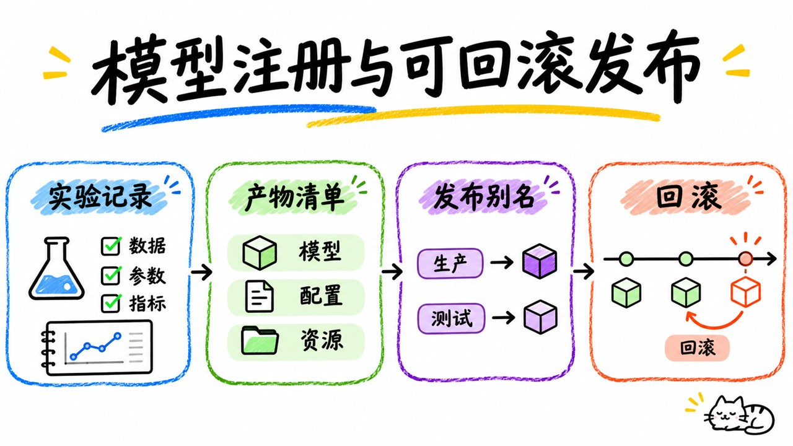

> **生成工具**：Codex\
> **生成模型**：gpt-6.2-sol

退款服务今天把最大输出从 32 改成 48 Token。明天遇到报告输出异常，光凭「模型叫 Qwen」无法复现。还得找到当时的权重、分词器、聊天模板、量化、适配器、评测集与服务配置。产物血缘（lineage）就是这些对象之间可回查的关系。

## 1. 分开实验、版本和服务标识

MLflow Tracking 保存实验的运行记录（run），可记录参数、指标和文件。Model Registry（模型注册库）保存一个模型名的多个注册版本，并允许 `champion` 这样的可移动别名指向某个具体版本。服务请求则记录自己的稳定发布 ID，例如 `refund-01`。接入层应在一次请求或批次开始时解析并固定版本，使运行中的请求不会被别名变更影响。

| 对象 | 本次示例 | 用途 |
| --- | --- | --- |
| run | 实验里的一次运行 ID | 找到检查、参数和归档清单 |
| 注册版本 | `refund-json` 的 1 或 2 | 指向一次确定的可发布内容 |
| 别名 | `champion` | 查询此刻应选的版本 |
| 发布 ID | `refund-01`、`refund-02` | 从某条请求反查真实上线组合 |

用固定 revision `7ae557604adf67be50417f59c2c2f167def9a775` 锁定模型和分词器，模板由仓库中的 `tokenizer_config.json` 提供。脚本给清单 JSON 计算 SHA-256（256 位安全哈希），再将摘要写到注册标签。两套清单都用同一基座，区别只有发布 ID 和最大输出长度。这里注册的 artifact 是发布清单，模型大文件仍在固定 revision 的仓库。 [MLflow 模型注册](https://mlflow.org/docs/latest/ml/model-registry/) · [MlflowClient API](https://mlflow.org/docs/latest/api_reference/python_api/mlflow.client.html)

## 2. 在 SQLite 中实际切一次再恢复

```bash
python3 -m venv /tmp/serv-registry-venv
/tmp/serv-registry-venv/bin/pip install mlflow-skinny==3.9.0 sqlalchemy==2.1.9 alembic==1.20.1
/tmp/serv-registry-venv/bin/python experiments/serving/registry.py --dir /tmp/refund-registry
```

SQLite 是文件型关系数据库，用来保存本地 Tracking 与 Registry 元数据。启动时自动初始化空库。每次变更别名后，脚本从该版本关联的 run 下载清单，重新计算 SHA-256，再核对版本、发布 ID 和标签。

| 操作 | 别名解析到版本 | 应随请求记录 |
| --- | ---: | --- |
| 首次上线 | 1 | `X-Release-Id: refund-01` |
| 升级 | 2 | `X-Release-Id: refund-02` |
| 回滚 | 1 | `X-Release-Id: refund-01` |

三次读回均通过哈希核验。脚本验证的是注册回滚和发布标识映射，业务评测与真实流量切换另在部署流程验收。要减少回滚延迟，上一版的模型文件、依赖与必要的预热副本需仍然可用。并发发布时应通过部署系统串行化变更或使用版本条件，避免旧操作覆盖新的发布结果。 [实验脚本](experiments/serving/registry.py) · [注册结果](experiments/serving/registry-results.json)

[返回 LLM 与 Agent 学习路线图](https://blog.lacknb.cn/articles/2026/11/19/1795058329577.html)
