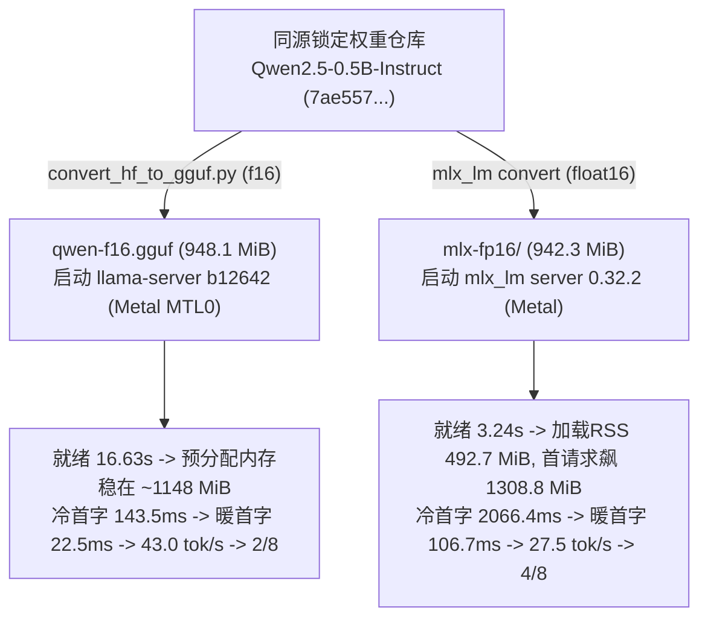

> **生成工具**：Codex\
> **生成模型**：gpt-6.2-sol

很多个人开发者或做边缘/端侧部署的团队，常常纠结：**「本地 Mac 或纯端侧到底该选通用的 `llama.cpp`，还是苹果生态专宠 `MLX-LM`？只要大家用的都是同一个模型的 16-bit 无量化原版，难道吐出来的回答不是应该一模一样吗？」**

口说无凭，今天咱们还是请出同一位老考官——退款 CSV `4`、`NA`、`6`，在同一台 Apple M1 机器上，严格从同一份锁定 Git revision 的 Hugging Face 权重目录切出 **GGUF** 与 **MLX** 两个原生 16-bit 产物，从冷启动秒表一直追到内存采样、生成速率与逐字输出文本，你会大吃一惊：**它俩不仅「起跑爆发力」彻底相反，连答出来的算术对错数量都能差出整整一倍！**

> **先用大白话讲明白**：把同个基座转成 `llama.cpp`（GGUF）和 `MLX-LM`（Safetensors）各自去跑，就像**把同一张菜谱分别交给两位厨艺流派完全不同的老师傅来做**：
> - **准备开火时间 vs 第一道菜上桌时间（Eager 提前算好 vs Lazy 等第一单再现场攒锅）**：`llama.cpp` 就像一位极其谨慎的老厨师——进门先把所有硬件图缓冲（KV 池、Metal 计算管线）全配齐才敢开窗挂牌，花了整整 `16.6` 秒说「就绪」，但第一位客人一来下单，**`143.5 ms` 秒上菜**；而 `MLX-LM` 仅仅 **`3.24` 秒**就笑眯眯挂牌「我好了」，可第一位真客人一来下单时它才慢吞吞首次激发底层 Metal 懒计算和算子编排，**生生让第一单卡了 `2066.4 ms`（超 2 秒！），第二单暖了立刻掉回 `106.7 ms`！**
> - **同模同精度 ≠ 逐字回答一模一样**：就算两个师傅拿了一模一样的 16 位半精度食材，底层矩阵乘法先乘哪个后加哪个、各家怎么配置停词和模板默认项都不相同——遇到原本得分就旗鼓相当的候选词（比如吐不吐代码围栏、怎么写 `count`），一点点浮点尾数微差就会推着两个引擎走进截然不同的句子！



## 1. 先从同一份源仓库，公平转出两套纯 16-bit 产物

**GGUF（GGML Universal File Format）**是 `llama.cpp` 家族的单文件容器，把权重张量、词表、聊天模板元数据塞进同一个 `.gguf` 文件里；**MLX-LM** 则是标准的目录结构，保留 `safetensors` 权重和原有的 `tokenizer_config.json` 配置文件。

转换时有一点特别要核对清楚：**模板细节、特殊控制符号、权重元素数据类型 `dtype` 与保留较高精度的例外张量**（哪怕号称 F16，某些转换工具对小型 Norm 参数仍可能保留 FP32）。本实验刻意不做任何整数权重量化，两边同以 **16-bit 浮点为主**、同钉死 `Qwen2.5-0.5B-Instruct` (`7ae557604adf67be50417f59c2c2f167def9a775`)、同定死引擎版本（`llama.cpp b12642` vs `MLX-LM 0.32.2`）：[llama.cpp 固定版](https://github.com/ggml-org/llama.cpp/releases/tag/b12642) · [MLX-LM 固定版](https://github.com/ml-explore/mlx-lm/tree/v0.32.2)

```bash
python llama.cpp/convert_hf_to_gguf.py "$QWEN_SNAPSHOT" --outfile qwen-f16.gguf --outtype f16
python -m mlx_lm convert --hf-path "$QWEN_SNAPSHOT" --mlx-path mlx-fp16 --dtype float16

llama-server -m qwen-f16.gguf --alias default_model --host 127.0.0.1 --port 18084 \
    -ngl 99 -c 4096 -np 4
python -m mlx_lm server --model mlx-fp16 --host 127.0.0.1 --port 18083
```

（检查 `llama-server` 的 `--list-devices` 确认识别到 `MTL0` Apple M1 Metal GPU 后，参数 `-ngl 99` 请求把全部层卸载到 GPU，`-c 4096` 为上下文池大小，`-np 4` 为 4 并发槽位。）

## 2. 同机真刀真枪同跑一圈：启动、内存、速度与正确率全摊开

用专门写的冷启动追踪工具 [launch_probe.py](experiments/serving/launch_probe.py) 与压测探针 [probe.py](experiments/serving/probe.py) 跑完完整测试（完整数据归档于 [llama-launch.json](experiments/serving/llama-launch.json)、[mlx-launch.json](experiments/serving/mlx-launch.json)、[llama-probe.json](experiments/serving/llama-probe.json)、[mlx-probe.json](experiments/serving/mlx-probe.json)）：

| 实测引擎版本 | 文件体积 (`MiB`) | 挂牌就绪耗时 (`s`) | 启动期采样峰值 RSS (`MiB`) | 暖跑后常驻 RSS (`MiB`) | 冷 / 暖 首字 TTFT (`ms`) | 串行同前缀生成速率 (`tok/s`) | 业务 8 题通过 |
| --- | ---: | ---: | ---: | ---: | ---: | ---: | ---: |
| **llama.cpp `b12642`** | `948.1` | `16.63` | `1146.7` | `1147.9` | **`143.5 / 22.5`** | **`43.0`** | `2/8` |
| **MLX-LM `0.32.2`** | `942.3` | **`3.24`** | **`492.7`** | `1308.8` | `2066.4 / 106.7` | `27.5` | **`4/8`** |

> **想再深入一层？（仔细读穿这三组表面数字背后的真相！）**
> 1. **「冷启动就绪快」的障眼法**：MLX-LM 从敲下命令到 `/health` 返回 200 只要 `3.24 秒`，此时采样内存甚至才 `492.7 MiB`（比权重体积还小！因为操作系统正利用内存映射懒按需读取文件！）；但紧跟着发第 1 条真实请求时，它当场补齐全部页映射、图构建和 GPU 缓冲区，结果第一个吃螃蟹的用户直接硬扛了 **`2,066.4 ms` 首字延迟**，进程 RSS 内存也在预热后一下子蹿升到 **`1,308.8 MiB`**！反观 `llama.cpp` 提前把 `4,096` 长度的多并发槽 KV 池与 Metal 资源老老实实在启动的 `16.63 秒` 内全建妥了（启动峰值直接 `1,146.7 MiB`，预热后几乎一动不动 `1,147.9 MiB`），头一位顾客进来 `143.5 ms` 秒开！**这就是为什么 SERV-08 一直强调用一条真实推理请求来当 Readiness 就绪检查，而不是只看 `/health`！**
> 2. **RSS（常驻集大小）口径提醒**：在 Apple 统一内存（Unified Memory）上通过 `ps -o rss` 采样只能抓到进程视角的主内存驻留估算，无法把操作系统动态共享页面、纯 GPU 驱动底层分配和微秒级瞬时尖峰一网打尽——这里仅如实报告单次固定条件下的观测快照。
> 3. **连核心混合行样本都没过严审**：看具体这组混合表 `4、NA、6` 的原生生成文本：MLX-LM 包上了代码围栏，而 llama.cpp 当场直接答歪成了 **`count=1, mean=null`**，所以单拎这一题两家全被严格评分拦在门外！

## 3. 为什么连输入 Token 数量都一模一样（74 个），两家回答却不一样？

查看日志里两家模型各自吃的提示 Token 长度——分毫不差全都是 **`74` 个**，温度还都设成了尽量确定的 `0`！那为什么一个能拿 **`4/8`**，另一个却只有 **`2/8`**（甚至 `count=1`）呢？排查这种「同基座跨引擎飘移」时重点盯着四处怀疑点：
1. **74 个数目相等 ≠ 每个整数 ID 一模一样**：某些引擎封装会在拼接 `messages` 角色或处理开头特殊符号 `bos_token` 时悄悄多加或少减一个换行符（必须按 ID 列表逐位打印对比，不能只看总长度！）；
2. **格式转换浮点舍入与默认参数微差**：`convert_hf_to_gguf` 和 `mlx_lm.convert` 对张量布局排列、精度保留小细节以及各自默认的 `stop_tokens` 设置未必完全对齐；
3. **底层矩阵乘法累加次序差异**：GPU Metal Kernel 执行顺序极其细微的浮点舍入偏差，碰上本来两个词 `logits` 分数就紧咬着差 `0.001` 的微弱边界时，`argmax` 选出的第一个偏折 Token 就足以让自回归整句话滑进另一个分支！

> **大白话小结（换引擎、改量化之前必做的顺序）**：
> 先做**无损/同精格式转换验证**——拿完全一致的输入和严格业务测试集跑一轮基线，确保转换工具没有暗地里把聊天模板或特殊停止符搞歪；确认基准靠谱之后，再去切开 **Q4_K_M / MLX 4-bit** 等整数压缩并测各自的延迟和精度代价！尤其切记：**GGUF 的块量化算法（比如 Q4_K_M）和 MLX 的分组仿射量化（如 group=64 affine）是两套完全不同的编码**，横向写选型报告对比时必须一并写清量化位宽、分组大小与具体方案名！

本地随时跑一轮验证探针：

```bash
python3 experiments/serving/probe.py --server http://127.0.0.1:18084 --model default_model \
    --out /tmp/llama-probe.json
```

## 下一篇

看到这里，无论是 `vLLM`、`SGLang`、`llama.cpp` 还是 `MLX-LM`，咱们已经亲手搭过、测过、比过好几回。可是老板要问一笔最实在的经济技术账：**「如果我手里只有一张固定的显卡（定死了多少 GiB 显存），怎么手算它最多能同时放进几条长上下文请求才不会 OOM？当我在压测时不断往上加并发，为什么 Token 总输出速率猛飙上去的同时，单个用户的 P95 等待时间和吐字流畅度却偷偷跌出了及格线？」** [**SERV-09《从显存预算到延迟与吞吐》**](serv-09-inference-optimization.md) 手把手教你从字节算起，算出真正让老板放心的**「达标吞吐（SLO Goodput）」**！

[返回 LLM 与 Agent 学习路线图](https://blog.lacknb.cn/articles/2026/11/19/1795058329577.html)
