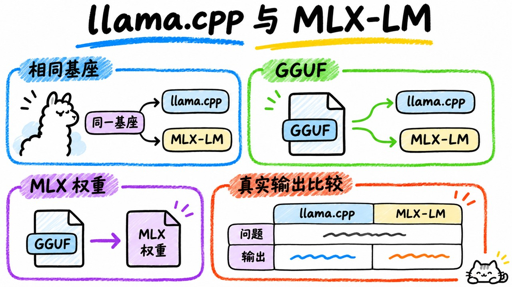

> **生成工具**：Codex\
> **生成模型**：gpt-6.2-sol

同一份退款表含 `4`、`NA`、`6`。在 Apple M1 上，由两个本地引擎分别接收同样的对话。我们把原始权重固定到同一个 revision，再做两个 16-bit 产物，比较真正的请求结果。

## 1. 从同一目录转出两套可加载的文件

GGUF（GGML Universal File Format）是 llama.cpp 常用的模型容器，可封装张量、词表和模型元数据。MLX-LM 的目录由 Safetensors 权重、配置和分词文件组成。转换时核对聊天模板、特殊 Token、权重 dtype（元素数据类型）和量化方法。本文不做整数权重量化，两个分支均以 16-bit 浮点权重为主。转换器对特定张量可以保留较高精度。

```bash
python llama.cpp/convert_hf_to_gguf.py "$QWEN_SNAPSHOT" --outfile qwen-f16.gguf --outtype f16
python -m mlx_lm convert --hf-path "$QWEN_SNAPSHOT" --mlx-path mlx-fp16 --dtype float16

llama-server -m qwen-f16.gguf --alias default_model --host 127.0.0.1 --port 18084 \
    -ngl 99 -c 4096 -np 4
python -m mlx_lm server --model mlx-fp16 --host 127.0.0.1 --port 18083
```

引擎固定为 llama.cpp `b12642` 和 MLX-LM `0.32.2`。模型固定为 Qwen2.5-0.5B-Instruct revision `7ae557604adf67be50417f59c2c2f167def9a775`。llama.cpp 的 `--list-devices` 列出 MTL0（Apple M1 Metal）及 BLAS，`-ngl 99` 请求尽可能多的层交给 GPU，启动输出再核对实际后端。MLX-LM 使用 Apple Metal 执行。 [llama.cpp 固定版](https://github.com/ggml-org/llama.cpp/releases/tag/b12642) · [MLX-LM 固定版](https://github.com/ml-explore/mlx-lm/tree/v0.32.2)

## 2. 同时记录性能与输出

| 引擎 | 权重（MiB） | 就绪（s） | 加载期采样峰值 RSS（MiB） | 预热后 RSS（MiB） | 首字冷 / 暖（ms） | 串行同前缀输出（Token/s） | 正确 / 请求 |
| --- | ---: | ---: | ---: | ---: | ---: | ---: | ---: | ---: |
| llama.cpp b12642 | 948.1 | 16.63 | 1146.7 | 1147.9 | 143.5 / 22.5 | 43.0 | 2/8 |
| MLX-LM 0.32.2 | 942.3 | 3.24 | 492.7 | 1308.8 | 2066.4 / 106.7 | 27.5 | 4/8 |

冷暖首字来自新进程里的第一次和第二次相同请求，完成速率与通过数取另一轮串行同前缀的 8 条。混合行本身的期望答案是裸 `{"count":2,"mean":5}`。MLX-LM 把正确数值放在代码围栏中，llama.cpp 此轮输出了 `count=1, mean=null`，都没通过这条严格核验。 [llama.cpp 冷暖](experiments/serving/llama-launch.json) · [MLX-LM 冷暖](experiments/serving/mlx-launch.json) · [llama.cpp 负载](experiments/serving/llama-probe.json) · [MLX-LM 负载](experiments/serving/mlx-probe.json)

RSS（Resident Set Size，常驻集大小）是 `ps` 采样到的进程内存口径。Apple 统一内存上的共享页、GPU 驱动分配和瞬时峰值，无法从单进程 RSS 完整还原。脚本的就绪时间包含导入、启动、模型加载到健康接口可访问。第一次调用依然可能有惰性计算、内核准备、文件页缓存和前缀缓存冷态开销。这里只报告一次固定条件下的观察值。

## 3. 为什么同一模型仍可能回答不同

两个引擎都读取了 74 个提示 Token，但最终答案不一样。候选原因包括转换后的浮点舍入、模板或停止配置、内核累加和贪心决策遇到几乎相同的分数。Token 数量相同只说明长度一致，定位时还需逐 ID 比对。转换成功后先跑相同输入与逐题业务评分，再单独测量量化幅度和引擎延迟。切到整数时，GGUF 的某种块量化和 MLX 的分组仿射编码是不同格式，比较时要记录组大小和量化方法。

```bash
python3 experiments/serving/probe.py --server http://127.0.0.1:18084 --model default_model \
    --out /tmp/llama-probe.json
```

[HTTP 探针](experiments/serving/probe.py) · [冷启动探针](experiments/serving/launch_probe.py)

[返回 LLM 与 Agent 学习路线图](https://blog.lacknb.cn/articles/2026/11/19/1795058329577.html)
