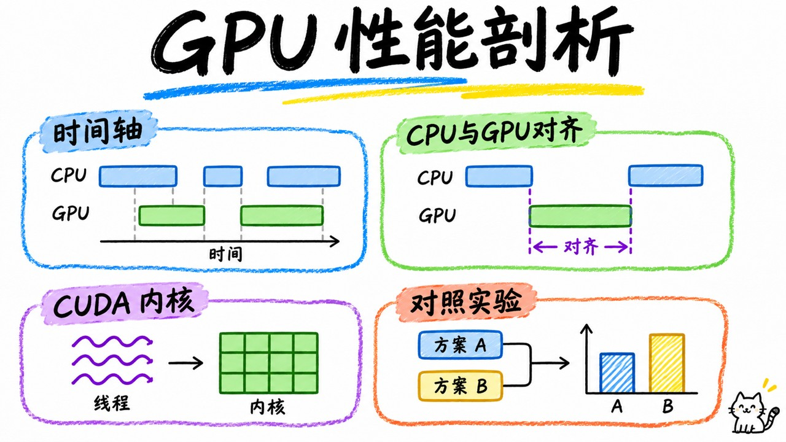

> **生成工具**：Codex\
> **生成模型**：gpt-6.2-sol

用户上传一份退款表，页面等了很久才开始显示统计。第一步先问慢在哪里。客户端首字时间包含 HTTP、排队、模板、分词、模型计算和流式发送。设备内核只是其中一段。Nsight Systems 是 NVIDIA 的系统追踪工具，可在同一系统时间轴上看 CPU 线程、CUDA 调用、GPU 内核和内存拷贝。CUDA 是 NVIDIA 的并行计算平台。 [Nsight Systems 用户指南](https://docs.nvidia.com/nsight-systems/UserGuide/index.html)

## 1. 以固定请求和请求 ID 划出范围

固定 Qwen 模型、批大小、输入 Token 数、最大输出 Token 数和采样设置。先做与线上一致的预热。令一次退款请求的标识为 `profile-001`，在代理和服务日志中都记录它。若可改 vLLM 本地实验代码，在 Prefill（预填充输入）与 Decode（逐步生成）范围加 NVTX 区间。NVTX 是 NVIDIA 用来给代码阶段添加可追踪标签的接口。高并发时一个批次包含多个请求，标签还要记批次 ID 和各请求进入该批的关系。

以下命令在 Linux CUDA 实验机启动引擎进程并抓一段系统时间线。应先确认该版本的 `nsys profile --help`，并从另一终端用相同请求重放。捕获窗口应包含模型已就绪后的预热与正式请求。

```bash
nsys profile --trace=cuda,nvtx,osrt --sample=none --output refund-profile \
    vllm serve Qwen/Qwen2.5-0.5B-Instruct --host 127.0.0.1 --port 18080
nsys stats --report cuda_gpu_kern_sum,cuda_gpu_mem_time_sum refund-profile.nsys-rep
nsys export --type sqlite --output refund-profile.sqlite refund-profile.nsys-rep
```

追踪多进程时，在时间线上确认引擎 worker 的设备事件确实存在。只看 API 进程可能只看到网络和排队。采集本身带开销，性能对照另用重复的无追踪负载测量。

## 2. 内核时长和 GPU 活跃时长的区别

用一个可手算的时间线复核口径。时间以请求开始后的毫秒计。

| 区间（ms） | 事件 |
| --- | --- |
| 0–8 | CPU 准备或排队 |
| 8–10 | 数据搬运 |
| 11–15 | GPU 内核 A |
| 14–18 | GPU 内核 B |
| 18–21 | CPU 发送与收尾 |

两个内核分别历时 4 ms，内核耗时求和是 8 ms。14–15 两者重叠，至少一个 GPU 内核运行的时间是两区间并集，即 7 ms。在这一条 21 ms 时间线内，8 ms 可用于看内核工作量的组成，7 ms 可用于算活跃时间覆盖。拷贝引擎的时长用单独轨道看，归因时再确认是否与计算重叠。

```bash
python3 experiments/serving/simulate.py --out /tmp/serving-simulation.json
```

脚本对人工时间线取区间并集，得到 7 ms。这个演算可在任何机器复现。CUDA 采集命令面向 NVIDIA 实验机，本机 Apple Silicon 未产生 Nsight 报告。

## 3. 一次只验证一个可改变的量

若长提示导致其他请求的 Decode 出现空洞，可以只改 `max_num_batched_tokens`，看预填充和解码如何分配时间。若 GPU 利用率低而 CPU 繁忙，优先检查 Tokenization、事件循环、进程间通信、数据拷贝或空队列。若内核运行紧凑且占据大部分关键路径，再用 Nsight Compute 对具体内核分析访存和算力。

给出修改前后的请求分布、P95 首字、输出间隔、达标吞吐，并附对应观察窗口。若首字改善，核对是否只是排队变少。若吞吐下降，先检查生成长度和被取消请求是否改变。 [实验脚本](experiments/serving/simulate.py) · [区间计算结果](experiments/serving/simulated-results.json)

[返回 LLM 与 Agent 学习路线图](https://blog.lacknb.cn/articles/2026/11/19/1795058329577.html)
