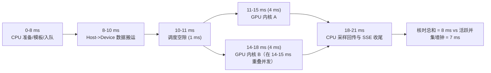

> **生成工具**：Codex\
> **生成模型**：gpt-6.2-sol

用户传上来一份退款表，屏幕却足足呆坐了一两秒才肯冒字。一遇慢请求，所有人第一反应都是「快把显卡换成 H100」——**可很多时候，显卡自己在那儿闲得发慌，真正把请求拽慢的竟然是 CPU 上卡住的分词、异步队列切换或者来回搬运数据！**

从网页点完按钮一直到首个汉字落上屏幕，中间跨越了网络、排队、模板拼装、分词、跨进程通信、**CUDA（NVIDIA 并行计算平台）**算子运行，再回到解码传流——只盯着「客户端总毫秒」就像闭着眼睛听诊。今天教你拿出系统级显微镜 **NVIDIA Nsight Systems**（`nsys`），沿着同一条时间轴把 CPU 线程、驱动接口、内存拷贝和显卡计算核一齐对表，找出真正的瓶颈所在！[Nsight Systems 用户指南](https://docs.nvidia.com/nsight-systems/UserGuide/index.html)

> **先用大白话讲明白**：用 `nsys` 给慢请求做性能剖析，就像**给一次送餐卡顿拍一张多轨同步的「系统时间轴心电图」**：
> - **四条轨道齐步画**：第 1 条看厨师长 CPU 备菜和拆单、第 2 条看传菜工搬原料上灶（CPU->GPU Copy）、第 3 条看真正在显卡算力灶台上开火炒菜（CUDA Kernel）、第 4 条看做完收尾写回！一眼就瞧见到底是「火太慢」还是「菜一直在半路等着搬」；
> - **注意别把「叠加炒的两口锅」算成了两倍营业时间！**：假如灶台 A 在 `11–15 ms` 炒了 4 ms，灶台 B 在 `14–18 ms`（提前 1 ms 并行搭伙启动）又炒了 4 ms——算工作量之和确实干了 `8 ms` 的活，但看整张时间轴墙钟，其实显卡统共只忙碌了 `11–18 ms`（**区间并集仅仅 `7 ms`！**）。把重叠并行时间全傻傻累加起来算「GPU 活跃率」，甚至能加出 150% 的笑话！



## 1. 先钉死单一可控请求、加 NVTX 标签与系统预热

在嘈杂的一堆线程里抓取有效信号，开录之前先做四件准备：
1. 固定 Qwen 模型权重、批大小、准确输入 Token 数、最大生成上限以及采样参数；
2. 提前跑几轮跟线上环境一致的暖场预热（绝不能拿第一条正在惰性编译 CUDA 图或初始化分配器的冷请求当性能常态）；
3. 给你要解剖的目标请求起一个独一无二的追踪 ID，比如 **`profile-001`**，在网关日志和服务引擎日志两边都写清；
4. 如果正在改本地实验版 vLLM 代码，推荐给 **Prefill（首次吞提示建缓存）** 与 **Decode（后续逐步生字）** 阶段分别包上 **NVTX（NVIDIA Tools Extension，给程序阶段贴追踪色块的标签接口）**。一旦高并发上来了多个请求混跑，NVTX 上一并记好批次 ID 和进批映射，追踪图里瞬间高亮出哪一段是吃提示、哪一段在吐字！

下面这套标准命令可在 Linux NVIDIA GPU 实验机上启动引擎并抓取 `.nsys-rep` 系统时间线（运行前先核对当前环境 `nsys profile --help` 支持的开关，然后在另一个终端打进预热和固定请求 `profile-001`）：

```bash
nsys profile --trace=cuda,nvtx,osrt --sample=none --output refund-profile \
    vllm serve Qwen/Qwen2.5-0.5B-Instruct --host 127.0.0.1 --port 18080
nsys stats --report cuda_gpu_kern_sum,cuda_gpu_mem_time_sum refund-profile.nsys-rep
nsys export --type sqlite --output refund-profile.sqlite refund-profile.nsys-rep
```

> **容易踩的坑（别抓错了进程、更别直接拿带剖析开销的数据作吞吐报告！）**：
> 1. 想起我们在 [SERV-03](serv-03-vllm-v1-source.md) 看过的 vLLM V1 架构——API 接口进程和真正驱动显卡干活的 EngineCore/Worker 是**多进程分离**的！`nsys profile` 时如果没把追踪挂到子 Worker 进程上，时间轴打开全是无聊的 Python HTTP 与异步等待，一行显卡 CUDA 内核事件都没有！
> 2. 启用剖析采样本身会消耗额外 CPU 与磁盘缓冲带宽，所以**严禁用挂着 `nsys` 抓出来的响应毫秒直接充当生产基准耗时**——性能对比照旧要放回干净无追踪模式下去重复多轮测！

## 2. 内核耗时总和 vs GPU 真实活跃墙钟时间：算一笔区间并集

为了彻底理顺报表里经常打架的两个口径，跟着仓库 [simulate.py](experiments/serving/simulate.py) 手算一条 `21 ms` 简化人工时间线：

| 时间区间 (`ms`) | 时长 (`ms`) | 发生事件 | 在时间轴上归属于哪一栏？ |
| --- | ---: | --- | --- |
| `0 – 8` | `8` | CPU 解析请求、渲染分词与入队等待 | 宿主 CPU 耗时 |
| `8 – 10` | `2` | 主机向设备内存拷贝张量 (H2D Copy) | Copy Engine 拷贝轨 |
| **`11 – 15`** | **`4`** | **GPU 内核 A**（比如计算 QKV 投影） | **GPU 计算流 1** |
| **`14 – 18`** | **`4`** | **GPU 内核 B**（比如另一条并行算子在 Stream 2） | **GPU 计算流 2（与 A 重叠 1 ms！）** |
| `18 – 21` | `3` | GPU 吐完 ID -> CPU 解码推流与收尾 | 宿主 CPU 收尾 |

直接拿两把不同的尺子一算就明白为什么常有人看报表头晕：
- **所有 GPU 内核耗时累加和**：`4 + 4 =` **`8 ms`**（适合回答「这批显卡核总共工作了多大计算份额、每个 Kernel 分别占比多少」）；
- **GPU 计算引擎真实活跃墙钟时间（区间合并并集）**：把 `[11, 15]` 和 `[14, 18]` 求时间轴并集得 `[11, 18]`，实际仅仅覆盖了 **`7 ms`**！再拿同样方法单独去看拷贝引擎轨道，并确认拷贝到底有没有被算子计算掩盖隐藏（Overlap）掉。

在任意电脑运行仓库脚本复现区间合并算法检查 **`gpu_active_wall_ms = 7`** vs **`gpu_sum_kernel_ms = 8`**（见 [simulated-results.json](experiments/serving/simulated-results.json)；诚实界定：上方 `nsys` 指令针对具备 CUDA 的 NVIDIA 实验机，本机 Apple Silicon 仅跑了时间区间计算，并未生成真正 `.nsys-rep` 文件）：

```bash
python3 experiments/serving/simulate.py --out /tmp/serving-simulation.json
```

## 3. 拿到时间轴之后怎么对症下药？（一次只许改一个变量！）

对着图形化时间线，常见瓶颈一对照就清清楚楚：
- **情况 1：顺畅吐字途中突然被别人砸出一大段漫长 Prefill 阻塞空洞** -> 只改 `max_num_batched_tokens`（[SERV-06](serv-06-prefill-speculative.md)），看缩短单步分块预算能不能抹平卡顿空洞；
- **情况 2：GPU 算力轨道上留出大把空白间隙（Bubble），CPU 那几轨却红通通忙得要命** -> 问题八成不在算力！优先回头排查 **Tokenizer 分词抢 CPU、FastAPI 事件循环阻塞、跨进程序列化与 ZeroMQ IPC 拷贝、或是张量同步回传太频繁**；
- **情况 3：CPU 轨道稀稀拉拉、整个关键路径上 GPU 计算核密密麻麻无缝贴满** -> 恭喜找对地儿了，算力/访存真的吃满了！此时换用更细粒度的 **Nsight Compute (`ncu`)** 钻进那几个最肥的 CUDA Kernel 里面看它是受限于 HBM 显存带宽（Memory-bound）还是张量核计算（Compute-bound），再做算子融合或上量化精度。

> **大白话小结**：每次根据时间轴动手改了一项调优配置，发布评审单里一定要附上修改前后的同请求分布、首字 P95、吐字间隔、**达标吞吐（SLO Goodput）**以及采样时间窗。万一发现首字变快了，务必核查一下是因为内核本身变快了、还是因为当前测试环境队列恰好没人排队；要是总体吞吐反而掉了，记得先看生成长度和被中止请求数是不是悄悄变样了！

## 下一篇

看到单卡推理能调的东西几乎掘地三尺了。可现实中如果并发实在太多单张卡接不住，或者模型太大一张卡干脆塞都塞不下——我们把任务摊给多张 GPU 时该怎么分？而且目前超大规模部署最火的 **PD 分离架构（把算输入的 Prefill 池与专门吐字的 Decode 池彻底拆到两群不同卡上！）**，传一份 `2,048` Token 的退款上下文缓存过去到底占多大带宽、最低得多长时间？[**SERV-10《多 GPU 与 Prefill、Decode 分离部署》**](serv-10-distributed-inference.md) 亲自从 Qwen 配置算到互联传输毫秒下限！

[返回 LLM 与 Agent 学习路线图](https://blog.lacknb.cn/articles/2026/11/19/1795058329577.html)
