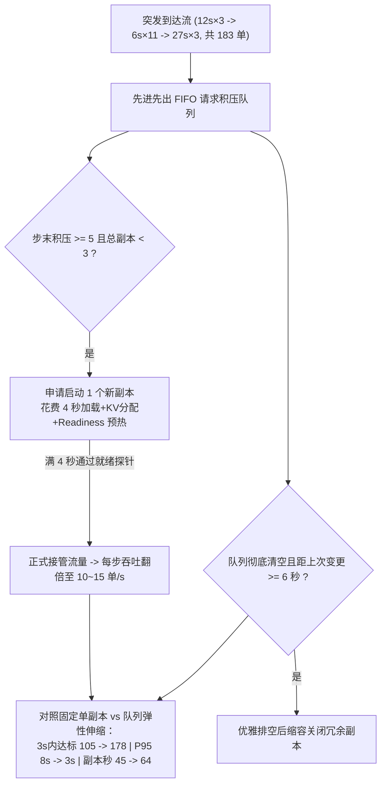

> **生成工具**：Codex\
> **生成模型**：gpt-6.2-sol

看规划机器数量时，最坑人的一道算术误区叫「算总平均流量」。假设咱们的退款助手平时流量平稳得像湖水——每秒只进 **`3` 个**请求；可到了每月最后一天集中对账，流量会毫无预警地连续 **`6` 秒飙到每秒 `11` 个请求**！整个 45 秒窗口下来，平均每秒请求数其实才 `4.07` 个——听起来好像区区 1 台处理能力 `5 req/s` 的副本就能轻松搞定？

**错了！在突发脉冲面前，平均数毫无意义。** 只要突发那几秒接不住，队列瞬间像雪球越滚越长，排在后面的无辜用户要干等整整八九秒超时崩溃！更扎心的是：大语言模型可不像无状态小微服务能「0.1 秒秒起」——拉起新副本光下权重、分配 KV 缓存、编译暖机随便都要好几秒甚至一两分钟。怎么用冷冰冰的数字算出「究竟得常备几台机器、扩缩容什么时候触发才不算马后炮」，正是这一篇的核心账本！

> **先用大白话讲明白**：搞定 LLM 服务容量规划与弹性扩容（Autoscaling），核心围绕**「稳态摸底 + 排队账本 + 启动滞后时间」**三件事：
> - **先摸清 1 个副本不超标的最大接单线（`5 req/s`）**：在模拟线上真实长度下死命往上加压，找到 P95 尾延迟还能稳稳守住及格线的最高速度；想死扛 `11 req/s` 尖峰而不排队，静态至少得直接摆上 `⌈11 ÷ 5⌉ = 3` 个副本。
> - **永远别忽略「新分店开火需要 `4` 秒预热延迟」！**：哪怕队列一超过 `5` 个请求你秒速下单加开新分店，新来的模型在 **loading 与 warmup 那 `4` 秒钟里不仅一个单都帮不上忙，甚至花钱已经在跑了（副本秒计费已在跳表！）**——要是峰值一共才持续 2 秒，新店开张那一刻早就风平浪静成了纯浪费；而在下面长达 `6` 秒的大突发里，虽头 4 秒同样要熬，及时加上的第 2 台却依然成功把后面大批积压雪崩提前切了一半、将 `P95` 从 **`8 秒`** 狠拽回 **`3 秒`**！



## 1. 先从单机真实服务标定你的「单副本可用上限」

不要拿纸面算力瞎猜一台卡能扛多少 QPS！首先结合 **SLO（Service Level Objective，服务等级目标）** 定清楚及格标准（通常一并卡死首字时间、整条耗时与业务通过率），就像上一篇学的 **达标吞吐（SLO Goodput）**：在保持正确且不超尾延迟的约束下，拿逼近真实长度比例与到达间隔的测试流量逐步加码压测，**测出单副本刚好稳住 SLO 的最高稳定吞吐上限**。

假设在本演示里，实测敲定这台 0.5B 单副本刚好不越线的稳态接单能力是 **`5 req/s`**。如果希望全天候稳稳接住突发的每秒 `11` 个请求、一点队伍都不准排，简化除法起点至少得配 `ceil(11 ÷ 5) = 3` 个常驻副本！当然记住前提：现实流量中长提示加短提示混合非常凶险，有时两波同样叫 `5 req/s` 的流量，仅仅因为一批带了大长 CSV，算力和 KV 预算就能差出好几倍——**正式估算必须跑过按真实长度分桶的实压测！**

## 2. 离散排队演算：看「固定硬扛」vs「队列驱动扩容 + 4 秒启动滞后」

把 [simulate.py](experiments/serving/simulate.py) 的队列模拟器（`capacity()`）拉出来亲自演算整段 `45 秒` 风暴，一步步严丝合缝（结果完全同步记录于 [simulated-results.json](experiments/serving/simulated-results.json)）：
- **到达流输入**：前 `12` 秒每秒来 `3` 单，第 `12～17` 秒连炸 **`6` 秒高潮每秒来 `11` 单**，随后第 `18～44` 秒恢复每秒 `3` 单——累计到达总量恰好 **`183` 请求**；
- **执行及弹性策略**：每副本每步最多解决 `5` 单，队列先进先出；当步内刚好解决算完成时长 `1 秒`。**按队列自动伸缩策略**设定：若某一秒结束后积压 **`>= 5`** 且目前可用与正在启动中的总副本少于 **`3`**，立马新申起 `1` 副本，但需要苦等 **`4 秒`** 才正式就绪干活；等队列彻底消化光且距离上回扩缩变动过去至少 **`6 秒`冷却期**，才准安全缩回 `1` 副本。

把两套方案的 45 秒战报直接摆一起对比：

| 容量策略模式 | 峰值最大积压队列 | 窗口完结单数 | **3 秒红线内完成数** | 全体完成 `P95` 延迟 | 消耗总计费资源 (**副本·秒**) |
| --- | ---: | ---: | ---: | ---: | ---: |
| **死守 1 副本（固定容量）** | **`36`** 单排死 | `183` | `105` (仅 57%) | **`8 秒`**（严重越线） | `45` 副本秒 |
| **按队列弹性伸缩（含 4s 预热）** | **`25`** 单 | `183` | **`178` (97.3%！)** | **`3 秒`**（骤降 5 秒！） | **`64`** 副本秒（多花 ~42% 算力成本） |

> **想再深入一层？（看懂「副本·秒」计费账和扩容晚到陷阱！）**
> 注意口径里定义的 **副本·秒（Replica-Seconds）** 是每秒把「已就绪干活的 + 正在启动预热花着电费的」副本数统统相加——所以弹性组虽只在中间短时间用上了多副本，也实打实从 45 涨到了 64 副本·秒；换来的是 **3 秒以内达标人数几乎翻全满（105 -> 178）、P95 直接砍成不到一半（8s -> 3s）**！
>
> 反过来也给你提个醒：如果业务里的重型 70B 模型从拉镜像、读百 G 权重、划分 KV 池加编 CUDA 图一共需要 **60 秒**才能启动，可你的营销秒杀尖峰只持续 **15 秒**——**那指望「等队列积压了再现起扩容」纯粹是刻舟求剑，新副本还没启动好、用户早就全超时跑光了！** 遇到启动太慢模型 + 急促突发流，生产级做法只有三条：提前**按日常预留热备余量（Headroom）**、在入口代理**限制最大排队队列直接快速吐 `429` 保护在线存活用户**、或者针对月底结算、整点推送这种**可预测时间窗口做定时预先扩容（Scheduled Scaling）**！

本地随时一键复算这组时序队列变化：

```bash
python3 experiments/serving/simulate.py --out /tmp/serving-simulation.json
```

（提醒：该离散模型使用固定的步进吞吐率便于看清排队与滞后规律，并未模拟真引擎 Token 粒度的混批波动、预热偶发抖动与抢占重算。）

## 3. 线上到底看哪个传感器告警扩缩，怎么防抖与收尾？

光看传统的 `CPU > 80%` 扩缩容对大模型毫无意义（因为显卡算力和显存早就爆了时 CPU 可能才占 15%！）。上真集群（比如配合 [Kubernetes HPA 自定义外部指标](https://kubernetes.io/docs/tasks/run-application/horizontal-pod-autoscale/)）优先盯着下面四类信号组合研判：

| 在线监测核心信号 | 它真实暴露了什么问题？ | 误判警戒（容易踩的坑） |
| --- | --- | --- |
| **等待队列长度 & 队列首部等待时长** | 最直接！客人已经站在门外干等了，容量真的不够用了。 | 也要对照下游网络/存储是不是慢了，别一股脑瞎加卡。 |
| **在途活跃请求数 & 排队总 Token 量** | 预先感知未来几秒的计算与显存 KV 水位余量。 | 长文请求和短问请求含金量差距极大——尽量按相同模型版本与 Token 长度口径估算。 |
| **GPU 算力活跃度 / KV Cache 占用百分比** | 贴身监测显卡自己吃饱还是显存快见底抢占了。 | 经常碰到 GPU 利用率看似只有 40%，其实瓶颈全被 CPU 分词或网络带宽堵住了！ |
| **客户端真实达标吞吐 & 异常率** | 最终业务结果兜底护城河。 | 必须把 429 限流、500 服务报错、超时和模型算术错误拆开记账。 |

**扩与缩的安全操作闭环铁律**：
- **扩容期严防冷请求撞墙（Readiness Gate）**：新副本启动与热身期间，死死关闭 `readiness` 探针把所有真实请求挡在门外；唯有自检预热跑通才许挂上负载均衡接客；
- **缩容期先断流排空再杀进程（Graceful Drain）**：决定把某台多余旧副本缩掉时，**绝不许一把 `kill -9` 掐死！** 要先把它从入口路由摘掉停止新接请求，等上面正在进行的长 SSE 流体面地全部输出完毕排空（Drain）之后再关停回收；同时配好滑动指标平均窗口与充足的下调冷却稳定期（Stabilization Window），防止流量稍微一眨眼就把副本刚删掉一分钟后又拉起、反复横跳浪费启动开销！复盘时也把每回新副本「下单 -> 就绪完成」的 P50 / P95 实耗时间画进监控面板。

## 下一篇

看到这里，前面 15 篇全都在围绕「客户端急等着一两秒内必须收结果的在线同步对话服务」打转。可如果今天运营同学一次性提交 4 张（甚至上万张）历史退款总表要夜里批量跑完：**用户根本不需要站在网页前傻等，只要递交上去拿到一个 `job_id` 回执，后台稳稳跑完再取就行——这能怎样借并发榨干间隙算力？万一跑到第 3,000 张某一行网络抽风挂了，怎么确保只重做挂掉的那 1 条而不全盘重跑？而且同一个任务万一不小心被工作线程重复执行了两回，数据库怎么死守「只记一次账（幂等去重）」？** 全系列第五部分的收官篇 [**SERV-16《离线批量推理、失败重试与结果去重》**](serv-16-offline-batch.md) 带你用 SQLite 亲手写完并跑通这套持久化批作业系统！

[返回 LLM 与 Agent 学习路线图](https://blog.lacknb.cn/articles/2026/11/19/1795058329577.html)
