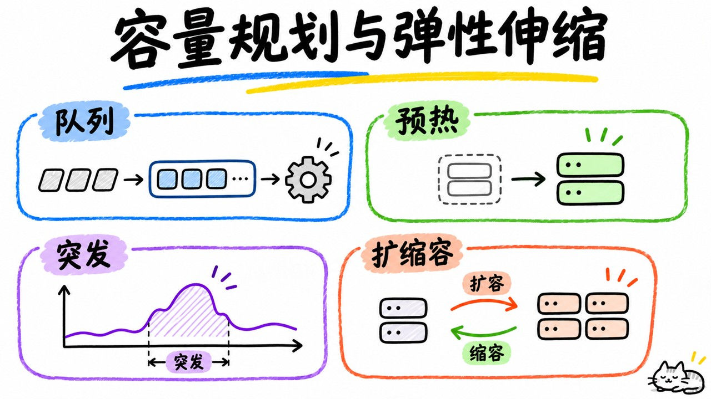

> **生成工具**：Codex\
> **生成模型**：gpt-6.2-sol

退款助手平时每秒收到 3 个请求，月底连续 6 秒达到每秒 11 个请求。平均请求数容易算，但用户能否在目标时间内拿到结果，要由突然涌入的请求、当时可用的推理副本和副本启动速度一起决定。

## 1. 先从真实服务标定可用容量

P95 指 95% 请求能在该值以内完成。SLO（Service Level Objective，服务等级目标）是给请求设定的服务目标，可同时包含首段文字时限、整条延迟和业务正确性。一种实用的容量口径是「每秒多少请求同时满足这些条件」，称为达标吞吐。

先按生产请求近似构造输入、输出长度和到达分布。逐步提高请求到达速率，找出单副本仍符合 SLO 的最大稳态吞吐。假设这个值是每秒 5 个同类型请求。若设计要在稳态承接每秒 11 个请求，`ceil(11 / 5) = 3`，是这种简化比例下的起点。混合负载下，同一请求数可对应不同 Token 量、上下文预算和解码尾巴。以真实长度分桶的压测结果为准。

## 2. 用离散队列演算突发流量

模拟以一秒为一步，开头 12 秒每秒 3 请求，随后 6 秒每秒 11 请求，然后回到每秒 3 请求。单副本单步最多完成 5 个请求，队列先进先出。伸缩方案在一步结束时积压达到 5 条就申请一个副本，最多 3 个，4 秒后才就绪。队列清空且距离上次容量变更至少 6 秒时允许缩容。一步内完成计为 1 秒。

| 策略 | 最大积压 | 完成 | 3 秒内完成 | P95（秒） | 副本秒 |
| --- | ---: | ---: | ---: | ---: | ---: |
| 单副本固定 | 36 | 183 | 105 | 8 | 45 |
| 按队列伸缩 | 25 | 183 | 178 | 3 | 64 |

副本秒是每个时间步把运行与启动中的副本数加起来。两个方案的总请求和总完成数相同，尾延迟和资源占用明显不同。如果模型要较长时间下载、分配 KV Cache 并预热，尖峰可能在新副本就绪前结束。提前留有余量、限制队列或按已知业务时段预扩，都能用同一流量回放比较。

```bash
python3 experiments/serving/simulate.py --out /tmp/serving-simulation.json
```

该表是离散模型输出。它使用固定服务速率，也没有模拟真实 Token 调度、预热抖动和抢占。

## 3. 在线选什么信号

| 信号 | 解读 | 注意 |
| --- | --- | --- |
| 等待请求与等待时长 | 用户已经在排队 | 适合发现容量不足，也要查下游卡顿 |
| 在途请求和排队 Token | 当前压力与剩余工作量 | 长短请求最好按同一模型版本估算 |
| GPU 活跃或显存水位 | 硬件占用趋势 | 低利用率仍可能被 CPU 或网络限制 |
| 达标吞吐和异常率 | 实际客户端结果 | 区分限流、错误、超时和业务失败 |

启动期用 readiness（就绪）把流量挡在新副本之外。预热完成后再加入入口，缩容前停止向旧副本派新请求并等待流式连接收尾。配置滑动窗口和下调稳定期可减少来回切换。生产复盘还应记录新副本从下单到就绪的分位数，量化扩容晚到的代价。 [Kubernetes HPA](https://kubernetes.io/docs/tasks/run-application/horizontal-pod-autoscale/) · [实验脚本](experiments/serving/simulate.py) · [时序数据](experiments/serving/simulated-results.json)

[返回 LLM 与 Agent 学习路线图](https://blog.lacknb.cn/articles/2026/11/19/1795058329577.html)
