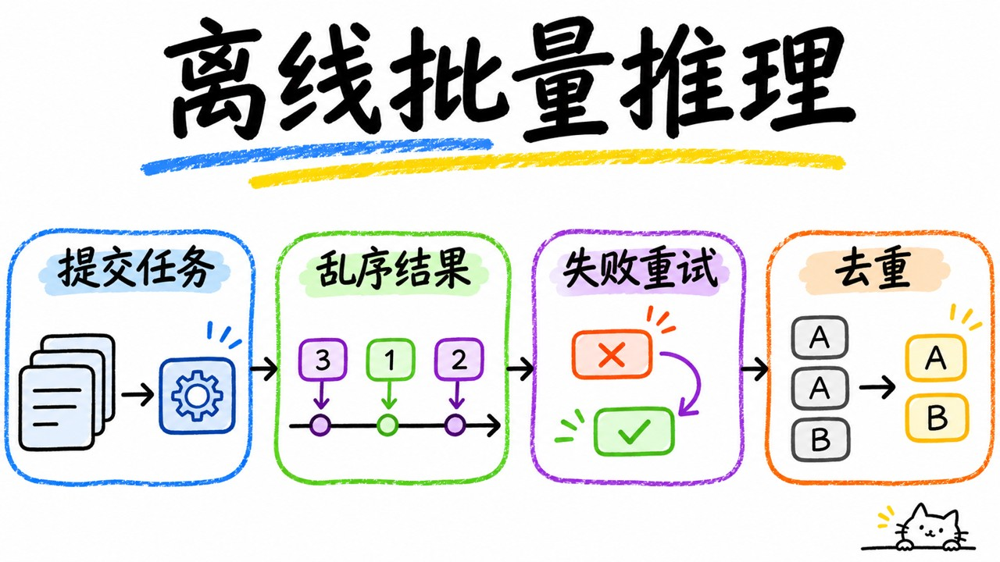

> **生成工具**：Codex\
> **生成模型**：gpt-6.2-sol

运营需要处理四份退款报表。单张的标准结果仍是有效行数和均值。若请求方不需要立刻等四份结果返回，可以提交任务后拿一个作业 ID，稍后查询进度，失败时只处理仍失败的条目。

## 1. 任务和条目要有各自可重试的边界

任务 `refund-batch-01` 有四个输入，原始提交顺序是混合行、零值、全空和小数均值。按 `job_id:sample` 的 SHA-256 摘要生成教学标识，把任务与条目 ID 当作 SQLite 复合主键。生产系统还应把输入校验值和发布模型版本持久化。提交时先批量落盘，再把 ID 返回给调用方。相同条目 ID 再来时，应先确认本次内容与先前一致，防止旧结果被新内容误用。

工作线程并发调用引擎，一个请求超时可重试。同一个任务有多个条目，完成顺序无需等于输入顺序。回传时以 ID 关联。用状态区分尚未开始、失败和已完成。生产上的多 worker 要原子认领并附租约，崩溃后回收过期租约。消费端需容忍同一推理发生多次，持久化以幂等方式防止结果重复。这里的教学脚本由单个协调器写库。

## 2. 运行四条输入和一次故障注入

```bash
python3 experiments/serving/batch.py --server http://127.0.0.1:18083 --model default_model \
    --db /tmp/refund-batch.sqlite --out /tmp/refund-batch.json
```

在线基线用同一引擎逐条处理四个普通请求。作业模式先落盘，再以最多三个线程发请求，教学脚本在第一轮让全空条目在调用推理前失败一次，并在混合条目加入 400 ms 可控延迟。第一轮结束后，只查询未完成条目重跑。随后对一个已完成条目重复执行结果更新，数据库更新行数应为零。

MLX-LM 0.32.2 本机运行中，事务提交约 0.49 ms，整个批次约 1.86 s，在线逐条约 2.21 s。完成顺序是零值、小数均值、混合行、全空。全空的尝试次数为 2，其他各 1。重复写入影响 0 行，四条都拿到响应。在线与批模式的四个裸 JSON 结果都未达业务评分。实验包含预设故障与延迟，耗时只说明如何量两种流程。 [逐条输出和执行结果](experiments/serving/batch.json)

## 3. 应用作业和引擎内部批处理处在不同层

离线作业负责持久化、完成状态、结果交付、重试和访问控制。连续批处理是引擎内部的推理调度技术，决定不同请求在同一步是否共享执行批次。即使应用每次提交一个作业，底层模型仍可能和在线请求混批。应用的批提交延迟很短时，也要分别报告整批完成墙钟时间、失败和重试后通过率。正式成本按归属于该批的计算与服务用量除以成功条目数。

外部 Batch API 的提交、结果文件与期限以服务规定为准。加入稳定的 `custom_id` 可以在结果乱序时对回原输入，并根据失败原因重建仅包含失败项的下一批。 [OpenAI Batch API](https://developers.openai.com/api/docs/guides/batch) · [实验脚本](experiments/serving/batch.py)

[返回 LLM 与 Agent 学习路线图](https://blog.lacknb.cn/articles/2026/11/19/1795058329577.html)
