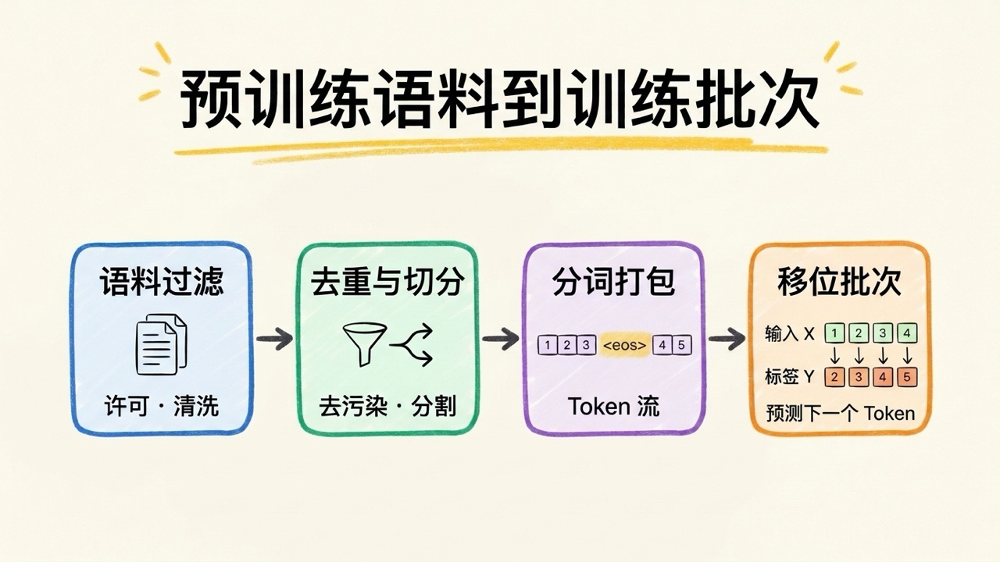

> **生成工具**：Antigravity\
> **生成模型**：Gemini 4 Neon

在 [F-10《模型从预训练到会按要求回答》](https://blog.lacknb.cn/articles/2026/11/20/1795161450059.html) 里，我们看到 **预训练**（Pretraining）的核心任务是让模型根据上文预测下一个 Token（分词后的基本处理单位）。但真实训练开始前，硬盘里往往只有一堆格式杂乱的网页、手册、代码和日志——既可能混着禁止训练的专有文档，也可能夹着大量重复片段，甚至意外包含留出测试集里的原题。

把原始文档变成模型能直接读取的训练批次，这套流程叫做 **Token 数据管线（Data Pipeline）**。这一篇准备 9 篇合成文档和 1 条来自 [LE-01](https://blog.lacknb.cn/articles/2026/11/21/1795270270258.html) 的退款测试题，完整跟踪它们如何经过许可校验、清洗、去重、去污染、文档级切分、分词和打包，最后落成一个 `uint16` 二进制分片和形状为 `[2, 6]` 的训练批次。全篇脚本只依赖 Python 3 标准库，每一步的中间结果都可以手算核对。

```text
9 篇原始文档（含来源与许可元数据）
  │  1. 许可白名单 + 网页清洗 + 邮箱脱敏 + 长度过滤
  │  2. 精确去重（SHA-256）+ 近似去重（3-gram Jaccard）
  │  3. 去污染（核对留出评测题 5-gram 重叠）
  ▼
4 篇合格文档
  │  4. 文档级切分（按 family 哈希划入 train / val，先切分再打包）
  │  5. 仅用 train 建词表 → 分词并追加 <eos> → 写入 train.bin / val.bin
  ▼
训练批次 X [2, 6] 与移位标签 Y [2, 6]（含跨文档边界掩码）
```

## 1. 先给语料记账，再过滤、清洗、去重和去污染

预训练用的原始文档集合称为**语料（Corpus）**。任何处理之前，每篇文档都应带上**来源与许可元数据（Provenance & License）**：唯一编号 `doc_id`、来源渠道 `source`、授权协议 `license`、同源案例族 `family` 和正文 `text`。把这份清单连同后续丢弃原因写进 `manifest.json`，模型出问题或要审查合规边界时，才能顺着版本号追回具体来源。

下面 9 篇文档围绕退款口径与报表导出构造，故意混入了 5 种真实抓取中常见的坏样本。同时固定 1 条留出评测题 `eval-01`：`refund csv test amount 10 empty 0 expected count 2 mean 5`。管线按五个顺序关卡依次筛查：

1. **许可白名单（License Gate）。** 本例只允许 `CC-BY-4.0` 和 `MIT` 协议。`doc-02` 标记为 `proprietary-no-train`（未授权专有文本），直接拒绝，后续不再进入清洗或分词。
2. **清洗、脱敏与质量过滤（Cleaning & Quality Filter）。** 去掉 `<p>`、`<div>` 这类 HTML 标签，把 **PII（Personally Identifiable Information，个人可识别信息）** 中的邮箱 `ops@example.com` 替换为占位符 `redacted_email`，再折叠多余空白并提取小写词元。这里设最低词数门槛 `MIN_WORDS = 5`，像 `<div>Click here OK</div>` 这种清洗后只剩 3 个词的页面噪声（`doc-04`）会被丢弃。
3. **精确去重（Exact Deduplication）。** 把规范化后的正文用 **SHA-256（256 位安全哈希算法，把任意文本压成固定 64 位指纹）** 算摘要。`doc-05` 只是比 `doc-01` 多了前后空格和连续空格，规范化后指纹与 `doc-01` 完全一致，判为精确重复。
4. **近似去重（Near-Deduplication）。** 转载页面常在末尾多一个词或改一处日期，哈希会完全不同。这里把每篇文档切成连续 3 个词的窗口，称为 **3-gram（3 元词组，在去重中也叫 shingle / 文本瓦片）**，再用 **Jaccard 相似度** 比较两篇文档的 3-gram 集合 `A` 和 `B`：

```text
J(A, B) = |A ∩ B| ÷ |A ∪ B|
```

公式中 `A`、`B` 分别是两篇文档的 3-gram 集合，`|A ∩ B|` 是共同出现的 3-gram 个数（单位：个），`|A ∪ B|` 是合并去重后的总个数，结果 `J(A, B)` 是 0 到 1 之间的无量纲比值（0 表示无交集，1 表示完全一致）。手算 `doc-01`（9 个词，共 `9 - 3 + 1 = 7` 个 3-gram）与末尾多了一个 `updated` 的 `doc-06`（10 个词，共 `8` 个 3-gram）：

- `doc-01` 的 7 个 3-gram 全部包含在 `doc-06` 里，因此交集 `|A ∩ B| = 7`。
- `doc-06` 只多出 1 个新窗口 `(zero, amounts, updated)`，因此并集 `|A ∪ B| = 8`。
- `J(doc-01, doc-06) = 7 ÷ 8 = 0.875`，达到阈值 `0.80`，判定为近似重复并丢弃。

现实中千万级文档不能两两硬算 Jaccard（复杂度与文档数平方成正比）。工业管线（如 Hugging Face 的 FineWeb 与 AI2 的 Dolma）通常用 **MinHash（最小哈希，把大集合压成固定长度签名以近似 Jaccard）** 配合 **LSH（Locality-Sensitive Hashing，局部敏感哈希，把相似签名分入同一哈希桶）** 缩小比对范围，只对同桶候选做复核。 [FineWeb 论文](https://arxiv.org/abs/2406.17557) · [Dolma 论文](https://arxiv.org/abs/2402.00159)

5. **去污染（Decontamination）。** 如果训练语料混进了验证题或公开基准的原题，模型靠死记硬背就能拿高分，评测结论会失真。本例提取 `eval-01` 的全部 **5-gram**，检查每篇候选文档是否命中任意一条。`doc-07` 包含 `("refund", "csv", "test", "amount", "10")` 等多个重叠 5-gram，直接拦截。GPT-3 论文在更大规模语料上采用了 **13-gram** 重叠检查来识别基准泄漏；本例文本较短，改用 5-gram 便于逐条肉眼核对。 [GPT-3 论文（13-gram 去污染）](https://arxiv.org/abs/2005.14165)

把 9 篇原始文档经过全部关卡的结果汇成一张账单：

| 文档 ID | 来源 / 许可 | 原始正文摘录 | 处置结果 | 原因或去向 |
| --- | --- | --- | --- | --- |
| `doc-01` | `docs-wiki` / `CC-BY-4.0` | `Refund policy excludes empty cells and keeps zero amounts.` | 保留 | `train`（9 词） |
| `doc-02` | `internal-erp` / `proprietary-no-train` | `Internal refund ledger contains private customer balances.` | 丢弃 | `disallowed_license` |
| `doc-03` | `web-crawl` / `CC-BY-4.0` | `<p>CSV export   rules: keep zero. Contact ops@example.com</p>` | 清洗后保留 | 脱敏邮箱，进入 `train`（7 词） |
| `doc-04` | `web-crawl` / `CC-BY-4.0` | `<div>Click here OK</div>` | 丢弃 | `too_short`（仅 3 词） |
| `doc-05` | `mirror-site` / `CC-BY-4.0` | `  Refund   policy excludes empty cells and keeps zero amounts. ` | 丢弃 | `exact_duplicate` |
| `doc-06` | `blog-repost` / `CC-BY-4.0` | `Refund policy excludes empty cells and keeps zero amounts updated.` | 丢弃 | `near_duplicate(0.875)` |
| `doc-07` | `forum-dump` / `MIT` | `Guide note: refund csv test amount 10 empty 0 expected count 2 mean 5.` | 丢弃 | `eval_contaminated` |
| `doc-08` | `docs-wiki` / `MIT` | `Audit log keeps zero csv cells after export.` | 保留 | `val`（8 词） |
| `doc-09` | `docs-wiki` / `MIT` | `Batch check splits each doc before packing.` | 保留 | `train`（7 词） |

## 2. 先做文档级切分，再建词表、分词和打包

剩下的 4 篇合格文档，接下来要分成 **训练集**（`train`）和 **验证集**（`val`）。这里有一条很容易踩坑的顺序规则：**先做文档级切分，再做样本打包。**

如果先把全部文档拼成一条长 Token 流，再按最后 10% 切出 `val`，或先切成固定窗口再随机打散，同一篇长文章的前半段可能进 `train`、后半段进 `val`；如果同一系列文档的不同版本分散在两边，验证损失也会虚低。本例沿用 [LE-01](https://blog.lacknb.cn/articles/2026/11/21/1795270270258.html) 的思路，按同源标识 `family` 计算确定性哈希 `sha256("trn01-v1:" + family) % 4`：余数为 3 进 `val`，其余进 `train`。结果是 `doc-01`、`doc-03`、`doc-09` 进 `train`，`doc-08` 进 `val`。切完后再用断言确认两边的 `family` 不相交，且 3-gram 重叠数为 0。

### 词表、特殊 Token 与 `<unk>` 的启示

为了手算每个数字，脚本只从 `train` 的 3 篇文档统计词表（**绝不偷看 `val` 建词表**），预留两个特殊 Token：`0` 表示 **`<eos>`（End of Sequence，序列 / 文档结束标记；真实分词器常写作 `<|endoftext|>` 或 `<|im_end|>`）**，`1` 表示 **`<unk>`（Unknown，未登录词占位符）**，其余词按在 `train` 中首次出现的顺序编号 `2` 到 `23`，词表大小共 **24**。

编码 `val` 中的 `doc-08`（`audit log keeps zero csv cells after export`）时，在 `train` 里出现过的 `keeps(8)`、`zero(9)`、`csv(11)`、`cells(6)`、`export(12)` 正常映射，而没见过的 `audit`、`log`、`after` 都会变成 `1`（`<unk>`）。这恰好说明为什么真实大语言模型不会用简单词级词表，而是使用 [F-01](https://blog.lacknb.cn/articles/2026/11/19/1795068393122.html) 讲过的字节级 **BPE（Byte Pair Encoding，字节对编码）**：任何新词都能拆成已知子词或 UTF-8 字节，不会丢失信息变成 `<unk>`。

### 样本打包与 `uint16` 二进制分片

模型训练时一次并行处理一个二维矩阵，每一行必须等长（长度记作 `T`，即上下文长度）。如果把长度只有 8 或 10 的短文档各自补齐 `<pad>`（填充标记）到长窗口，大量算力会浪费在填充位上。**样本打包**（Sequence Packing）的做法是：在每篇文档编码末尾追加一个 `<eos>`（ID `0`），把同属一个划分的多篇文档首尾拼成一条连续的一维 Token 流：

- `train` 流长度 = `doc-01`（9 词 + 1 个 `<eos>`）+ `doc-03`（7 + 1）+ `doc-09`（7 + 1）= **26 个 Token**。
- `val` 流长度 = `doc-08`（8 + 1）= **9 个 Token**。

真实预训练语料动辄数十亿到数万亿 Token，训练循环不会每次都从原始 JSON 重新分词，而是提前把 Token ID 序列写成紧凑的二进制分片文件（如 `train.bin`、`val.bin`），训练时通过 **内存映射**（`memmap`，按需直接从磁盘映射数组片段而不必一次性全部读进内存）随机切片。单个分片的体积可直接计算：

```text
文件字节数（Byte） = Token 总数 × 单个 Token 所占字节数
```

本例词表大小 `24 ≤ 65,535`（即 `2^16 - 1`），用 **`uint16`（16 位无符号整数，每项占 2 字节，小端字节序）** 存储即可：`train.bin` 占 `26 × 2 = 52` 字节，`val.bin` 占 `9 × 2 = 18` 字节。真实工程里要按目标分词器的最大 ID 选数据类型：GPT-2 词表大小 50,257（最大 ID 50,256 ≤ 65,535），nanoGPT 因此用 `uint16`；而 F-01 用到的 Qwen2.5 词表超过 15 万（大于 65,535），存储分片时必须升到 **`uint32`（32 位无符号整数，每项占 4 字节）**，否则高位截断会直接把 ID 写坏。

## 3. 一个 `[2, 6]` 训练批次的输入、移位标签与跨文档边界

现在从 26 个 Token 的 `train` 流中切出一个**训练批次（Batch）**。设批大小 **`B = 2`**（同时喂给模型的样本条数），上下文长度 **`T = 6`**（每条样本的 Token 数），输入张量 `X` 和标签张量 `Y` 的形状都是 **`[B, T] = [2, 6]`**——第 0 轴对应批次里的样本编号 `b ∈ {0, 1}`，第 1 轴对应样本内的时间步 `t ∈ {0, 1, 2, 3, 4, 5}`。

因为每个输入位置 `X[b, t]` 都要预测紧跟其后的下一个 Token，切出一条长度为 `T` 的样本需要从 Token 流中取出连续 **`T + 1`** 个元素：

- 输入 `X[b] = stream[start : start + T]`
- 原始移位标签 `Y_raw[b] = stream[start + 1 : start + 1 + T]`

本例按无重叠步长 `T = 6` 取前两条样本：`row 0` 起点 `start = 0`，`row 1` 起点 `start = 6`。需要顺手区分三种常见切片约定：按步长 `T` 切片时，`row 0` 末尾的 `and(7)` 预测 `row 1` 开头的 `keeps(8)`，不丢任何转移；nanoGPT 的 `get_batch` 在 `[0, len(stream) - T)` 内随机抽 `start`，同样每行算满 `T` 个损失；而把流先切成长度为 `T` 的独立块再在模型内部做 `logits[:-1]` 对 `labels[1:]` 移位（如 Hugging Face 常见的 `group_texts` 写法），每块实际只算 `T - 1` 个损失。

先把 `row 0` 和 `row 1` 的每个位置逐列展开，对照看最容易混淆的跨文档边界：

| 样本行 | 位置 `t` | 输入 `X`（ID / 词） | 原始标签 `Y_raw`（ID / 词） | 边界掩码后 `Y_masked` | `doc_ids` | 局部位次 `position_ids` |
| --- | ---: | --- | --- | --- | ---: | ---: |
| `row 0` | 0 | `2` (`refund`) | `3` (`policy`) | `3` (`policy`) | 1 | 0 |
| `row 0` | 1 | `3` (`policy`) | `4` (`excludes`) | `4` (`excludes`) | 1 | 1 |
| `row 0` | 2 | `4` (`excludes`) | `5` (`empty`) | `5` (`empty`) | 1 | 2 |
| `row 0` | 3 | `5` (`empty`) | `6` (`cells`) | `6` (`cells`) | 1 | 3 |
| `row 0` | 4 | `6` (`cells`) | `7` (`and`) | `7` (`and`) | 1 | 4 |
| `row 0` | 5 | `7` (`and`) | `8` (`keeps`) | `8` (`keeps`) | 1 | 5 |
| `row 1` | 0 | `8` (`keeps`) | `9` (`zero`) | `9` (`zero`) | 1 | 0 |
| `row 1` | 1 | `9` (`zero`) | `10` (`amounts`) | `10` (`amounts`) | 1 | 1 |
| `row 1` | 2 | `10` (`amounts`) | `0` (`<eos>`) | **`0`（保留）** | 1 | 2 |
| `row 1` | 3 | `0` (`<eos>`) | `11` (`csv`) | **`-100`（忽略）** | 1 | 3 |
| `row 1` | 4 | `11` (`csv`) | `12` (`export`) | `12` (`export`) | 3 | **0** |
| `row 1` | 5 | `12` (`export`) | `13` (`rules`) | `13` (`rules`) | 3 | **1** |

盯住 `row 1` 的 **`t = 2`** 和 **`t = 3`** 这两行，它们把打包边界的两个问题讲得清清楚楚：

1. **为什么 `t = 2` 必须算损失，而 `t = 3` 可以忽略？** 在 `t = 2`，输入是 `doc-01` 的最后一个词 `amounts(10)`，目标是 `doc-01` 自己的结束符 `<eos>(0)`，两者同属文档 1——这一步教模型学会「文章说完时输出结束符」。到了 `t = 3`，输入已经是文档 1 的 `<eos>(0)`，而 `Y_raw` 指向下一篇无关文档 `doc-03` 的首词 `csv(11)`（`doc_ids` 从 `1` 跳到了 `3`）。文档 1 的结尾根本推不出文档 3 的开头，因此在严格边界隔离下把 `Y_masked[1, 3]` 设为 **`-100`**（即 [F-10](https://blog.lacknb.cn/articles/2026/11/20/1795161450059.html) 里 PyTorch 交叉熵的默认 `ignore_index=-100`，该位置不计入损失也不回传梯度）。
2. **为什么还要做文档内因果注意力掩码和位置重置？** 在普通下三角因果掩码里，`row 1` 位置 `t = 4`（`csv`）和 `t = 5`（`export`）属于 `doc-03`，却能回头注意到 `t = 0..3` 里 `doc-01` 的词。如果在打包流旁边同时记录文档编号 `doc_ids`，就可以构造**文档内因果注意力掩码** `M`（形状 `[T, T]`，行轴 `q` 为当前查询位置，列轴 `k` 为被关注的键位置）：当且仅当 **`k ≤ q` 且 `doc_ids[q] == doc_ids[k]`** 时 `M[q, k] = 1`（允许关注），否则为 `0`（屏蔽）。`row 1` 的 `6 × 6` 掩码长这样：

```text
q \ k    0(doc1) 1(doc1) 2(doc1) 3(doc1) │ 4(doc3) 5(doc3)
0(doc1)     1       0       0       0    │    0       0
1(doc1)     1       1       0       0    │    0       0
2(doc1)     1       1       1       0    │    0       0
3(doc1)     1       1       1       1    │    0       0
─────────────────────────────────────────┼────────────────
4(doc3)     0       0       0       0    │    1       0
5(doc3)     0       0       0       0    │    1       1
```

这是一个分块下三角矩阵：左上角 `4 × 4` 块只让 `doc-01` 内部互看，右下角 `2 × 2` 块只让 `doc-03` 内部互看，左下角全 0 把两篇文档彻底隔开。同时，使用 [F-03](https://blog.lacknb.cn/articles/2026/11/20/1795154536776.html) 里的 **RoPE（Rotary Position Embedding，旋转位置编码）** 时，会把 `doc-03` 开头的 `position_ids` 重置回 `0`（即 `[0, 1, 2, 3, 0, 1]`），避免新文档误以为自己出现在第 4 个位置。早期简化实现（如 GPT-2 与 nanoGPT）通常省略这一步，仅靠 `<eos>` 软分隔；而 Llama 3 技术报告指出，在长上下文续训阶段，启用文档边界注意力掩码对保持长文本结构边界尤为关键。 [Llama 3 论文（文档注意力掩码）](https://arxiv.org/abs/2407.21783)

## 4. 用标准库 Python 跑通完整管线

把下面代码保存为 `pretrain_pipeline.py`，在空目录运行 `python3 pretrain_pipeline.py`。脚本只用 Python 3 标准库，会在当前目录生成 `train.bin`、`val.bin` 和 `manifest.json`，并用 `assert` 逐项校验去重、去污染、划分零重叠、二进制读回、标签移位与 6×6 掩码。

```python
from array import array
from hashlib import sha256
import json
from pathlib import Path
import re
import sys

ALLOWED_LICENSES = {"CC-BY-4.0", "MIT"}
MIN_WORDS = 5
NEAR_DUP_THRESHOLD = 0.80
EVAL_NGRAM = 5
CONTEXT_LEN = 6
BATCH_SIZE = 2
IGNORE_INDEX = -100

# 格式：doc_id、来源、许可、案例族、原始正文。
RAW_SPECS = [
    ("doc-01", "docs-wiki", "CC-BY-4.0", "policy",
     "Refund policy excludes empty cells and keeps zero amounts."),
    ("doc-02", "internal-erp", "proprietary-no-train", "erp",
     "Internal refund ledger contains private customer balances."),
    ("doc-03", "web-crawl", "CC-BY-4.0", "html-clean",
     "<p>CSV export   rules: keep zero. Contact ops@example.com</p>"),
    ("doc-04", "web-crawl", "CC-BY-4.0", "noise",
     "<div>Click here OK</div>"),
    ("doc-05", "mirror-site", "CC-BY-4.0", "policy-mirror",
     "  Refund   policy excludes empty cells and keeps zero amounts. "),
    ("doc-06", "blog-repost", "CC-BY-4.0", "policy-repost",
     "Refund policy excludes empty cells and keeps zero amounts updated."),
    ("doc-07", "forum-dump", "MIT", "forum",
     "Guide note: refund csv test amount 10 empty 0 expected count 2 mean 5."),
    ("doc-08", "docs-wiki", "MIT", "audit",
     "Audit log keeps zero csv cells after export."),
    ("doc-09", "docs-wiki", "MIT", "batch-note",
     "Batch check splits each doc before packing."),
]
RAW_DOCS = [
    dict(zip(("doc_id", "source", "license", "family", "text"), row))
    for row in RAW_SPECS
]
EVAL_CASES = ["refund csv test amount 10 empty 0 expected count 2 mean 5"]

TAG_RE = re.compile(r"<[^>]+>")
EMAIL_RE = re.compile(r"[A-Za-z0-9._%+-]+@[A-Za-z0-9.-]+\.[A-Za-z]{2,}")
WORD_RE = re.compile(r"[a-z0-9_]+")


def clean_words(raw):
    text = EMAIL_RE.sub("redacted_email", TAG_RE.sub(" ", raw))
    return WORD_RE.findall(text.lower())


def ngrams(words, n):
    return {tuple(words[i : i + n]) for i in range(len(words) - n + 1)}


def jaccard(a, b):
    union = a | b
    return len(a & b) / len(union) if union else 0.0


def assign_split(family):
    bucket = int.from_bytes(sha256(f"trn01-v1:{family}".encode()).digest()[:4], "big") % 4
    return "val" if bucket == 3 else "train"


def write_uint16(path, ids):
    buf = array("H", ids)
    if sys.byteorder != "little":
        buf.byteswap()
    data = buf.tobytes()
    Path(path).write_bytes(data)
    return data


def read_uint16(path):
    buf = array("H")
    buf.frombytes(Path(path).read_bytes())
    if sys.byteorder != "little":
        buf.byteswap()
    return buf.tolist()


eval_ngrams = set().union(*(ngrams(clean_words(item), EVAL_NGRAM) for item in EVAL_CASES))
seen_hashes, kept_shingles, kept, dropped = set(), [], [], []

for doc in RAW_DOCS:
    if doc["license"] not in ALLOWED_LICENSES:
        dropped.append({"doc_id": doc["doc_id"], "reason": "disallowed_license"})
        continue
    words = clean_words(doc["text"])
    if len(words) < MIN_WORDS:
        dropped.append({"doc_id": doc["doc_id"], "reason": "too_short"})
        continue
    digest = sha256(" ".join(words).encode("utf-8")).hexdigest()
    if digest in seen_hashes:
        dropped.append({"doc_id": doc["doc_id"], "reason": "exact_duplicate"})
        continue
    shingles = ngrams(words, 3)
    best = max((jaccard(shingles, prev) for prev in kept_shingles), default=0.0)
    if best >= NEAR_DUP_THRESHOLD:
        dropped.append({"doc_id": doc["doc_id"], "reason": f"near_duplicate({best:.3f})"})
        continue
    if ngrams(words, EVAL_NGRAM) & eval_ngrams:
        dropped.append({"doc_id": doc["doc_id"], "reason": "eval_contaminated"})
        continue
    seen_hashes.add(digest)
    kept_shingles.append(shingles)
    kept.append({**doc, "words": words, "split": assign_split(doc["family"])})

train_docs = [doc for doc in kept if doc["split"] == "train"]
val_docs = [doc for doc in kept if doc["split"] == "val"]
assert {d["family"] for d in train_docs}.isdisjoint({d["family"] for d in val_docs})
train_3grams = set().union(*(ngrams(d["words"], 3) for d in train_docs))
val_3grams = set().union(*(ngrams(d["words"], 3) for d in val_docs))
assert train_3grams.isdisjoint(val_3grams)

vocab = {"<eos>": 0, "<unk>": 1}
for doc in train_docs:
    for word in doc["words"]:
        vocab.setdefault(word, len(vocab))
id_to_token = {idx: tok for tok, idx in vocab.items()}


def pack_docs(docs):
    stream, doc_tags = [], []
    for doc in docs:
        num = int(doc["doc_id"].split("-")[1])
        encoded = [vocab.get(w, 1) for w in doc["words"]] + [0]
        stream.extend(encoded)
        doc_tags.extend([num] * len(encoded))
    return stream, doc_tags


train_ids, train_doc_tags = pack_docs(train_docs)
val_ids, val_doc_tags = pack_docs(val_docs)
train_bytes = write_uint16("train.bin", train_ids)
val_bytes = write_uint16("val.bin", val_ids)
assert read_uint16("train.bin") == train_ids
assert read_uint16("val.bin") == val_ids


def make_batch(ids, doc_tags, offsets, seq_len):
    x_rows, y_raw_rows, y_masked_rows, doc_rows = [], [], [], []
    for start in offsets:
        x = ids[start : start + seq_len]
        y_raw = ids[start + 1 : start + 1 + seq_len]
        x_docs = doc_tags[start : start + seq_len]
        y_docs = doc_tags[start + 1 : start + 1 + seq_len]
        y_masked = [
            tok if dx == dy else IGNORE_INDEX
            for tok, dx, dy in zip(y_raw, x_docs, y_docs)
        ]
        x_rows.append(x)
        y_raw_rows.append(y_raw)
        y_masked_rows.append(y_masked)
        doc_rows.append(x_docs)
    return x_rows, y_raw_rows, y_masked_rows, doc_rows


offsets = [i * CONTEXT_LEN for i in range(BATCH_SIZE)]
x_batch, y_raw, y_masked, doc_batch = make_batch(train_ids, train_doc_tags, offsets, CONTEXT_LEN)

assert len(vocab) == 24
assert len(train_ids) == 26 and len(train_bytes) == 52
assert len(val_ids) == 9 and len(val_bytes) == 18
assert y_raw[1][3] == vocab["csv"] and y_masked[1][3] == IGNORE_INDEX
assert y_masked[1][2] == vocab["<eos>"]

row1_docs = doc_batch[1]
row1_mask = [
    [1 if k <= q and row1_docs[q] == row1_docs[k] else 0 for k in range(CONTEXT_LEN)]
    for q in range(CONTEXT_LEN)
]
assert row1_mask[4] == [0, 0, 0, 0, 1, 0]
assert row1_mask[5] == [0, 0, 0, 0, 1, 1]

manifest = {
    "pipeline_version": "trn-01-v1",
    "allowed_licenses": sorted(ALLOWED_LICENSES),
    "raw_docs": len(RAW_DOCS),
    "dropped": dropped,
    "kept": [
        {"doc_id": d["doc_id"], "source": d["source"], "license": d["license"],
         "family": d["family"], "split": d["split"], "tokens_with_eos": len(d["words"]) + 1}
        for d in kept
    ],
    "vocab_size": len(vocab),
    "shards": {
        "train.bin": {"dtype": "uint16", "tokens": len(train_ids), "bytes": len(train_bytes),
                      "sha256": sha256(train_bytes).hexdigest()},
        "val.bin": {"dtype": "uint16", "tokens": len(val_ids), "bytes": len(val_bytes),
                    "sha256": sha256(val_bytes).hexdigest()},
    },
}
Path("manifest.json").write_text(json.dumps(manifest, ensure_ascii=False, indent=2) + "\n", encoding="utf-8")

print("dropped:", [(item["doc_id"], item["reason"]) for item in dropped])
print("splits:", "train=", [d["doc_id"] for d in train_docs], "val=", [d["doc_id"] for d in val_docs])
print("vocab_size=", len(vocab), "train_tokens=", len(train_ids), "val_tokens=", len(val_ids))
print("train.bin sha256=", manifest["shards"]["train.bin"]["sha256"][:16])
print("val.bin   sha256=", manifest["shards"]["val.bin"]["sha256"][:16])
for row_idx in range(BATCH_SIZE):
    x_toks = [id_to_token[i] for i in x_batch[row_idx]]
    y_toks = ["<IGNORE>" if i == IGNORE_INDEX else id_to_token[i] for i in y_masked[row_idx]]
    print(f"row {row_idx} X={x_batch[row_idx]} {x_toks}")
    print(f"row {row_idx} Y_raw={y_raw[row_idx]} Y_masked={y_masked[row_idx]} {y_toks}")
```

实跑输出如下（其中 `train.bin` 的 SHA-256 前 16 位为 `8197763aa571157c`，`val.bin` 为 `b2b50b18eb4a3059`）：

```text
dropped: [('doc-02', 'disallowed_license'), ('doc-04', 'too_short'), ('doc-05', 'exact_duplicate'), ('doc-06', 'near_duplicate(0.875)'), ('doc-07', 'eval_contaminated')]
splits: train= ['doc-01', 'doc-03', 'doc-09'] val= ['doc-08']
vocab_size= 24 train_tokens= 26 val_tokens= 9
train.bin sha256= 8197763aa571157c
val.bin   sha256= b2b50b18eb4a3059
row 0 X=[2, 3, 4, 5, 6, 7] ['refund', 'policy', 'excludes', 'empty', 'cells', 'and']
row 0 Y_raw=[3, 4, 5, 6, 7, 8] Y_masked=[3, 4, 5, 6, 7, 8] ['policy', 'excludes', 'empty', 'cells', 'and', 'keeps']
row 1 X=[8, 9, 10, 0, 11, 12] ['keeps', 'zero', 'amounts', '<eos>', 'csv', 'export']
row 1 Y_raw=[9, 10, 0, 11, 12, 13] Y_masked=[9, 10, 0, -100, 12, 13] ['zero', 'amounts', '<eos>', '<IGNORE>', 'export', 'rules']
```

两个小改动值得亲手试一次：

1. **调松近似去重阈值或改写 `doc-06`。** 把 `doc-06` 末尾再多加两个新词 `updated yesterday morning`（12 词，10 个 3-gram），Jaccard 会降到 `7 ÷ 10 = 0.700`，低于 `0.80` 而放行；由此可以直观体会去重阈值在「漏掉抄袭变体」与「误杀合理改写」之间的权衡。
2. **模拟测试集泄漏。** 把 `doc-08`（`val`）里的句子复制到 `doc-09`（`train`）末尾再跑，即使它们的 `family` 不同，脚本里的 `assert train_3grams.isdisjoint(val_3grams)` 也会立刻报错，拦住跨划分重叠。

## 5. 从教学管线到真实开源实现

本篇把 9 篇文档的整条管线压缩到了两百来行代码，真实预训练系统会在吞吐和规模上扩展同一套骨架。想继续看工程实现，可以沿着三条线索读：

1. **二进制分片与随机移位取批。** 打开 [nanoGPT 的 `prepare.py`](https://github.com/karpathy/nanoGPT/blob/master/data/openwebtext/prepare.py)，看它如何用 `tiktoken` 的 GPT-2 BPE 给 OpenWebText 分词、在篇尾追加 `eot_token` 并写入 `uint16` 的 `train.bin` / `val.bin`，再到 `train.py` 的 `get_batch()` 对照 `x = data[i:i+block_size]` 和 `y = data[i+1:i+1+block_size]`。
2. **大规模网页清洗与去重配方。** 读 [FineWeb 论文](https://arxiv.org/abs/2406.17557) 和 [Dolma 论文](https://arxiv.org/abs/2402.00159)，重点看它们怎样在数百亿到万亿 Token 上组合 URL 过滤、语言识别、启发式重复率规则、MinHash LSH 去重，并用小型代理模型在公开基准上做消融，验证每条过滤规则是真的提升了下游能力而不是只把数据变少。
3. **长上下文打包隔离。** 读 [Llama 3 论文](https://arxiv.org/abs/2407.21783) 的预训练数据与架构章节，对照本篇第 3 节的 6×6 掩码，看真实 GPU 训练如何把每个打包文档的起止偏移量交给变长注意力内核（例如 FlashAttention 的变长接口）来避免显式构造巨大的二维掩码矩阵。

## 下一篇

二进制分片 `train.bin`、`val.bin` 和形状为 `[B, T]` 的移位批次已经就绪。**TRN-02《从随机权重预训练一个微型语言模型》** 会直接读取这类 Token 分片，把一个批次送进微型 decoder-only Transformer，完整跑通前向传播、下一 Token 交叉熵损失、反向传播、梯度累积、优化器更新与 Checkpoint 保存续训，并与 nanoGPT 的训练循环逐段对照。

[LE-05 模型改了，线上效果真的变好了吗](https://blog.lacknb.cn/articles/2026/11/21/1795270264488.html) · [LLM 与 Agent 学习路线图](https://blog.lacknb.cn/articles/2026/11/19/1795058329577.html)
