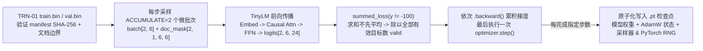

> **生成工具**：Codex\
> **生成模型**：gpt-6.2-sol

在 [TRN-01](https://blog.lacknb.cn/articles/2026/11/21/1795272443691.html) 里，我们把 9 篇退款说明洗干净并装进了两个二进制分片里：训练流 `26` 个 Token、验证流 `9` 个 Token、词表共 `24` 项。

今天正式把训练机器转起来！我们不依赖任何神秘黑盒训练库，亲手搭一个只有 **14,496 个参数**、在单核 CPU 上几秒就能跑完 60 步的 **微型 decoder-only Transformer**（只使用带因果遮罩的解码器堆叠——这正是现代绝大多数大语言模型的骨架），让它从完全胡言乱语的随机数字出发学「猜下一个词」，再亲自砸碎进程测试「断点续训能不能一丝不差接上进度」。

> **先用大白话讲明白**：预训练一个语言模型，就像**培训一个刚出生的接龙学徒，靠「猜错就扣分、攒几道题一块改错题本」练成老手**：
> - **前向传播 + 交叉熵损失（猜词算扣分）**：遮住下一个词让模型去猜词表里 24 个候选的概率，猜中率 `0.25` 扣 `-ln(0.25) = 1.386` 分，猜中率 `0.5` 扣 `0.693` 分，猜得越准扣分越少！跨文档那个 `-100` 位直接免扣分。
> - **反向传播 + 梯度累积（先写多份草稿再统一擦改笔记）**：嫌每次只算 2 行批次太抖、显存又塞不下大块头？那就先连续抽 2 个「微批次」各算一遍哪几个参数该调大调小（梯度累加在一起，别忘了按**全部微批次真正算进来的有效词数之和**做平均！），再由 **AdamW 优化器** 顺便擦汗改一次权重，算作完整 1 步。
> - **断点续训 Checkpoint（高保真游戏即时存档）**：不仅要存当前模型权重，还得把 **AdamW 自己攒了 30 步的动量惯性、下一批随机抽卡种子** 统统拍进快照——否则半路宕机重开，虽然权重还在，优化器突然失忆清零步子就走歪了！



## 1. 同一个 `[2, 6]` 批次，怎样流过模型的每一层？

沿用上一篇切片取出的前两行训练数据——从 `train` 流下标 `0` 和 `6` 各取连续 **7** 项，前 6 项进输入 `X`，右移一位后 6 项进标签 `Y`（批大小 `B = 2`，序列长度 `T = 6`）：

```text
X[0] = [2, 3, 4, 5, 6, 7]      Y[0] = [3, 4, 5, 6, 7, 8]
X[1] = [8, 9, 10, 0, 11, 12]   Y[1] = [9, 10, 0, -100, 12, 13]
```

再复习一次两个核心隔离分界：第 1 行的 `0` 是文档结束符 **EOS**（End of Sequence）。`-100` 是交叉熵损失的忽略标签，确保模型不会傻傻尝试用文档 1 的句号去预测文档 3 的开篇词 `csv`；而前向传播里另外构造的布尔注意力掩码（`allowed`）进一步保住了文档隔离——文档 3 的 `export` 可以回看同文档的 `csv` 和自身，但永远偷窥不到前一篇文档的 `amounts`。**记住：忽略标签 `-100` 只管哪几位要算错分，注意力掩码决定前向能看见哪些前文，两件事互不替代、必须分别配对！**

这个只有 `14,496` 参数的微型 Transformer 内部张量形状变化极其干净：

| 前向执行步骤 | 输出张量形状（轴含义） | 这一步在干什么？ |
| --- | --- | --- |
| **Token + 位置嵌入** | `[2, 6, 32]` (`[B, T, H]`) | 把 6 个整数 ID 分别查表映射成 32 维语义向量，叠加 `0..5` 窗口内位置向量。 |
| **Q / K / V 拆头** | 各 `[2, 4, 6, 8]` (`[B, Heads, T, d_head]`) | 把 32 维线性投影再切成 **4 个注意力头**，每头 8 维特征分别问、答、取值。 |
| **因果注意力 + FFN** | `[2, 6, 32]` (`[B, T, H]`) | 严格按掩码只从本位置和同文档较早词汇总信息，过残差连接与两层全连接提炼。 |
| **词表输出头** | `[2, 6, 24]` (`[B, T, V]`) | 每个位置一次性吐出对全词表 **24** 个候选词的原始未归一化打分（**logits**）。 |

传给 PyTorch 缩放点积注意力的掩码 `allowed` 形状为 **`[2, 1, 6, 6]`**——第 1 轴长度为 1 会自动广播复制给 4 个注意力头，里面 `True` 表示允许互看。注意本微型演示里每段取出的 6 词窗口都是独立切出来的，位置向量就简洁地按窗口内部 `0..5` 编址。[PyTorch 缩放点积注意力](https://docs.pytorch.org/docs/stable/generated/torch.nn.functional.scaled_dot_product_attention.html)

## 2. 从 logits 算交叉熵损失，小心梯度累积加权陷阱！

**交叉熵（Cross-Entropy）**专门惩罚「猜错了还自信爆棚」：把某个位置 24 个候选分数过 Softmax 变成总和为 1 的概率，然后对正确词的概率取负自然对数 `-ln(p)`（单位 **nat**，自然信息单位）。要是模型给正确答案 `policy` 分配 `0.25` 概率，这一格损失就是 `-ln(0.25) ≈ 1.386 nat`；另一个词给对 `0.5`，损失 `0.693 nat`；两个词平均大约 `1.040 nat`。写代码时直接把 `[B, T, 24]` 拍扁成 `[B×T, 24]` 交给 `F.cross_entropy`，底层自动做防数值溢出对数计算。[PyTorch 交叉熵](https://docs.pytorch.org/docs/stable/generated/torch.nn.functional.cross_entropy.html)

算完损失后调用 `.backward()` 做**反向传播（Backpropagation）**，顺着计算图把「每个参数变动一点点会使总损失降多少」全算出来（叫梯度）；接着由 **AdamW 优化器**（不仅看这一步梯度，还会记住过去几十步梯度的平滑惯性「一阶动量」与波动幅度「二阶动量」，加上温和权重衰减防过拟合）统一走一步更新权重。

> **容易踩的坑（梯度累积怎么平均才公平？）**：设想每次更新收集 `2` 个微批次：第 1 批刚好没碰到跨文档缝隙，有效预测目标是 **`11` 个** Token；第 2 批撞到两条跨文档缝隙，有效目标是 **`10` 个** Token。正确的联合平均损失应该是**「（两批损失总和）÷ `21`」**！
> 如果图省事直接调用默认 `reduction='mean'` 对第 1 批求平均、第 2 批求平均，再粗暴除以 `2` 相加——第 2 批里每一个 Token 分摊到的梯度权重（`1/20`）就会悄悄比第 1 批的（`1/22`）大出一截！所以 `summed_loss()` 特意设 `reduction="sum"`，在 `update()` 里先数清全部微批次的 `valid` 总和，最后拿总分母去一一相除反传！

## 3. 在单核 CPU 上实跑 60 步，并测一次中途宕机恢复

先回到空目录跑一遍 [TRN-01](https://blog.lacknb.cn/articles/2026/11/21/1795272443691.html) 的管线拿到 `train.bin`、`val.bin` 和 `manifest.json`。接着在 Python 3.12 环境下安装实测版 PyTorch：

```bash
python -m pip install "torch==2.11.0"
```

把下面代码保存为 `train_tiny.py`。它在加载数据时会首先校对 `manifest.json` 的字节长度和 SHA-256 指纹，顺手拿断言验算与 TRN-01 一模一样的 `x[0], x[1], y[1], mask` 边界矩阵，然后跑满 60 个优化器步：

```python
import argparse
from hashlib import sha256
import json
from pathlib import Path
import struct

import torch
from torch import nn
from torch.nn import functional as F

T, WIDTH, HEADS = 6, 32, 4
MICRO_BATCH, ACCUMULATE = 2, 2
IGNORE, EOS = -100, 0


def load_shard(directory, name, info, vocab):
    raw = (directory / name).read_bytes()
    if (info["dtype"] != "uint16" or len(raw) != 2 * info["tokens"]
            or sha256(raw).hexdigest() != info["sha256"]):
        raise ValueError(f"{name} does not match TRN-01 manifest")
    tokens = torch.tensor(struct.unpack(f"<{info['tokens']}H", raw), dtype=torch.long)
    if len(tokens) <= T or int(tokens.max()) >= vocab or int(tokens[-1]) != EOS:
        raise ValueError(f"invalid tokens in {name}")
    # EOS belongs to the document that ends at that position.
    ends = tokens.eq(EOS).long()
    return tokens, ends.cumsum(0) - ends


def batch(shard, starts):
    tokens, docs = shard
    indices = starts[:, None] + torch.arange(T)
    x, y = tokens[indices], tokens[indices + 1]
    segment = docs[indices]
    y = y.masked_fill(segment != docs[indices + 1], IGNORE)
    same_doc = segment[:, :, None] == segment[:, None, :]
    causal = torch.ones(T, T, dtype=torch.bool).tril()
    return x, y, (same_doc & causal)[:, None, :, :]


class TinyLM(nn.Module):
    def __init__(self, vocab):
        super().__init__()
        self.token = nn.Embedding(vocab, WIDTH)
        self.position = nn.Embedding(T, WIDTH)
        self.norm_attn = nn.LayerNorm(WIDTH)
        self.qkv = nn.Linear(WIDTH, 3 * WIDTH)
        self.merge = nn.Linear(WIDTH, WIDTH)
        self.norm_ffn = nn.LayerNorm(WIDTH)
        self.ffn = nn.Sequential(nn.Linear(WIDTH, 4 * WIDTH), nn.GELU(),
                                 nn.Linear(4 * WIDTH, WIDTH))
        self.final = nn.LayerNorm(WIDTH)
        self.head = nn.Linear(WIDTH, vocab, bias=False)

    def forward(self, x, allowed):
        h = self.token(x) + self.position(torch.arange(T))
        b = x.shape[0]
        q, k, v = (part.reshape(b, T, HEADS, WIDTH // HEADS).transpose(1, 2)
                   for part in self.qkv(self.norm_attn(h)).chunk(3, dim=-1))
        z = F.scaled_dot_product_attention(q, k, v, attn_mask=allowed, dropout_p=0.0)
        h = h + self.merge(z.transpose(1, 2).reshape(b, T, WIDTH))
        h = h + self.ffn(self.norm_ffn(h))
        return self.head(self.final(h))


def summed_loss(model, x, y, allowed):
    logits = model(x, allowed)
    return F.cross_entropy(logits.flatten(0, 1), y.flatten(),
                           ignore_index=IGNORE, reduction="sum")


def update(model, optimizer, train, sampler):
    windows = len(train[0]) - T
    starts = torch.randint(windows, (ACCUMULATE, MICRO_BATCH), generator=sampler)
    micro_batches = [batch(train, ids) for ids in starts]
    valid = sum(int(y.ne(IGNORE).sum()) for _, y, _ in micro_batches)
    if not valid:
        raise ValueError("no valid next-token targets")
    optimizer.zero_grad(set_to_none=True)
    for x, y, allowed in micro_batches:
        (summed_loss(model, x, y, allowed) / valid).backward()
    optimizer.step()


@torch.no_grad()
def evaluate(model, shard):
    model.eval()
    x, y, allowed = batch(shard, torch.arange(len(shard[0]) - T))
    loss = summed_loss(model, x, y, allowed).item() / int(y.ne(IGNORE).sum())
    model.train()
    return loss


def main():
    p = argparse.ArgumentParser()
    p.add_argument("--data-dir", type=Path, default=Path("."))
    p.add_argument("--steps", type=int, required=True, help="total optimizer steps")
    p.add_argument("--out", type=Path, required=True)
    p.add_argument("--resume", type=Path)
    args = p.parse_args()

    torch.set_num_threads(1)
    torch.use_deterministic_algorithms(True)
    torch.manual_seed(2026)
    sampler = torch.Generator().manual_seed(91)
    raw_manifest = (args.data_dir / "manifest.json").read_bytes()
    manifest_id = sha256(raw_manifest).hexdigest()
    manifest = json.loads(raw_manifest)
    vocab = manifest["vocab_size"]
    train, val = [load_shard(args.data_dir, name, manifest["shards"][name], vocab)
                  for name in ("train.bin", "val.bin")]

    x, y, mask = batch(train, torch.tensor([0, 6]))
    assert x.tolist() == [[2, 3, 4, 5, 6, 7], [8, 9, 10, 0, 11, 12]]
    assert y[1].tolist() == [9, 10, 0, IGNORE, 12, 13]
    assert not mask[1, 0, 4, 3] and mask[1, 0, 5, 4]

    model = TinyLM(vocab)
    optimizer = torch.optim.AdamW(model.parameters(), lr=0.003, foreach=False)
    config = [vocab, T, WIDTH, HEADS, MICRO_BATCH, ACCUMULATE]
    step = 0
    if args.resume:
        saved = torch.load(args.resume, map_location="cpu", weights_only=True)
        if saved["manifest_id"] != manifest_id or saved["config"] != config:
            raise ValueError("checkpoint data or model configuration mismatch")
        model.load_state_dict(saved["model"])
        optimizer.load_state_dict(saved["optimizer"])
        sampler.set_state(saved["random_batch"])
        torch.set_rng_state(saved["torch_rng"])
        step = saved["step"]

    if args.steps < step:
        p.error("--steps must be at least the checkpoint step")

    print(f"parameters={sum(v.numel() for v in model.parameters())}")
    while True:
        if step % 15 == 0 or step == args.steps:
            print(json.dumps({"step": step, "train_loss": round(evaluate(model, train), 6),
                              "val_loss": round(evaluate(model, val), 6)}))
        if step == args.steps:
            break
        update(model, optimizer, train, sampler)
        step += 1
    partial = args.out.with_suffix(args.out.suffix + ".tmp")
    torch.save({"step": step, "config": config, "manifest_id": manifest_id,
                "model": model.state_dict(), "optimizer": optimizer.state_dict(),
                "random_batch": sampler.get_state(), "torch_rng": torch.get_rng_state()},
               partial)
    partial.replace(args.out)


if __name__ == "__main__":
    main()
```

依次执行三条命令：一条一口气跑到 60 步作为对照基准，另两条先跑到 30 步打个存档再从 30 步接着跑到 60 步：

```bash
python train_tiny.py --steps 60 --out full.pt
python train_tiny.py --steps 30 --out half.pt
python train_tiny.py --steps 60 --resume half.pt --out resumed.pt
```

> **想再深入一层？** 在 Apple Silicon CPU 和 PyTorch 2.11.0 上实跑 `14,496` 参数模型的结果如下（其中训练/验证均值为各自分片上所有连续长度为 7 的重叠窗口之精确有效标签平均）：

| 已完成优化器步数 | 训练损失 (`nat/Token`) | 验证损失 (`nat/Token`) | 发生了什么？ |
| ---: | ---: | ---: | --- |
| `0` | `3.092652` | `2.926361` | 随机刚起步时大致相当于 `ln(24) ≈ 3.178` 瞎猜水平 |
| `15` | `1.807375` | `3.055978` | 训练集开始背熟，验证集微微抬头 |
| `30` | `0.829670` | `3.127822` | 一半进程，模型对常见搭配很快有把握 |
| `45` | `0.381644` | `3.438450` | 训练集背得极熟，过拟合信号放大 |
| `60` | **`0.217125`** | **`3.716034`** | 经典小语料「背书过拟合」：验证流因为只有 1 篇包含多个 `<unk>` 的短文，死背训练短句反而让它越偏越远 |

这就是教科书级的**过拟合（Overfitting）**：模型把这 3 篇训练短文背得滚瓜烂熟，却并没有因此更猜得出留出的陌生句子（何况验证篇还带着一堆 `<unk>`）。真正验证泛化能力，需要更大规模独立语料库与 BPE 子词词表。

## 4. 验证断点续训是不是真正还原到了同一条宇宙线

> **容易踩的坑**：很多同学保存 **Checkpoint（检查点）** 时只调用 `torch.save(model.state_dict())`——那只是「保存了权重用于推理」，根本算不上能接着训练的断点存档！少存 AdamW 动量会让恢复后前几步步幅突然暴乱，少存数据采样随机数会立刻重新抽到之前刚练过的老数据，而在保存过程断电还会写坏整份文件（所以脚本特意先写 `.tmp` 再靠 `replace()` 原子改名）。

在本例里，检查点都在完整更新结束后保存（因此无需保存半路梯度），且验证过程不消耗训练采样随机数 `sampler`。在相同确定性配置下跑下面这份对比脚本，检验 `full.pt`（一口气 60 步）与 `resumed.pt`（跑 30 步存盘再接跑 30 步）是不是**每一个浮点数比特一字不差**：

```python
import torch

full = torch.load("full.pt", map_location="cpu", weights_only=True)
resumed = torch.load("resumed.pt", map_location="cpu", weights_only=True)


def equal(a, b):
    if isinstance(a, torch.Tensor):
        return torch.equal(a, b)
    if isinstance(a, dict):
        return a.keys() == b.keys() and all(equal(a[k], b[k]) for k in a)
    if isinstance(a, (list, tuple)):
        return len(a) == len(b) and all(equal(x, y) for x, y in zip(a, b))
    return a == b


assert full["step"] == resumed["step"] == 60
assert equal(full, resumed)
print("step=60: weights, optimizer and RNG states match exactly")
```

实测两条轨迹逐元素完全相等！真正在大集群里如果换了不同版本 PyTorch、更换 GPU 型号或开启异步采样，底层并行归约浮点累加顺序不同也可能产生微弱尾数差异；如果上了学习率调度器（Scheduler）、混合精度缩放器（GradScaler）与流式数据指针，也记得通通塞进 Checkpoint 字典里。[PyTorch 保存和加载模型](https://docs.pytorch.org/tutorials/beginner/saving_loading_models.html)

## 5. 到 nanoGPT 源码里对照同一条主循环

Karpathy 的开源项目 [nanoGPT](https://github.com/karpathy/nanoGPT) 只用几百行清晰的代码就写透了预训练核心逻辑。读源码时按这四个锚点跟我们今天的 `train_tiny.py` 一一认亲即可：
- [`train.py` 的 `get_batch()`](https://github.com/karpathy/nanoGPT/blob/master/train.py) 对应这里的移位取样切片 `x` 与 `y`；
- [`model.py` 的 `GPT.forward()`](https://github.com/karpathy/nanoGPT/blob/master/model.py) 对应输出 `logits` 与交叉熵算损失；
- 回到 `train.py` 的微批次循环、`scaler` 反向传播、梯度裁剪和 `optimizer.step()`，以及定时采样算评估的 `estimate_loss()` 和通过 `init_from='resume'` 加载 Checkpoint 恢复状态。

> **大白话小结**：两者只有一个微妙而关键的区别——nanoGPT 面向固定超长窗口直接按 `gradient_accumulation_steps` 均匀除损失；而我们这一篇引入了跨文档缝隙 `-100` 遮罩，所以示范了先总和再统一除以全局有效标签数 `valid`。看源码时多盯一眼这些「未明说的默认前提」，自己上手改真实工程时才不会悄悄踩进失真坑！

## 下一篇

刚才跑的微型模型才 `14,496` 个参数，显存占用跟九牛一毛一样，一张普通笔记本地板都能随便塞下。可换上真实 7B、70B 大模型，**光是把参数、梯度和 AdamW 两份动量状态摊开，单卡瞬间炸穿 OOM！** 按路线图行序，下一篇 [**TRN-10《分布式训练的显存账本，FSDP 与 ZeRO》**](trn-10-distributed-memory.md) 会拿着同一个 `14,496` 参数模型一字节一字节地把显存账单算到底，并用两个真进程演练 **FSDP 分片收集与分片续训**。 [LLM 与 Agent 学习路线图](https://blog.lacknb.cn/articles/2026/11/19/1795058329577.html)
