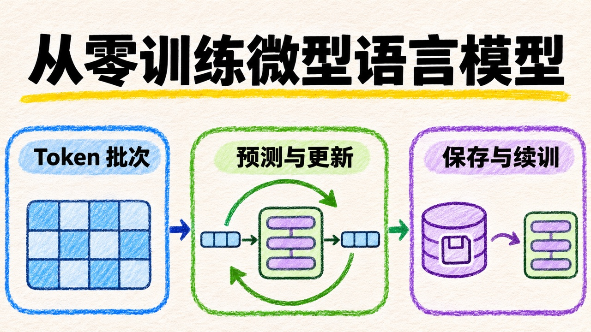

> **生成工具**：Codex\
> **生成模型**：gpt-6.2-sol

[TRN-01](https://blog.lacknb.cn/articles/2026/11/21/1795272443691.html) 把退款说明变成了两个二进制分片。训练流有 26 个 Token，验证流有 9 个，词表共 24 项。这一篇直接读取那两个分片，用随机初始化的模型学下一 Token 预测，再验证同一个训练任务中断后能否接回去。

**预训练（pretraining）**在本例中指给模型读原始文本，用文本本身的后续 Token 作为答案来更新权重。模型是一个 **decoder-only Transformer**，即只采用解码器式因果注意力的 Transformer。它在每个位置根据允许访问的前文预测下一个 Token。代码用 Python 和 PyTorch，一个 CPU 线程即可运行。

## 1. 同一个批次怎样变成预测？

从训练流的下标 0 和 6 各取连续 **7** 项，前 6 项做输入，后 6 项做标签。批大小 `B=2`，上下文长度 `T=6`。`B` 是同一次前向处理的样本数，`T` 是每条输入的位置数。

```text
X[0] = [2, 3, 4, 5, 6, 7]      Y[0] = [3, 4, 5, 6, 7, 8]
X[1] = [8, 9, 10, 0, 11, 12]   Y[1] = [9, 10, 0, -100, 12, 13]
```

第一行的 Token 2 是 `refund`，其标签 3 是 `policy`。第二行的 0 是文档结束标记 EOS（End of Sequence）。`-100` 是交叉熵的忽略标记，防止模型被要求预测下一篇文档的第一个词 `csv`。注意力也单独做隔离。例如第二行 `export` 能看到同文档的 `csv` 和自身，它无法读取前一文档的 `amounts`。忽略标签只影响损失，注意力掩码决定前向看到了什么，两者分别配置。

| 前向步骤 | 形状 | 在做什么？ |
| --- | --- | --- |
| Token 与位置嵌入 | `[2, 6, 32]` | 按 Token ID 查向量，并叠加窗口内的位置向量。 |
| Q、K、V | 各 `[2, 4, 6, 8]` | 由输入向量算出查询、键和值。4 是注意力头数，每个头有 8 个特征。 |
| 同文档因果注意力和前馈层 | `[2, 6, 32]` | 只从本位置与同文档的较早位置取信息，再更新各位置的表示。 |
| 输出头 | `[2, 6, 24]` | 每个输入位置得到对 24 个词表项的原始分数，即 logits。 |

传给 PyTorch 缩放点积注意力的布尔掩码形状是 `[2, 1, 6, 6]`。最后两轴是查询位置和被访问位置，长度为 1 的头维广播给四个头。这个接口的 `True` 表示允许注意。位置编号按每个采样窗口从 0 到 5。 [PyTorch 缩放点积注意力](https://docs.pytorch.org/docs/stable/generated/torch.nn.functional.scaled_dot_product_attention.html)

## 2. 从 logit 算损失，再更新一次参数

**交叉熵（cross-entropy）**衡量模型给正确标签多少概率。把某个位置的 24 个分数做 Softmax 得到概率分布。若模型给正确的 `policy` 概率 0.25，该位置损失是 `-ln(0.25) ≈ 1.386`。如果另一个位置的正确标签概率为 0.5，它的损失是 0.693。两个位置平均约 1.040。自然对数对应的损失单位是 nat。代码把 `[B,T,24]` 展成 `[B×T,24]` 交给 `cross_entropy`，让 PyTorch 在内部做稳定计算。

**反向传播（backpropagation）**从标量损失算出各参数的梯度，表示参数变动时损失如何变化。**AdamW** 是这里使用的优化器。它维护梯度动量与平方梯度的滑动统计，结合学习率和权重衰减更新参数。每个优化器步先清理梯度，从训练流随机抽两个微批次，分别前向和反向，最后才更新一次参数。

这就是**梯度累积（gradient accumulation）**。两个微批次各自可能有不同数量的有效标签。假设一批 11 项，另一批 10 项，合并损失应为「两批损失之和 ÷ 21」。两批先分别求均值再等权相加，会给 10 项那批更高的逐 Token 权重。下面的实现先数所有有效标签，再对每个微批次的损失总和除以同一个分母。 [PyTorch 交叉熵](https://docs.pytorch.org/docs/stable/generated/torch.nn.functional.cross_entropy.html)

## 3. 在 CPU 上实跑 60 个优化器步

在独立目录运行 TRN-01 的 Python 代码，得到 `train.bin`、`val.bin` 和 `manifest.json`。在 Python 3.12 虚拟环境中，运行下面的命令安装实测使用的 PyTorch 版本。

```bash
python -m pip install "torch==2.11.0"
```

把下列代码存为 `train_tiny.py`。它校验分片摘要，从文件重建文档边界，并用同一份数据验收移位标签和掩码。

```python
import argparse
from hashlib import sha256
import json
from pathlib import Path
import struct

import torch
from torch import nn
from torch.nn import functional as F

T, WIDTH, HEADS = 6, 32, 4
MICRO_BATCH, ACCUMULATE = 2, 2
IGNORE, EOS = -100, 0


def load_shard(directory, name, info, vocab):
    raw = (directory / name).read_bytes()
    if (info["dtype"] != "uint16" or len(raw) != 2 * info["tokens"]
            or sha256(raw).hexdigest() != info["sha256"]):
        raise ValueError(f"{name} does not match TRN-01 manifest")
    tokens = torch.tensor(struct.unpack(f"<{info['tokens']}H", raw), dtype=torch.long)
    if len(tokens) <= T or int(tokens.max()) >= vocab or int(tokens[-1]) != EOS:
        raise ValueError(f"invalid tokens in {name}")
    # EOS belongs to the document that ends at that position.
    ends = tokens.eq(EOS).long()
    return tokens, ends.cumsum(0) - ends


def batch(shard, starts):
    tokens, docs = shard
    indices = starts[:, None] + torch.arange(T)
    x, y = tokens[indices], tokens[indices + 1]
    segment = docs[indices]
    y = y.masked_fill(segment != docs[indices + 1], IGNORE)
    same_doc = segment[:, :, None] == segment[:, None, :]
    causal = torch.ones(T, T, dtype=torch.bool).tril()
    return x, y, (same_doc & causal)[:, None, :, :]


class TinyLM(nn.Module):
    def __init__(self, vocab):
        super().__init__()
        self.token = nn.Embedding(vocab, WIDTH)
        self.position = nn.Embedding(T, WIDTH)
        self.norm_attn = nn.LayerNorm(WIDTH)
        self.qkv = nn.Linear(WIDTH, 3 * WIDTH)
        self.merge = nn.Linear(WIDTH, WIDTH)
        self.norm_ffn = nn.LayerNorm(WIDTH)
        self.ffn = nn.Sequential(nn.Linear(WIDTH, 4 * WIDTH), nn.GELU(),
                                 nn.Linear(4 * WIDTH, WIDTH))
        self.final = nn.LayerNorm(WIDTH)
        self.head = nn.Linear(WIDTH, vocab, bias=False)

    def forward(self, x, allowed):
        h = self.token(x) + self.position(torch.arange(T))
        b = x.shape[0]
        q, k, v = (part.reshape(b, T, HEADS, WIDTH // HEADS).transpose(1, 2)
                   for part in self.qkv(self.norm_attn(h)).chunk(3, dim=-1))
        z = F.scaled_dot_product_attention(q, k, v, attn_mask=allowed, dropout_p=0.0)
        h = h + self.merge(z.transpose(1, 2).reshape(b, T, WIDTH))
        h = h + self.ffn(self.norm_ffn(h))
        return self.head(self.final(h))


def summed_loss(model, x, y, allowed):
    logits = model(x, allowed)
    return F.cross_entropy(logits.flatten(0, 1), y.flatten(),
                           ignore_index=IGNORE, reduction="sum")


def update(model, optimizer, train, sampler):
    windows = len(train[0]) - T
    starts = torch.randint(windows, (ACCUMULATE, MICRO_BATCH), generator=sampler)
    micro_batches = [batch(train, ids) for ids in starts]
    valid = sum(int(y.ne(IGNORE).sum()) for _, y, _ in micro_batches)
    if not valid:
        raise ValueError("no valid next-token targets")
    optimizer.zero_grad(set_to_none=True)
    for x, y, allowed in micro_batches:
        (summed_loss(model, x, y, allowed) / valid).backward()
    optimizer.step()


@torch.no_grad()
def evaluate(model, shard):
    model.eval()
    x, y, allowed = batch(shard, torch.arange(len(shard[0]) - T))
    loss = summed_loss(model, x, y, allowed).item() / int(y.ne(IGNORE).sum())
    model.train()
    return loss


def main():
    p = argparse.ArgumentParser()
    p.add_argument("--data-dir", type=Path, default=Path("."))
    p.add_argument("--steps", type=int, required=True, help="total optimizer steps")
    p.add_argument("--out", type=Path, required=True)
    p.add_argument("--resume", type=Path)
    args = p.parse_args()

    torch.set_num_threads(1)
    torch.use_deterministic_algorithms(True)
    torch.manual_seed(2026)
    sampler = torch.Generator().manual_seed(91)
    raw_manifest = (args.data_dir / "manifest.json").read_bytes()
    manifest_id = sha256(raw_manifest).hexdigest()
    manifest = json.loads(raw_manifest)
    vocab = manifest["vocab_size"]
    train, val = [load_shard(args.data_dir, name, manifest["shards"][name], vocab)
                  for name in ("train.bin", "val.bin")]

    x, y, mask = batch(train, torch.tensor([0, 6]))
    assert x.tolist() == [[2, 3, 4, 5, 6, 7], [8, 9, 10, 0, 11, 12]]
    assert y[1].tolist() == [9, 10, 0, IGNORE, 12, 13]
    assert not mask[1, 0, 4, 3] and mask[1, 0, 5, 4]

    model = TinyLM(vocab)
    optimizer = torch.optim.AdamW(model.parameters(), lr=0.003, foreach=False)
    config = [vocab, T, WIDTH, HEADS, MICRO_BATCH, ACCUMULATE]
    step = 0
    if args.resume:
        saved = torch.load(args.resume, map_location="cpu", weights_only=True)
        if saved["manifest_id"] != manifest_id or saved["config"] != config:
            raise ValueError("checkpoint data or model configuration mismatch")
        model.load_state_dict(saved["model"])
        optimizer.load_state_dict(saved["optimizer"])
        sampler.set_state(saved["random_batch"])
        torch.set_rng_state(saved["torch_rng"])
        step = saved["step"]

    if args.steps < step:
        p.error("--steps must be at least the checkpoint step")

    print(f"parameters={sum(v.numel() for v in model.parameters())}")
    while True:
        if step % 15 == 0 or step == args.steps:
            print(json.dumps({"step": step, "train_loss": round(evaluate(model, train), 6),
                              "val_loss": round(evaluate(model, val), 6)}))
        if step == args.steps:
            break
        update(model, optimizer, train, sampler)
        step += 1
    partial = args.out.with_suffix(args.out.suffix + ".tmp")
    torch.save({"step": step, "config": config, "manifest_id": manifest_id,
                "model": model.state_dict(), "optimizer": optimizer.state_dict(),
                "random_batch": sampler.get_state(), "torch_rng": torch.get_rng_state()},
               partial)
    partial.replace(args.out)


if __name__ == "__main__":
    main()
```

```bash
python train_tiny.py --steps 60 --out full.pt
python train_tiny.py --steps 30 --out half.pt
python train_tiny.py --steps 60 --resume half.pt --out resumed.pt
```

`--steps` 指累计完成的优化器步数，所以最后一个命令从第 30 步继续，另外执行 30 步。分片不在当前目录时，可给三个命令都加上相同的 `--data-dir`。用空目录运行可保留已有同名检查点。

在 Apple Silicon CPU 和 PyTorch 2.11.0 上，模型有 **14,496** 个参数。训练与验证均值都用各自分片所有长度为 7 的连续窗口计算。窗口会重叠，表中是固定窗口集的逐有效标签平均损失。

| 完成步数 | 训练损失（nat/Token） | 验证损失（nat/Token） |
| ---: | ---: | ---: |
| 0 | 3.092652 | 2.926361 |
| 15 | 1.807375 | 3.055978 |
| 30 | 0.829670 | 3.127822 |
| 45 | 0.381644 | 3.438450 |
| 60 | 0.217125 | 3.716034 |

这组结果展示了过拟合信号。模型对训练里的短句越来越有把握，留出的文档损失却在上升。验证只有一篇短文，也有几处被编码为 `<unk>` 的未登录词。要比较真实泛化能力，需要更多独立文档和更合适的分词器。

## 4. 验证恢复后是不是同一条训练轨迹

**Checkpoint（检查点）**保存可继续运行的训练状态。本例保存权重、AdamW 状态、已完成步数、随机采样器状态、PyTorch 随机数状态，以及模型配置和数据清单的摘要。检查点放在一次完整更新结束后，因此这里无需保存累积到一半的梯度。断点恢复时用同一个状态继续抽样，验证循环会枚举固定窗口，也不会消耗训练采样器。

在相同 CPU 环境、版本与确定性配置下，用下面的脚本对照两份检查点，逐项检查数据配置、权重、优化器和随机状态。

```python
import torch

full = torch.load("full.pt", map_location="cpu", weights_only=True)
resumed = torch.load("resumed.pt", map_location="cpu", weights_only=True)


def equal(a, b):
    if isinstance(a, torch.Tensor):
        return torch.equal(a, b)
    if isinstance(a, dict):
        return a.keys() == b.keys() and all(equal(a[k], b[k]) for k in a)
    if isinstance(a, (list, tuple)):
        return len(a) == len(b) and all(equal(x, y) for x, y in zip(a, b))
    return a == b


assert full["step"] == resumed["step"] == 60
assert equal(full, resumed)
print("step=60: weights, optimizer and RNG states match exactly")
```

实测比较全部通过。从不同硬件、PyTorch 版本或不同注意力内核复跑时，浮点差异可能影响逐元素相等。实际训练使用学习率调度、混合精度或分布式数据采样时，也要保存对应的调度、缩放器和数据状态。 [PyTorch 保存和加载模型](https://docs.pytorch.org/tutorials/beginner/saving_loading_models.html)

## 5. 到 nanoGPT 源码里定位同一条链路

nanoGPT 已有完整的语言模型和训练循环，可以直接复用来扩展实验。这里采用小规模教学实现，是为了与 TRN-01 的两行批次和文档掩码逐项对照。阅读时从 `train.py` 的 `get_batch()` 找移位取样，到 `model.py` 的 `GPT.forward()` 找 logits 与损失，再回 `train.py` 看微步反传和优化器更新。`estimate_loss()` 在训练与验证集上采样估计损失。恢复路径从 `init_from='resume'` 进入，用检查点重建模型和累计步数并加载优化器状态。 [nanoGPT 训练循环](https://github.com/karpathy/nanoGPT/blob/master/train.py) · [nanoGPT 模型](https://github.com/karpathy/nanoGPT/blob/master/model.py)

nanoGPT 的常规取样窗口长度固定，训练循环将微批损失按累积步数缩放。本例有跨文档忽略位，于是按有效标签总数加权，并另外保存采样器状态来核对逐元素续训。带着这个差异读源码，可以看清一段代码的默认假设怎样影响损失和恢复。

## 下一篇

按路线图行序接下来是 [**TRN-10《分布式训练的显存账本，FSDP 与 ZeRO》**](trn-10-distributed-memory.md)，会从本篇的权重、梯度和 AdamW 状态出发，算它们如何占用训练显存。 [LLM 与 Agent 学习路线图](https://blog.lacknb.cn/articles/2026/11/19/1795058329577.html)
