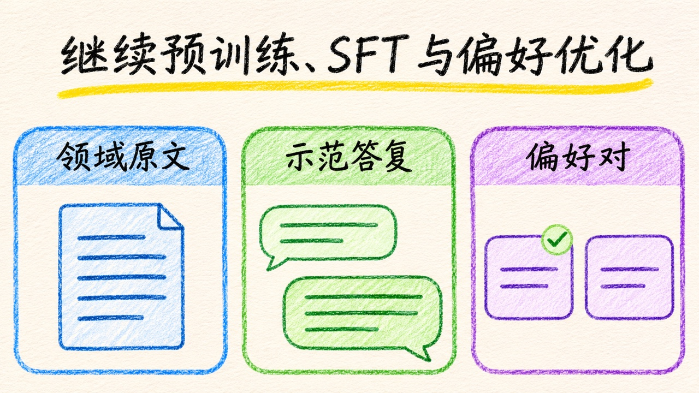

> **生成工具**：Codex\
> **生成模型**：gpt-6.2-sol

退款 CSV 的三行金额是 10、空、0。业务要求排除空值，保留 0，所以有效条数是 **2**，均值是 **(10 + 0) ÷ 2 = 5**。现在假设同一个模型遇到三个问题：它不熟悉退款口径，只会用自然语言写报告，或者在两份报告都能写出来时仍倾向选择错误口径。原始手册、正确示范和偏好标签能提供三种不同的训练信号。

[TRN-02](trn-02-tiny-language-model.md) 从随机权重跑过下一 Token 训练，[TRN-10](trn-10-distributed-memory.md) 拆过参数、梯度与优化器状态的开销。这一篇沿用同一个微型 Transformer 的实现，先用少量通用材料生成公共初始权重，然后分成三条训练路径。

## 1. 同一个退款任务可以准备三种数据

| 训练目标 | 训练样本 | 从样本里获取的信号 |
| --- | --- | --- |
| **继续预训练（Continued Pretraining）** | 退款手册原文，例如「空金额排除，零金额保留」。 | 用上下文预测后续 Token，学习领域里的用词、内容和结构。 |
| **SFT（Supervised Fine-Tuning，监督微调）** | 用户给出 CSV，助手示范返回有效 2 条、均值 5。 | 在同一用户输入下，提高示范回复的概率。本文只给助手回复与结束标记计损失。 |
| **偏好优化（Preference Optimization）** | 同一请求有两份候选。优选是有效 2 条、均值 5。劣选把空值也算入，给出有效 3 条、均值 3.33。 | 根据选择标签学习偏好。本文用 DPO，把当前模型对两份回复的相对偏好与冻结参考模型比较。 |

继续预训练沿用基座的语言建模目标，适合有足量合规领域文本、想适配表述或分布的场景。SFT 则要求能写出高质量的想要行为，例如按指定字段输出或解释分母。偏好优化适合能判断两份合理候选哪个更符合要求的情形。也有方法以奖励反馈指导优化，后面 TRN-07 和 TRN-08 会分别展开离线偏好和在线采样。 [领域适配预训练](https://arxiv.org/abs/2004.10964) · [InstructGPT 的示范与排序数据](https://arxiv.org/abs/2203.02155)

## 2. 损失在哪些位置产生？

教学分词把 `count=2` 当一个 Token。下面让七个 Token 进入同样的移位结构，模型的六个输入位置各预测下一项：

```text
手册片段   <doc>  refund  empty  skip         zero     keep    <eos>
示范样本   <user> refund  mixed  <assistant>  count=2  mean=5  <eos>
SFT 计损失         否      否      否           是       是      是
```

`<eos>`（End of Sequence）是结束标记。手册样本对全部六个移位目标计算**负对数似然**（Negative Log-Likelihood，NLL），即取正确 Token 的概率做负自然对数。SFT 样本仍让模型看到用户消息，只对 `count=2`、`mean=5` 和 `<eos>` 求平均。若三项概率都是 0.5，平均损失就是 `-ln(0.5) ≈ 0.693` nat/Token。

**DPO（Direct Preference Optimization，直接偏好优化）**用同一 Prompt（模型提示）下的一对回复。先把回复 Token 的对数概率相加，得到回复的对数概率。记 `M = log P(优选 | 提示) - log P(劣选 | 提示)`，它是两份完整回复的对数概率差，单位是 nat。DPO 计算当前模型的 `M` 相对冻结参考模型的增量 `ΔM`，再用 `softplus(-β × ΔM)` 算损失。`β` 是无量纲系数，本例设为 0.5。这里 `softplus(z) = ln(1+exp(z))`。两模型起始权重相同，`ΔM=0`，损失是 `ln(2)≈0.693`。当优化后相对间隔增大时，损失下降。它可以通过抬高优选、压低劣选或两者共同作用来实现。 [DPO 原论文](https://arxiv.org/abs/2305.18290) · [TRL 的 SFT](https://huggingface.co/docs/trl/sft_trainer) · [TRL 的 DPO](https://huggingface.co/docs/trl/dpo_trainer)

## 3. 从同一份权重实跑三个目标

在空目录把下面摘录的 TRN-02 模型存为 `train_tiny.py`。只需要模型类与上下文长度 `T`。

```python
import torch
from torch import nn
from torch.nn import functional as F

T, WIDTH, HEADS = 6, 32, 4


class TinyLM(nn.Module):
    def __init__(self, vocab):
        super().__init__()
        self.token = nn.Embedding(vocab, WIDTH)
        self.position = nn.Embedding(T, WIDTH)
        self.norm_attn = nn.LayerNorm(WIDTH)
        self.qkv = nn.Linear(WIDTH, 3 * WIDTH)
        self.merge = nn.Linear(WIDTH, WIDTH)
        self.norm_ffn = nn.LayerNorm(WIDTH)
        self.ffn = nn.Sequential(nn.Linear(WIDTH, 4 * WIDTH), nn.GELU(),
                                 nn.Linear(4 * WIDTH, WIDTH))
        self.final = nn.LayerNorm(WIDTH)
        self.head = nn.Linear(WIDTH, vocab, bias=False)

    def forward(self, x, allowed):
        h = self.token(x) + self.position(torch.arange(T))
        b = x.shape[0]
        q, k, v = (part.reshape(b, T, HEADS, WIDTH // HEADS).transpose(1, 2)
                   for part in self.qkv(self.norm_attn(h)).chunk(3, dim=-1))
        z = F.scaled_dot_product_attention(q, k, v, attn_mask=allowed, dropout_p=0.0)
        h = h + self.merge(z.transpose(1, 2).reshape(b, T, WIDTH))
        h = h + self.ffn(self.norm_ffn(h))
        return self.head(self.final(h))
```

把第二段脚本存为 `compare_objectives.py`。使用 Python 3.12，先运行 `python -m pip install "torch==2.11.0"`，再运行 `python compare_objectives.py`。本篇输入写在脚本里，教学词表预先固定。三条分支分别从暖身 16 步的同一份权重开始，各用全参数更新 20 步。每条分支单独初始化 AdamW 优化器。

两条留出输入分别代表三行全空和两行全零。参考答案是「有效 0 条、均值为空」和「有效 2 条、均值为 0」。代码用 `all_empty`、`all_zero` 概括两种输入，未在训练样本中使用这两个上下文。它们用于检查模型是否把混合样本的回复套到其它请求上。此处用贪心生成并要求两项统计及结束标记完全匹配。

```python
from copy import deepcopy
import json
from pathlib import Path

import torch
from torch.nn import functional as F

from train_tiny import T, TinyLM

# 每行 7 个教学 Token，包含序列结束标记。
WARMUP = [
    "<doc> export text columns keep header <eos>",
    "<doc> ledger rows keep date text <eos>",
    "<user> export standard <assistant> count=2 mean=4 <eos>",
    "<user> ledger standard <assistant> count=1 mean=7 <eos>",
]
DOCUMENTS = [
    "<doc> refund empty skip zero keep <eos>",
    "<doc> refund mixed count=2 mean=5 rule <eos>",
]
PROMPT = "<user> refund mixed <assistant>"
CHOSEN = PROMPT + " count=2 mean=5 <eos>"
REJECTED = PROMPT + " count=3 mean=3.33 <eos>"
HOLDOUT = [
    ("<user> refund all_empty <assistant>", "count=0 mean=null <eos>"),
    ("<user> refund all_zero <assistant>", "count=2 mean=0 <eos>"),
]
# 教学词表固定，留出数据不参与构建。
vocab = (
    "<assistant> <doc> <eos> <user> all_empty all_zero columns count=0 "
    "count=1 count=2 count=3 date empty export header keep ledger mean=0 "
    "mean=3.33 mean=4 mean=5 mean=7 mean=null mixed refund rows rule skip "
    "standard text zero "
).split()
ids = {word: i for i, word in enumerate(vocab)}
CAUSAL = torch.ones(T, T, dtype=torch.bool).tril()[None, None]
BETA = 0.5


def encode(text):
    return [ids[word] for word in text.split()]


def token_logps(model, texts):
    sequence = torch.tensor([encode(text) for text in texts])
    assert sequence.shape[1] == T + 1
    logits = model(sequence[:, :-1], CAUSAL)
    return logits.log_softmax(-1).gather(-1, sequence[:, 1:, None]).squeeze(-1)


def answer_logps(model):
    first_answer = len(PROMPT.split()) - 1  # 输入位置 3 预测首个答复 Token。
    return token_logps(model, [CHOSEN, REJECTED])[:, first_answer:].sum(-1)


def fit(model, objective, steps):
    opt = torch.optim.AdamW(model.parameters(), lr=0.003, foreach=False)
    with torch.no_grad():
        before = float(objective(model))
    for _ in range(steps):
        opt.zero_grad(set_to_none=True)
        objective(model).backward()
        opt.step()
    with torch.no_grad():
        return before, float(objective(model))


@torch.no_grad()
def generate(model, prompt):
    tokens = encode(prompt)
    result = []
    for _ in range(3):
        padded = (tokens + [ids["<eos>"]] * T)[:T]
        logits = model(torch.tensor([padded]), CAUSAL)
        pick = int(logits[0, len(tokens) - 1].argmax())
        result.append(vocab[pick])
        tokens.append(pick)
        if vocab[pick] == "<eos>":
            break
    return " ".join(result)


@torch.no_grad()
def evaluate(model):
    logps = answer_logps(model)
    predictions = [generate(model, prompt) for prompt, _ in HOLDOUT]
    return {
        "document_nll": round(float(-token_logps(model, DOCUMENTS).mean()), 6),
        "chosen_nll": round(float(-logps[0] / 3), 6),
        "pair_margin": round(float(logps[0] - logps[1]), 6),
        "heldout_correct": sum(pred == gold for pred, (_, gold) in zip(predictions, HOLDOUT)),
        "heldout_outputs": predictions,
        "training_prompt_output": generate(model, PROMPT),
    }


def main():
    torch.set_num_threads(1)
    torch.use_deterministic_algorithms(True)
    torch.manual_seed(2026)
    base = TinyLM(len(vocab))
    fit(base, lambda model: -token_logps(model, WARMUP).mean(), steps=16)
    reference = deepcopy(base).requires_grad_(False)
    ref_good, ref_bad = answer_logps(reference)
    ref_margin = ref_good - ref_bad

    def dpo(model):
        good, bad = answer_logps(model)
        return F.softplus(-BETA * (good - bad - ref_margin))

    objectives = {
        "continued": lambda model: -token_logps(model, DOCUMENTS).mean(),
        "sft": lambda model: -answer_logps(model)[0] / 3,
        "dpo": dpo,
    }
    results = {"torch": str(torch.__version__), "vocab_size": len(vocab),
               "parameters": sum(p.numel() for p in base.parameters()),
               "warmup_steps": 16, "branch_steps": 20,
               "base": evaluate(base), "branches": {}}
    for name, objective in objectives.items():
        model = deepcopy(base)
        before, after = fit(model, objective, steps=20)
        assert after < before
        row = {"objective_before": round(before, 6),
               "objective_after": round(after, 6), **evaluate(model)}
        results["branches"][name] = row

    assert abs(results["branches"]["dpo"]["objective_before"] - 0.693147) < 1e-6
    assert results["branches"]["dpo"]["pair_margin"] > results["base"]["pair_margin"]
    assert evaluate(base) == evaluate(reference) == results["base"]
    output = json.dumps(results, indent=2)
    Path("objective-runs.json").write_text(output + "\n")
    print(output)


if __name__ == "__main__":
    main()
```

本机 Apple Silicon CPU 实测如下。文档 NLL 和优选回复 NLL 是各自样本池的平均负对数似然。`M` 是在同一个混合样本上的优选与劣选间隔。四组都用同一种评估方式算这三项。

| 分支 | 文档 NLL（nat/Token） | 优选回复 NLL（nat/Token） | 偏好间隔 M（nat） | 留出题通过 |
| --- | ---: | ---: | ---: | ---: |
| 暖身基座 | 3.650 | 1.973 | 3.485 | 0/2 |
| 继续预训练 | 0.496 | 0.953 | 6.425 | 0/2 |
| SFT | 3.548 | 0.084 | 11.903 | 0/2 |
| DPO | 3.656 | 0.747 | 18.036 | 0/2 |

继续预训练后，模型更容易接续看过的手册。但对混合请求生成「`count=2 rule`」，没有交付完整示范。SFT 和 DPO 都能对训练里的混合请求生成「`count=2 mean=5`」，遇到两条留出题仍复述同样的统计。DPO 的目标损失由 0.693147 降到 0.000692，偏好间隔扩大，示范回复的逐 Token 似然仍不及 SFT 分支。三个目标的训练损失检查的是不同量，公同比较应使用同一批业务样本。此处的文档、优选和偏好间隔都来自训练样本，留出测试才用于观察这次是否迁移到新输入。

这个微型实验各分支仅使用一对或两条样本，并且每步处理的序列数不同。它用来观察监督信号如何直接作用到输出。正式选型时，固定数据切分，补充真实的空值、零值、负值和通用能力回归，再记录各组处理的 Token 数和训练耗时。

## 4. 更新哪些参数是另一个选择

上面的三条路径都更新全参数。选好目标以后，还要决定允许哪些张量学习。**PEFT（Parameter-Efficient Fine-Tuning，参数高效微调）**用较少的可训练参数适配模型，例如增加 Adapter 或软提示。

| 更新范围 | 哪些参数变化 | 怎样看质量和显存 |
| --- | --- | --- |
| 全参数 | 整个模型的权重更新。 | 用作有足够算力和任务数据时的质量基线。梯度与优化器状态覆盖全部参数。 |
| 部分层 | 冻结其余参数，只更新选定层或输出头。 | 检查选的层能否应对目标变化。以本例为例，仅更新输出头是 `31 × 32 = 992` 个训练参数。 |
| Adapter（适配模块） | 冻结基座，在指定层训练新增参数。LoRA（Low-Rank Adaptation，低秩适配）通过低秩增量实现一种适配。 | 固定模型与目标，比较目标层和秩。基础权重和前向激活仍占空间。 |
| 软提示（soft prompt） | 冻结基座，训练一小段连续的输入向量。 | 更新参数少，可按任务切换。提示位置也占上下文，能表达的变化由基座和接入方式决定。 |

例如本例宽度是 32，若给一个 `32 × 32` 投影配置秩为 4 的 LoRA，新增两个矩阵共 `4 × (32 + 32) = 256` 个参数。若学习 4 个宽度为 32 的软提示向量，则有 `4 × 32 = 128` 个参数。这些数字只描述更新规模。训练峰值还要把基座权重、激活和临时工作区算进去。DPO 还需为同一提示处理优选与劣选，并取得参考对数概率，这会影响算力和内存。 [LoRA 论文](https://arxiv.org/abs/2106.09685) · [Prompt Tuning 论文](https://arxiv.org/abs/2104.08691)

结合退款例子，先按错误类型选择信号。领域文本不熟悉时，先检查是否有足够且获授权的原文，以及领域适配后通用能力是否回退。报告字段和工具流程不一致时，先准备覆盖边界的正确示范。两份候选都能生成、主要难点在取舍时，再定义偏好规则并收集有区分力的配对。上线评估同时报告任务正确率、失败类型、可训练参数量、峰值显存和训练预算，避免只看一项指标做选择。

## 下一篇

按路线图行序接下来是 **TRN-04《SFT 怎么把对话变成监督信号》**。会从本篇只有一轮的回复掩码出发，展开聊天模板、多轮标签、截断和 EOS。 [LLM 与 Agent 学习路线图](https://blog.lacknb.cn/articles/2026/11/19/1795058329577.html)
