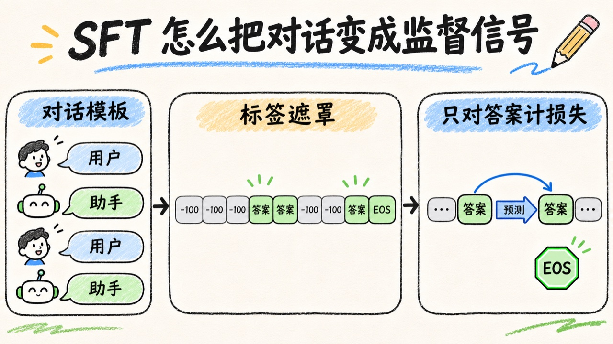

> **生成工具**：Codex\
> **生成模型**：gpt-6.2-sol

退款报表里的三行金额是 `4`、`NA`、`6`。第一轮，用户问有效条数，助手答 `{"count":2}`。第二轮，用户要求同时给出条数和均值，助手答 `{"count":2,"mean":5}`。我们希望模型学会在这两个位置输出示范回复，并学会在每次答完时停下。

[TRN-03](https://blog.lacknb.cn/articles/2026/11/22/1795327133650.html) 用单轮回复对比了三种训练目标。这一篇用 Qwen2.5 的实际分词器追踪多轮对话，最后用同一份基座权重比较三种输出。SFT（Supervised Fine-Tuning，监督微调）在这里指用人工定义的正确回复训练模型，提高这些回复在给定对话下出现的概率。

## 1. 聊天模板先把角色和轮次写进序列

传给程序的是一组消息，每条消息有 `role`（角色）和 `content`（正文）。Chat Template（聊天模板）规定这些消息怎样序列化成文本，再由分词器转成 Token（词元）。本例用 `Qwen2.5-0.5B-Instruct` 仓库的分词器和模板，训练起点用 `Qwen2.5-0.5B` 的原始基座权重。分词器决定格式和 Token ID，权重决定每个下一 Token 的预测分数。实验只加载了 Instruct 仓库的分词器。 [Qwen 基座模型卡](https://huggingface.co/Qwen/Qwen2.5-0.5B) · [本次使用的模板配置](https://huggingface.co/Qwen/Qwen2.5-0.5B-Instruct/blob/7ae557604adf67be50417f59c2c2f167def9a775/tokenizer_config.json)

这是 `tokenizer.apply_chat_template` 对该样本的实际输出，末尾还有一个换行。

```text
<|im_start|>system
你是退款报表助手。<|im_end|>
<|im_start|>user
退款金额 CSV
refund
4
NA
6
忽略 NA，先报有效条数。<|im_end|>
<|im_start|>assistant
{"count":2}<|im_end|>
<|im_start|>user
现在同时给出有效条数和均值。<|im_end|>
<|im_start|>assistant
{"count":2,"mean":5}<|im_end|>
```

`system` 给出系统指令，`user` 标出用户消息，`assistant` 标出助手消息。`<|im_start|>` 和 `<|im_end|>` 分别围住一条消息。完整训练样本已有两条助手回复，渲染时用 `add_generation_prompt=False`。第二轮推理时只提供截至第二个用户问题的历史，改用 `add_generation_prompt=True`，让模板追加 `<|im_start|>assistant\n`，模型从这个位置生成。模板已写入所需的特殊符号，随后单独调用分词器时用 `add_special_tokens=False`。 [Transformers 聊天模板](https://huggingface.co/docs/transformers/chat_templating)

## 2. 输入保留全部历史，标签只给助手正文和结束标记

`input_ids` 是模型读入的 Token ID。标签 `labels` 与它等长，参与损失的位置填原 Token ID，其他位置填 `-100`，这是当前交叉熵实现忽略的标签值。用模板先渲染完整对话，再对每条助手消息渲染一次该轮的推理前缀。确认前缀和回复在完整文本里对齐后，用同一次分词返回的字符区间 `offset_mapping` 找到正文及结束标记的 Token。这样可以检查边界上有没有横跨两边的 Token。分别对每条消息分词再拼接，可能因边界处分词合并而得到不同序列。

在实际分出的 75 个 Token 中，第一轮助手的监督区间是下标 **39–44**，共 6 个。第二轮是 **64–73**，共 10 个。下标从 0 开始，表里只摘几个边界位置。

| 下标 | 解码内容 | `input_ids` | `labels` |
| ---: | --- | ---: | ---: |
| 34 | 用户消息的 `<|im_end|>` | 151645 | -100 |
| 37 | `assistant` | 77091 | -100 |
| 38 | 助手头之后的换行 | 198 | -100 |
| 39 | `{"` | 4913 | 4913 |
| 42 | `2` | 17 | 17 |
| 44 | 第一条助手消息的 `<|im_end|>` | 151645 | 151645 |
| 64 | 第二条回复开头的 `{"` | 4913 | 4913 |
| 71 | `5` | 20 | 20 |
| 73 | 第二条助手消息的 `<|im_end|>` | 151645 | 151645 |
| 74 | 模板最后的换行 | 198 | -100 |

两种角色都用 ID `151645` 结束消息，只有助手轮次的这个 ID 计入损失。对生成而言，它是 EOS（End of Sequence，序列结束符）。把它放在监督目标里，才能直接训练「答完在这里停」这个下一 Token。实验显式把同一 ID 传给 `generate`。全句按 ID 搜索结束标记会混入用户轮次，因此这里按角色对应的区间赋标签。

### 损失发生在上一个位置的预测上

模型输出的 `logits` 是词表上尚未归一化的预测分数，形状为 `[B, T, V]`。三个轴分别是批次内的样本数、补齐后的 Token 位置数和词表输出维数。传入 `labels` 后，Transformers 的 `ForCausalLMLoss` 把标签左移一位，让第 `t` 个位置的预测对应第 `t+1` 个位置的标签。比如第 38 个位置读到助手头之后的换行，它的预测就与 `labels[39]=4913` 比较。若模型给 ID 4913 的概率是 0.25，这一项交叉熵是 `-ln(0.25) ≈ 1.386` nat，nat 表示用自然对数计量。样本损失取 16 个有效目标的平均。整个批次则对批次内的有效目标求平均。 [Qwen2 模型入口](https://github.com/huggingface/transformers/blob/v4.57.1/src/transformers/models/qwen2/modeling_qwen2.py) · [Transformers 损失实现](https://github.com/huggingface/transformers/blob/v4.57.1/src/transformers/loss/loss_utils.py)

用户 Token 即使标了 `-100`，依然参与前向计算，后面的助手位置可以通过因果注意力读取它们。训练时第二轮也能看到第一轮的正确助手回复。这叫 Teacher Forcing（教师强制），即模型用数据里的历史预测下一 Token。实际产品若让第一轮也由模型现场生成，第一轮的错误还可能传到第二轮。

## 3. 填充、截断和结束符要做三项独立检查

- **填充**。同批两条对话长度不齐时，脚本向右补齐。真实对话的 `attention_mask=1`，补位是 `0`。补位的 `input_ids=151643`（`<|endoftext|>`），`labels=-100`。实测最长与最短训练样本相差 8 个 Token，断言短样本的 8 个补位全都屏蔽注意力和损失。
- **截断**。若把示例直接截成前 73 个 Token，下标 73 的第二轮 EOS 和下标 74 的换行都丢了，第二轮正文还在，表面上仍有监督标签。本例将 160 个 Token 设为长度上限，遇到超长整条报错，避免悄悄训练半个答案。处理长数据时可以先从消息层缩短 CSV 或裁去不再引用的旧轮次，再重新渲染和检查每个需要监督的回复。
- **结束**。每个助手监督区间都要至少有一个目标，最后一个必须是 EOS，且区间能解码回原助手回复加结束标记。部署时如果更换模板，要重新验证精确的停止 ID 以及推理前缀。

用 Hugging Face TRL（提供大模型后训练工具的 Python 库）的 `SFTTrainer` 时，可以让 `assistant_only_loss=True` 处理助手遮罩。该路径依赖模板标出 `` 区间，需检查所用版本和模板是否提供它，以及 EOS 是否包含在监督范围内。本篇固定的模板没有这个区间，脚本在 Transformers 上显式生成标签，便于直接检查每个位置。 [TRL SFTTrainer](https://huggingface.co/docs/trl/sft_trainer)

## 4. 在同一个基座上比较提示与微调

实验用脚本生成的 **32 组训练样本和 6 组留出样本**。有有效值的样本按金额多重集合去重，调整金额顺序或插入 `NA` 不能把同组数据分到两边。全空训练样本有三行，留出样本有两行，用来检查同一空值规则能否适用于另一种长度。参考答案由 Python 计算，例如示例有两个有效值，`(4 + 6) ÷ 2 = 5`。留出集还覆盖小数均值、零金额和全空。

三组都用同一聊天模板、同一第二轮问题和正确的第一轮助手答复。原始基座和 SFT 组只用简短系统指令。提示词组仍用原始权重，在系统指令里增加 `count`、`mean` 的输出格式和空值规则。三组均用贪心解码，每个位置取分数最高的 Token，最多生成 32 个 Token。

实验在 Apple Silicon 的 MPS（Metal Performance Shaders，PyTorch 的 Apple GPU 后端）上用 FP32（32 位浮点数）运行，固定随机种子 2026、批次大小 2、学习率 0.00006，先运行 24 步，再从同一基础权重独立运行到 128 步。冻结输入嵌入、前面的 Transformer 层和输出权重，只更新最后四层与模型末端的归一化层，共 **59,650,432 / 494,032,768** 个参数。这里直接更新选中的原有权重，下一篇再看如何通过新增低秩参数控制更新成本。

将附录代码保存为 `run_sft.py`。首次运行会下载固定版本的公开模型文件，权重约 1 GB。实测使用 Python 3.12、PyTorch 2.8.0、Transformers 4.57.1。

```bash
python -m pip install 'torch==2.8.0' 'transformers==4.57.1' 'huggingface-hub==0.36.2'
python run_sft.py --device mps --steps 24 --out sft-runs.json
python run_sft.py --device mps --steps 128 --out sft-runs-128.json
```

脚本也接受 `--device cpu` 或 `--device cuda`，下列数据来自 MPS。输出文件记录了每题的原始生成、参考答案、格式、是否命中两个数值以及是否生成 EOS。

## 5. 分开看输出格式、计算正确和停止行为

**格式**要求整段输出能解析成 JSON 对象，并且只含 `count`（整数）和 `mean`（数值或 `null`）。**完全正确**还要求两个值都与参考答案一致。**EOS**单独看生成器是否真正遇到 `<|im_end|>`。评分时仅移除该结束标记，保留模型输出的其余内容。这样输出正确 JSON 后又开始写另一份报告，同样会被判为格式不合格。

| 组别 | 格式合格 | 完全正确 | 生成 EOS |
| --- | ---: | ---: | ---: |
| 原始基座 | 0/6 | 0/6 | 0/6 |
| 基座 + 明确格式提示 | 0/6 | 0/6 | 0/6 |
| SFT，24 步 | 0/6 | 0/6 | 0/6 |
| SFT，128 步 | 0/6 | 0/6 | 0/6 |

24 步时，前四个批次的平均训练损失为 **2.077**，最后四个为 **1.226**，单位是 nat/有效 Token。短程 SFT 在全空题已写出正确的 `{"count":0,"mean":null}`，随后却拼上多余文本并继续生成。第一题甚至把 5 写成了 6。训练损失测量的是「在正确历史和答案前缀下，下一 Token 有多可预测」。生成评估则让模型使用自己刚生成的前缀，错一个 Token 后就可能走向完全不同的续写。

看到 24 步结果后，我用相同设置从基座重跑到 128 步，前 24 步的损失序列完全一致。延长训练后，最后四个批次的平均损失降到 **1.033**。零金额题的开头从 `{"count":1,"mean":1}` 变成了 `{"count":1,"mean":0}`，后面仍拼接文本，六题依旧没有产出合格的整段 JSON，也没有一次触发 EOS。这个结果说明标签对齐和损失下降可以先验收，回复格式、数值和停止行为还需分别用生成结果验收。128 步用了同一组留出题做诊断，两次实验也只覆盖合成的退款样本和同一种问法。如果要据此选择训练预算，应另外留一组从未用于决策的测试题，并用程序直接验算报表数字。

接下来是 **TRN-05《LoRA 与参数高效微调》**。这一篇固定的是监督目标，下一篇会继续用退款报告比较更新原权重和学习低秩增量的成本。 [LLM 与 Agent 学习路线图](https://blog.lacknb.cn/articles/2026/11/19/1795058329577.html)

## 附录 · 完整实验脚本

```python
import argparse
import json
import platform
import random
from pathlib import Path
from time import monotonic

import torch
from torch.nn.utils.rnn import pad_sequence
from transformers import AutoModelForCausalLM, AutoTokenizer, __version__

BASE = "Qwen/Qwen2.5-0.5B"
BASE_REV = "060db6499f32faf8b98477b0a26969ef7d8b9987"
TOKENIZER = "Qwen/Qwen2.5-0.5B-Instruct"
TOKENIZER_REV = "7ae557604adf67be50417f59c2c2f167def9a775"
END = "<|im_end|>"
SYSTEM = "你是退款报表助手。"
PROMPTED = SYSTEM + ' 忽略 NA。只输出 JSON 对象，用 count 表示有效条数、mean 表示均值。没有有效值时 mean 为 null。'
IGNORE = -100
MAX_LENGTH = 160


def expected(values):
    valid = [v for v in values if v is not None]
    mean = sum(valid) / len(valid) if valid else None
    if mean is not None and mean.is_integer():
        mean = int(mean)
    return {"count": len(valid), "mean": mean}


def dialogue(values, system=SYSTEM):
    csv = "\n".join(["refund", *("NA" if v is None else str(v) for v in values)])
    answer = expected(values)
    return [
        {"role": "system", "content": system},
        {"role": "user", "content": f"退款金额 CSV\n{csv}\n忽略 NA，先报有效条数。"},
        {"role": "assistant", "content": json.dumps({"count": answer["count"]}, separators=(",", ":"))},
        {"role": "user", "content": "现在同时给出有效条数和均值。"},
        {"role": "assistant", "content": json.dumps(answer, separators=(",", ":"))},
    ]


def render(tokenizer, messages, *, generation=False):
    return tokenizer.apply_chat_template(
        messages, tokenize=False, add_generation_prompt=generation
    )


def make_example(tokenizer, messages, max_length=MAX_LENGTH):
    if any(mark in msg["content"] for msg in messages for mark in tokenizer.all_special_tokens):
        raise ValueError("消息正文包含模板控制标记")
    if not messages or messages[-1]["role"] != "assistant":
        raise ValueError("训练样本应以完整助手回复结束")
    full = render(tokenizer, messages)
    ranges = []
    for i, message in enumerate(messages):
        if message["role"] != "assistant":
            continue
        prompt = render(tokenizer, messages[:i], generation=True)
        completed = prompt + message["content"] + END
        if not full.startswith(completed):
            raise ValueError("训练模板与推理前缀不匹配")
        ranges.append((len(prompt), len(completed)))
    encoded = tokenizer(full, add_special_tokens=False, return_offsets_mapping=True)
    ids = encoded["input_ids"]
    if len(ids) > max_length:
        raise ValueError("样本超长，请缩短后重新构造")
    labels = [IGNORE] * len(ids)
    spans = []
    for start, end in ranges:
        indices = []
        for j, (left, right) in enumerate(encoded["offset_mapping"]):
            if left >= end or right <= start:
                continue
            if left < start or right > end:
                raise ValueError("Token 横跨上下文与监督边界")
            indices.append(j)
            labels[j] = ids[j]
        if not indices or indices[0] == 0 or ids[indices[-1]] != tokenizer.eos_token_id:
            raise ValueError("监督区间缺少有效前缀或 EOS")
        spans.append(indices)
    return ids, labels, spans


def collate(examples, pad_id, device):
    ids, labels, _ = zip(*examples)
    input_ids = pad_sequence([torch.tensor(row) for row in ids], batch_first=True, padding_value=pad_id)
    attention = pad_sequence([torch.ones(len(row), dtype=torch.long) for row in ids], batch_first=True)
    targets = pad_sequence([torch.tensor(row) for row in labels], batch_first=True, padding_value=IGNORE)
    return {k: v.to(device) for k, v in dict(input_ids=input_ids, attention_mask=attention, labels=targets).items()}


def splits():
    heldout = [
        [4, None, 6], [None, 9, 5], [2, 5, None], [None, 0],
        [2, None, 8, 5], [None, None],
    ]
    train = [[None, None, None], [None, 3], [None, 6], [7, None, None]]
    rng = random.Random(2026)
    # 相同有效金额即使改变顺序或插入 NA，也视为同一组。
    def signature(values):
        return tuple(sorted(v for v in values if v is not None))

    # 全空训练项用于教 null 规则，保留不同 CSV 行数的全空留出题。
    seen = {signature(v) for v in train + heldout}
    while len(train) < 32:
        n = rng.choice([2, 3])
        a = rng.randint(0, 15)
        b = rng.randint(0, 15)
        c = rng.randint(0, 15)
        values = [a, b] if n == 2 else [a, b, c - (a + b + c) % 3]
        values.insert(rng.randrange(n + 1), None)
        key = signature(values)
        if key in seen or min(v for v in values if v is not None) < 0:
            continue
        train.append(values)
        seen.add(key)
    return train, heldout


def evaluate(model, tokenizer, inputs, device, system):
    model.eval()
    results = []
    with torch.inference_mode():
        for values in inputs:
            messages = dialogue(values, system)
            prompt = render(tokenizer, messages[:-1], generation=True)
            batch = tokenizer(prompt, add_special_tokens=False, return_tensors="pt").to(device)
            generated = model.generate(
                **batch, max_new_tokens=32, do_sample=False,
                eos_token_id=tokenizer.eos_token_id, pad_token_id=tokenizer.pad_token_id,
            )[0, batch.input_ids.shape[-1]:].tolist()
            stopped = generated[-1] == tokenizer.eos_token_id
            text = tokenizer.decode(generated[:-1] if stopped else generated)
            try:
                parsed = json.loads(text)
            except json.JSONDecodeError:
                parsed = None
            schema = (
                isinstance(parsed, dict) and parsed.keys() == {"count", "mean"}
                and type(parsed["count"]) is int
                and type(parsed["mean"]) in (int, float, type(None))
            )
            correct = schema and parsed == expected(values)
            results.append(dict(values=values, expected=expected(values), text=text,
                                schema=schema, exact=correct, eos=stopped))
    return results


def main():
    parser = argparse.ArgumentParser(description="Qwen 多轮助手遮罩与退款报告 SFT")
    parser.add_argument("--device", default="mps", choices=["mps", "cpu", "cuda"])
    parser.add_argument("--steps", type=int, default=24)
    parser.add_argument("--out", type=Path, default=Path("sft-runs.json"))
    args = parser.parse_args()
    torch.set_num_threads(4)
    torch.manual_seed(2026)
    device = torch.device(args.device)
    start = monotonic()
    tokenizer = AutoTokenizer.from_pretrained(TOKENIZER, revision=TOKENIZER_REV)
    assert tokenizer.is_fast and tokenizer.eos_token == END
    train, heldout = splits()
    probe = make_example(tokenizer, dialogue(heldout[0]))
    ids, labels, spans = probe
    assert len(spans) == 2 and labels.count(tokenizer.eos_token_id) == 2
    assert sum(x != IGNORE for x in labels) == sum(map(len, spans))
    assert [tokenizer.decode([ids[i] for i in span]) for span in spans] == [
        m["content"] + END for m in dialogue(heldout[0]) if m["role"] == "assistant"
    ]
    try:
        make_example(tokenizer, dialogue(heldout[0]), max_length=len(ids) - 2)
    except ValueError as exc:
        assert "超长" in str(exc)
    else:
        raise AssertionError("截断会切掉最后一个 EOS，此例应被拒绝")
    examples = [make_example(tokenizer, dialogue(v)) for v in train]
    short, long = min(examples, key=lambda x: len(x[0])), max(examples, key=lambda x: len(x[0]))
    padded = collate([short, long], tokenizer.pad_token_id, "cpu")
    assert (padded["attention_mask"][0, len(short[0]):] == 0).all()
    assert (padded["labels"][0, len(short[0]):] == IGNORE).all()
    print("mask", len(ids), [len(s) for s in spans], "padding", len(long[0]) - len(short[0]), flush=True)
    model = AutoModelForCausalLM.from_pretrained(
        BASE, revision=BASE_REV, dtype=torch.float32, attn_implementation="sdpa"
    ).to(device)
    model.requires_grad_(False)
    for layer in model.model.layers[-4:]:
        layer.requires_grad_(True)
    model.model.norm.requires_grad_(True)
    params = [p for p in model.parameters() if p.requires_grad]
    result = {
        "base": BASE, "base_revision": BASE_REV, "tokenizer": TOKENIZER,
        "tokenizer_revision": TOKENIZER_REV, "torch": str(torch.__version__),
        "transformers": __version__, "device": args.device,
        "platform": platform.machine(), "dtype": "float32", "steps": args.steps,
        "batch_size": 2, "max_length": MAX_LENGTH, "lr": 0.00006, "seed": 2026,
        "trainable_params": sum(p.numel() for p in params),
        "total_params": sum(p.numel() for p in model.parameters()),
        "train": train, "heldout": heldout,
        "mask": dict(total=len(ids), supervised=sum(map(len, spans)), spans=spans,
                     tokens=tokenizer.convert_ids_to_tokens(ids), ids=ids, labels=labels,
                     padding=len(long[0]) - len(short[0]), truncation_rejected=True),
    }
    print("parameters", result["trainable_params"], result["total_params"], flush=True)
    result["base_outputs"] = evaluate(model, tokenizer, heldout, device, SYSTEM)
    result["prompt_outputs"] = evaluate(model, tokenizer, heldout, device, PROMPTED)
    print("baselines complete", round(monotonic() - start, 1), flush=True)
    model.train()
    opt = torch.optim.AdamW(params, lr=result["lr"], foreach=False)
    rng = random.Random(2026)
    order = list(range(len(examples)))
    losses = []
    for step in range(args.steps):
        offset = 2 * step % len(order)
        if offset == 0:
            rng.shuffle(order)
        opt.zero_grad(set_to_none=True)
        batch = collate([examples[i] for i in order[offset:offset + 2]], tokenizer.pad_token_id, device)
        loss = model(**batch, use_cache=False).loss
        if not torch.isfinite(loss).item():
            raise ValueError("训练损失出现非有限值")
        loss.backward()
        opt.step()
        losses.append(round(loss.item(), 6))
        if step == 0 or (step + 1) % 4 == 0:
            print("step", step + 1, "loss", losses[-1], "seconds", round(monotonic() - start, 1), flush=True)
    result["train_losses"] = losses
    result["sft_outputs"] = evaluate(model, tokenizer, heldout, device, SYSTEM)
    args.out.write_text(json.dumps(result, ensure_ascii=False, indent=2) + "\n")


if __name__ == "__main__":
    main()
```
