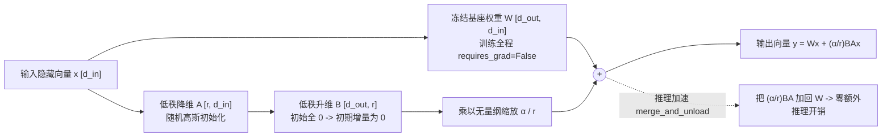

> **生成工具**：Codex\
> **生成模型**：gpt-6.2-sol

在 [TRN-04](https://blog.lacknb.cn/articles/2026/11/22/1795353665754.html) 里，哪怕我们死死冻住前面绝大多数网络层、仅仅解锁最后 4 层做 SFT，依然一次修改了将近 **6,000 万**个权重参数。要是线上同时有退款统计、合同审查、工单分类十个不同业务，难道每上线一个微调版本就要存十套完整的庞大权重文件、启动十个显卡进程吗？

**PEFT（Parameter-Efficient Fine-Tuning，参数高效微调）**解决的就是这个痛点，而其中最经典的方法就是 **LoRA（Low-Rank Adaptation，低秩适配）**：我们继续处理熟悉的退款 CSV `4`、`NA`、`6`（期望 `{"count":2,"mean":5}`），保留完全一样的监督目标，唯一变化是**一根手指头都不碰原始模型权重，只在旁路挂一对超窄矩阵学增量**。[LoRA 原论文](https://arxiv.org/abs/2106.09685)

> **先用大白话讲明白**：**LoRA** 就像**你买了一本几亿字的昂贵精装《大辞典》（基座模型），从不在正页上乱涂乱画，只在需要改写的地方贴一张小小的透明「便利贴补丁（`B × A`）」**：
> - **旁挂支路省参数**：原本这页是一张 `[d_out, d_in]` 的大方形表；现在不改原表 `W`，而是找两个又窄又薄的小条 `A`（先把 `d_in` 维压扁到只有 `r=4` 维）和 `B`（再把 `4` 维拉回到 `d_out` 维）一乘，结果加回原来的输出里。刚出厂时把 `B` 填满 `0`，贴上去的那一刻**输出和原版分毫不差**，不会一上来就破坏模型原有能力！
> - **一份底座跑十个业务（多适配器切换）**：只要在磁盘上存一张只有 **1.04 MiB** 的小便利贴文件（相比完整权重动辄上 GB），推理服务就能让一个基座实时切换不同业务便利贴；如果想跑得更快省掉加法开销，上线前也能调用 `merge_and_unload` 把便利贴永久誊写合进基座正文里。



## 1. 冻结基座：手算一遍低秩增量矩阵加法

以 Transformer 注意力层里的一层线性投影为例（暂时忽略偏置）。假设前面几层把退款 CSV 分词并加工到这一层时，某个 Token 的隐藏向量是 `x`（维度 `[d_in]`），原始线性投影权重矩阵 `W` 的形状是 **`[d_out, d_in]`**，原本输出为 `W × x`（维度 `[d_out]`）。

贴上 **LoRA** 之后，我们把 `W` 设成只读冻结，而在旁边多造两块很瘦的新矩阵 **`A`（形状 `[r, d_in]`）** 和 **`B`（形状 `[d_out, r]`）**。它们俩夹在中间的共同窄边宽度 `r` 称为**秩（Rank）**，它直接决定了整个修正补丁矩阵最多只有多大秩的表达自由度：

```text
y  = W × x + (α / r) × B × (A × x)
ΔW = (α / r) × B × A
```

这里的 `α`（Alpha）是一个无量纲配置超参，`(α / r)` 用来缩放适配支路的贡献强度（这样微调调整秩 `r` 时不必大改学习率）。按照常见默认初始化：**`A` 用小随机数、`B` 用全 `0`**，所以第一毫秒接上时 `ΔW = 0`，不会把基座原本学好的语感吓乱；等正确 JSON 目标 Token 的交叉熵反向传回来时，梯度流过冻结的 `W` 旁路并仅仅更新 `A` 和 `B` 里的数。[PEFT 的 LoRA 配置](https://huggingface.co/docs/peft/package_reference/lora)

来一笔完全能口算的数字检验原理：令 `x = [2, 1]`，原权重 `W` 为二维单位矩阵（`[[1, 0], [0, 1]]`），选定 `r = 1`、`α = 1`。假设训练完得到 `A = [1, -1]`、`B = [0.5, 2]ᵀ`：
1. 输入先过 `A`：把 2 维向量压成 1 维标量 `A × x = 1×2 + (-1)×1 = 1`；
2. 再过 `B` 拉回 2 维：`B × 1 = [0.5, 2]`（再乘以 `α/r = 1` 还是 `[0.5, 2]`）；
3. 加回原本基座输出 `W × x = [2, 1]` -> 最终结果 **`[2.5, 3]`**；
4. 如果把 `ΔW = B × A = [[0.5, -0.5], [2, -2]]` 提前算完加回 `W` 得到合并新矩阵 `[[1.5, -0.5], [2, -1]]`，拿它去乘 `x = [2, 1]`，口算得到 **`[3 - 0.5, 4 - 1] = [2.5, 3]`**——分毫不差！

## 2. 到底省了多少参数？亲手算清目标层公式与 GQA 差异

给一个尺寸为 `[d_out, d_in]` 的线性层插 `LoRA(r)`，新增可训练参数量就是 `A` 和 `B` 的元素数量之和：**`r × d_in + d_out × r = r × (d_in + d_out)`**。

拿到本次实验真实的 `Qwen2.5-0.5B-Instruct` 配置文件一对照 [本实验的 Qwen 配置](https://huggingface.co/Qwen/Qwen2.5-0.5B-Instruct/blob/7ae557604adf67be50417f59c2c2f167def9a775/config.json)：它共有 **`24`** 层，隐藏宽度 `d_in = 896`；我们选每层的 `q_proj`（查询投影）和 `v_proj`（值投影）作为插桩层，取 **`r = 4`**（`lora_alpha = 8`）：
- 你可能会纳闷：同样都是注意力投影，为什么 `q_proj` 的输出宽度是 `896`，而 `v_proj` 的输出宽度只有 **`128`**？这就是 [F-03](https://blog.lacknb.cn/articles/2026/11/20/1795154536776.html) 学过的 **GQA（分组查询注意力）**！Qwen2.5-0.5B 有 14 个查询头（`14 × 64 = 896`），却只配了 **2 个 KV 头（`2 × 64 = 128`）** 让多组查询共享！
- 于是全模型 24 层一共新增的 LoRA 可训练参数准确数字是：

```text
24 × [ 4 × (896 + 896) + 4 × (896 + 128) ] = 24 × [ 7168 + 4096 ] = 270,336
```

PEFT 库打出的结果正是 **`270,336 / 494,303,104 ≈ 0.0547%`** 可训练（分母里也包括刚刚加进去的这 27 万参数）！

> **容易踩的坑（别以为「可训练参数少 99.9%，显存就跟着降到 0.05%」！）**：可训练参数少确实把 **AdamW 优化器状态和梯度** 压缩掉了 99.9%，也极大缩小了保存的适配器体积；**但基座权重本身依然要加载进内存完成前向计算，而且反向传播为了给挂在深层（第 1～24 层）的 LoRA 算梯度，激活值缓存照样穿行整张网络！** 想把静态基座权重的显存也狠砍一半，请看下一篇 [TRN-06《QLoRA、训练量化和部署量化》](trn-06-qlora-quantization.md)。

## 3. 实测验证：微调、禁用开关、磁盘重载与合并还原

下面是实际跑通的工程实验链路：环境锁定 Apple Silicon M1 CPU、PyTorch `2.9.1`、Transformers `4.57.6`、PEFT `0.18.0`，基座固定 `Qwen/Qwen2.5-0.5B-Instruct`（revision `7ae557604adf67be50417f59c2c2f167def9a775`）。训练从 TRN-04 的划分池里取 12 条非全空退款样本，专门把全空语义组彻底留出给验证集，设学习率 `0.001`、单条步进 `12` 步（脚本详见仓库 [experiments/trn-post-training/run_peft.py](experiments/trn-post-training/run_peft.py) 与完整记录 [experiments/trn-post-training/peft-results.json](experiments/trn-post-training/peft-results.json)）。

> **想再深入一层？** 在真实业务部署适配器前，最稳妥的验收不只是看分数有没有变高，而是用 `run_peft.py` 里演示的这几句 PEFT 探针验证身份开关和合并精度：

```python
with torch.no_grad():
    model.set_adapter("default")
    separate = model(probe).logits[:, -1]
    with model.disable_adapter():           # 1. 临时摘下 LoRA，检查是不是瞬间打回基座原形
        frozen = model(probe).logits[:, -1]
    model.set_adapter("reloaded")           # 2. 从磁盘重读刚才保存的 Safetensors 适配器目录
    reloaded = model(probe).logits[:, -1]
# 3. 验证卸载合并后的纯浮点模型跟挂着支路运行时 logits 差值有多小
merged = model.merge_and_unload(safe_merge=True).eval()
```

来看看实测跑出的硬指标对比：
- **训练损失与留出表现**：12 步之间，第 1 步训练损失 `0.9693`，第 8 步降到最低 `0.0306`，第 12 步 `0.1999`（每步是不同样本）。在 6 道留出测试题上，**未微调基座 `0/6`**（全套着 ```` ```json ```` 代码块围栏输出，还有一条把均值算成无限小数截断 `4.66666666666666`）；**LoRA SFT 微调后成功摘掉了围栏，直接输出干净 JSON 并在 `[4, NA, 6]` 拿下 `1/6` 通过**（像 `[None, 0]` 和未见过的 `[None, None]` 因为训练样本仅 12 条且刻意没见过全空表，仍误算了条目数）。

再看四项最关键的适配器工程验真数据（`peft-results.json` 实测原值）：

| 工程检验操作 | 同一探针末位 Token `logits` 最大绝对差 | 实际含义与工程解读 |
| --- | ---: | --- |
| **开启 LoRA vs `disable_adapter()` 摘除** | **`8.325539`** (`base_max_abs`) | 说明短短 12 步微调已经实实在在改变了网络预测分布，且 `disable_adapter` 能干净隔离退回基座。 |
| **内存中 vs 存盘再 `load_adapter` 切回** | **`0.0`** (`reload_max_abs`) | 证明单独打包存下来的适配器文件交到同事硬盘上，一比一零误差复现！ |
| **外挂状态 vs `merge_and_unload` 永久合并** | **`0.0002222`** (`merge_max_abs`) | 在随后跑完 DPO 更新后再做权重永久加回，因为浮点矩阵乘法结合律顺序改变产生了约两万分之二的微小尾数误差，**6 道留出题生成结果完全逐字符一模一样**！ |

> **容易踩的坑**：当你拿着一个共享基座并发服务多条业务线时，千万不能让一个请求调用全球全局的 `model.set_adapter("refund")` 把状态改掉而撞车另一个同时进来的「发票审核」请求！如果推理框架原生支持 per-request 多 LoRA 路由（如 vLLM LoRA 批处理）就用请求级适配器 ID 绑定；否则干脆合并权重跑独立部署实例。[PEFT 的合并与切换接口](https://huggingface.co/docs/peft/package_reference/lora)

本地完整复现命令如下（首次运行会自动下载模型）：

```bash
python3 -m venv /tmp/trn-peft
/tmp/trn-peft/bin/pip install torch==2.9.1 transformers==4.57.6 peft==0.18.0
/tmp/trn-peft/bin/python experiments/trn-post-training/run_peft.py --out /tmp/peft-results.json
```

> **大白话小结**：单独交出一份 LoRA 适配器补丁时，光甩给下游一个 `adapter_model.safetensors` 是不够的！交付清单一并写死：**基座仓库精确 Git revision、分词器与聊天模板版本、注入目标层列表、秩 `r` 和缩放 `alpha`、以及文件哈希校验值**；若对方用的是只认完整权重的推理服务，别忘了额外跑通合并后权重的端到端回归测试。

## 下一篇

LoRA 虽然把可训练补丁压缩到了区区几十万个参数，可那整本 `4.9 亿` 甚至 `700 亿` 字的基座正文依然要花大量显存静静躺在内存里参加每次前向和反传计算。能不能把只读基座顺手压缩打包成 **4-bit**，只留下 16-bit 精度给小便利贴补丁去算梯度？[**TRN-06《QLoRA、训练量化和部署量化》**](trn-06-qlora-quantization.md) 会亲手在 M1 16 GiB 内存上对比 16-bit 与 4-bit 训练内存峰值到底省了多少，并帮你梳理清楚 QLoRA、PTQ、QAT 与 KV Cache 量化的区别！

[返回 LLM 与 Agent 学习路线图](https://blog.lacknb.cn/articles/2026/11/19/1795058329577.html)
