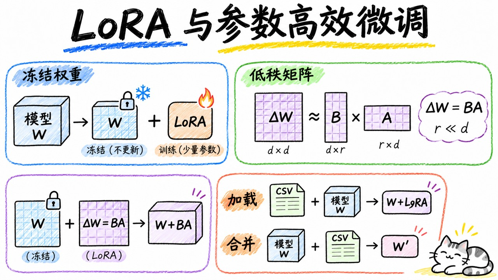

> **生成工具**：Codex\
> **生成模型**：gpt-6.2-sol

退款表有三行 `4`、`NA`、`6`。报表助手应该返回 `{"count":2,"mean":5}`。上一篇把正确回复写入监督标签。现在保留相同的监督目标，只改变哪些参数会更新。PEFT（Parameter-Efficient Fine-Tuning，参数高效微调）泛指只训练一小部分参数的做法。LoRA（Low-Rank Adaptation，低秩适配）给选中的线性层加一条小的可训练支路。 [TRN-04 的监督标签](https://blog.lacknb.cn/articles/2026/11/22/1795353665754.html) · [LoRA 原论文](https://arxiv.org/abs/2106.09685)

## 1. 冻结基座，让增量走一条低秩支路

一层线性投影原本输出 `W × x`。将退款问答经过分词和前面若干层后，某个位置进入投影的隐藏向量记为 `x`，形状为 `[d_in]`。假设权重 `W` 的形状是 `[d_out, d_in]`，输出为 `[d_out]`，忽略偏置。LoRA 增加两个矩阵 `A:[r,d_in]` 和 `B:[d_out,r]`。输入先过 A，再过 B，输出加回原来的结果。

```text
y = W × x + (α/r) × B × (A × x)
ΔW = (α/r) × B × A
```

`r` 是两矩阵之间的维度，也约束增量矩阵的秩上限。学习期间冻结 W，只更新 A 和 B。标准 LoRA 用 `α/r` 缩放，`α` 是无量纲的配置值。常见初始化让 B 从零开始，所以一接上支路，输出仍等于基座输出。训练以正确 JSON 的 Token 损失反传，逐步改变支路对投影结果的贡献。 [PEFT 的 LoRA 配置](https://huggingface.co/docs/peft/package_reference/lora)

取 `x=[2,1]`，W 是两维单位矩阵，`r=1`、`α=1`。设训练后 `A=[1,-1]`，`B=[0.5,2]ᵀ`。A 把两维压成 `2-1=1`，B 把它变回 `[0.5,2]`。原输出 `[2,1]` 加上增量后是 `[2.5,3]`。把 `BA` 提前并入 W 再做乘法，得到同样的值。这里的 2 和 1 是用来手算的隐藏分量，CSV 金额在真实模型里会先经过分词和多层计算。

## 2. 目标层和秩怎么算参数

一个投影新增 `r × (d_in + d_out)` 个参数。Qwen2.5-0.5B Instruct 有 24 层，实验选每层的 `q_proj`（查询投影）和 `v_proj`（值投影）。输入宽度是 896，输出分别为 896 和 128。值投影的输出较窄，是因为该模型让多组查询头共享较少的键和值头。秩取 4，所以 24 层共增加

```text
24 × [4 × (896 + 896) + 4 × (896 + 128)] = 270336
```

PEFT 报告 `270,336 / 494,303,104 ≈ 0.0547%` 可训练。分母包含适配器。增大秩或增加目标层会增大可训练参数与优化器状态。基座仍需参与前向和反传的相应计算，激活与临时缓冲区也占内存。这个比例适合估算更新规模。 [本实验的 Qwen 配置](https://huggingface.co/Qwen/Qwen2.5-0.5B-Instruct/blob/7ae557604adf67be50417f59c2c2f167def9a775/config.json)

## 3. 在同一基座上加载、切换和合并

在 Apple M1 的 CPU（中央处理器）上用 PyTorch 2.9.1、Transformers 4.57.6 和 PEFT 0.18.0 运行。训练使用 12 张退款表，基座版本固定为 `7ae557604adf67be50417f59c2c2f167def9a775`，单步一例，共 12 步。监督微调第一例的损失为 0.9693，第十二例为 0.1999，两例输入不同。六条留出题上，基座通过 0 条，微调后通过 1 条。通过要求输出完整结束且统计 JSON 正确。

| 检查 | 观察 |
| --- | --- |
| 临时关闭适配器 | 同一输入最后位置的 logits 最大绝对变化为 8.3255 |
| 从磁盘重新加载同一适配器并切换 | 同一位置 logits 最大绝对差为 0 |
| 对后续 DPO 更新后的适配器合并 | 最大绝对差约 0.0002222，六条留出生成文本逐条相同 |

Logits 是模型给下一 Token 的原始分数。重新加载验证的是相同适配器从磁盘复原，切换到另一业务适配器时应额外核对适配器身份和输出。合并把增量加进基座权重，浮点运算次序改变会带来小误差。上一行的六条输出一致只覆盖这组输入。共享基座的并发服务如果允许切换适配器，要让每个请求绑定适配器版本，避免并发路由修改全局激活状态。 [PEFT 的合并与切换接口](https://huggingface.co/docs/peft/package_reference/lora)

```bash
python3 -m venv /tmp/trn-peft
/tmp/trn-peft/bin/pip install torch==2.9.1 transformers==4.57.6 peft==0.18.0
/tmp/trn-peft/bin/python experiments/trn-post-training/run_peft.py --out /tmp/peft-results.json
```

独立交付适配器时，清单至少记录基座仓库、精确 revision、分词器及模板、目标层、秩、缩放和产物校验值。对只接收完整权重的推理端，再做合并和加载回归。实验结果包含完整生成文本，适配器权重可由脚本重新生成。 [实验脚本](experiments/trn-post-training/run_peft.py) · [执行结果](experiments/trn-post-training/peft-results.json)

[返回 LLM 与 Agent 学习路线图](https://blog.lacknb.cn/articles/2026/11/19/1795058329577.html)
