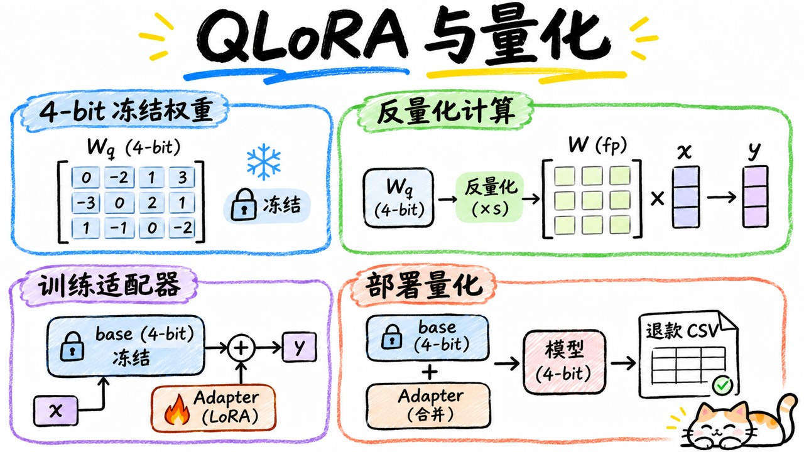

> **生成工具**：Codex\
> **生成模型**：gpt-6.2-sol

退款表仍是 `4`、`NA`、`6`，目标答案是 `{"count":2,"mean":5}`。LoRA 把大部分参数冻结，但前向时仍要读取基座。QLoRA（Quantized Low-Rank Adaptation，量化低秩适配）把冻结基座以更低位宽存储，训练少量浮点低秩参数。这使基座占用的空间变小，同时保留可微调的路径。 [QLoRA 原论文](https://arxiv.org/abs/2305.14314)

## 1. 4-bit 指的是存储编码

4 bit 能表示 16 个编码。用一个简化的线性有符号量化举例，令 `w=[0.12,-0.40,0.65,-1.00]` 为四个无量纲权重，步长 `s=1/7`。将每项除以 `s` 并取最近整数，限制在 `[-7,7]`，得到 `q=[1,-3,5,-7]`。需要计算时，用 `s × q` 恢复近似值，约为 `[0.1429,-0.4286,0.7143,-1.0000]`。输入隐藏向量如果是 `x=[2,1,0,1]`，原权重的点积为 `-1.16`，近似权重的点积为 `-1.1429`。误差来自编码取整。这组权重和隐藏分量用于手算，真实模型的隐藏向量来自前面的各层。

原论文用 NF4（4-bit NormalFloat，四位正态浮点编码），其码点间距适配近似正态分布的权重。论文还用双重量化压缩量化比例，并用分页优化器处理内存峰值。上面的线性例子只展示压缩与重建的关系。本文 Apple Silicon 实验采用 MLX 的分组仿射 4-bit 格式，它按组存编码与缩放、偏移，和 NF4 的码本不同。 [PEFT 量化指南](https://huggingface.co/docs/peft/developer_guides/quantization) · [MLX quantize](https://ml-explore.github.io/mlx/build/html/python/_autosummary/mlx.core.quantize.html)

## 2. 在前向和反传中分别用什么精度

输入同时流过两条支路。基座的内核读取压缩码、由比例等信息得到近似权重，完成乘法。具体内核可能边解码边乘法，不需要为整个模型留一份完整浮点副本。适配器支路在浮点张量上计算低秩增量，然后把结果加回。计算类型取决于硬件和配置，例如 bfloat16 或 float16。它描述算术所用的浮点格式，和基座位宽是两个量。反传要穿过模型计算路径，优化器更新的是 LoRA 矩阵。内存比较需同时看权重与比例、可训练张量、优化器状态、激活以及临时缓冲区。

| 方法 | 量化对象 | 发生时间 | 上线时要核对 |
| --- | --- | --- | --- |
| QLoRA | 微调时冻结的基座权重 | 加载基座或准备训练权重 | 基座、适配器、量化算法、内核 |
| PTQ（Post-Training Quantization，训练后量化） | 训练完成的权重，部分方案也量化激活 | 导出或加载时，可带校准数据 | 产物格式、位宽、设备、推理指标 |
| QAT（Quantization-Aware Training，量化感知训练） | 训练中模拟目标量化误差的张量 | 更新可训练权重时 | 训练仿真与导出算子的匹配程度 |
| KV Cache 量化 | 自回归解码缓存的 Key 和 Value 张量 | 推理生成时 | 缓存格式、长上下文质量、吞吐 |

KV Cache 是推理时缓存过往 Token 的注意力键和值，避免逐步生成时重复计算。模型用了 4-bit 权重，KV Cache 仍可采用另一种精度。选部署方案时，先用目标引擎读取同一产物，再比较业务正确率、长上下文行为、首 Token 延迟和生成速度。 [F-08 的精度与量化](f-08-model-precision-and-quantization.md) · [Transformers 的量化微调说明](https://huggingface.co/docs/transformers/quantization/finetune)

## 3. 同一基座对照 4-bit 与 16-bit

在 Apple M1 16 GiB 统一内存的机器上，用 Unsloth Zoo 的 MLX 后端加载同一个 Qwen2.5-0.5B-Instruct revision。两次使用相同数据、模板、目标层、秩、学习率和更新步数。16-bit 组使用浮点基座，4-bit 组让加载器实际量化线性层，并检查量化元数据里的位数。程序记录基座张量字节数和训练阶段 MLX 分配器峰值。MiB 是二进制兆字节，1 MiB 等于 1,048,576 字节。分配器统计不包括进程在 MLX 之外的全部内存。

| 基座格式 | 基座张量（MiB） | 训练分配峰值（MiB） | 可训练参数 | 基座通过 | 微调通过 |
| --- | ---: | ---: | ---: | ---: | ---: |
| 16-bit 浮点 | 942.29 | 1139.69 | 270,336 | 0/6 | 1/6 |
| 分组 4-bit 仿射 | 451.75 | 652.71 | 270,336 | 0/6 | 2/6 |

本次 4-bit 组用 64 个权重为一个量化组。基座张量字节数含保留的浮点张量和量化元数据，因此全模型平均位宽高于 4。两组都用原始生成文本做 JSON 解析和统计值比较。4-bit 组通过 2 条，16-bit 组通过 1 条。两组都把 `[4, NA, 6]` 错答为 `{"count":2,"mean":4}`。六题短跑适合核对训练链路和内存口径，数据不足以判断哪种精度普遍更好。

运行需使用 TRN-09 的已锁定环境。改成目标环境的位宽后重跑，并核对结果中的 `quantization`、`weight_bytes`、`peak_training_mlx_bytes` 和逐题输出。

```bash
/tmp/trn-mlx/bin/python experiments/trn-post-training/run_unsloth.py --bits 16 --work-dir /tmp/trn-fp16
/tmp/trn-mlx/bin/python experiments/trn-post-training/run_unsloth.py --bits 4 --work-dir /tmp/trn-q4
```

转换部署产物时，把独立适配器和完整合并权重分别验收。若从量化基座反量化后合并，反量化只恢复当时的近似值。如果需要在原始浮点基座上合并量化阶段训练出的适配器，再按部署引擎重新量化，应把这条路径也当成一次模型变更，单独跑留出回归。训练阶段的内存结果仅适用于本次 MLX 格式、模型和配置。 [实验脚本](experiments/trn-post-training/run_unsloth.py) · [16-bit 结果](experiments/trn-post-training/unsloth-fp16-results.json) · [4-bit 结果](experiments/trn-post-training/unsloth-q4-results.json)

[返回 LLM 与 Agent 学习路线图](https://blog.lacknb.cn/articles/2026/11/19/1795058329577.html)
