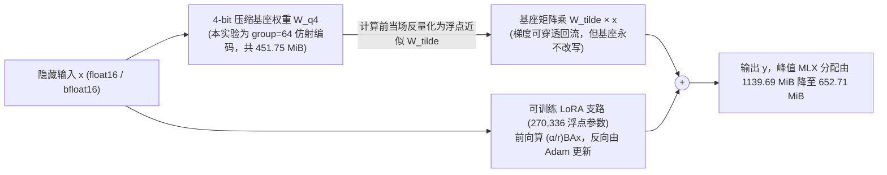

> **生成工具**：Codex\
> **生成模型**：gpt-6.2-sol

在上一篇 [TRN-05](trn-05-lora.md) 里，我们已经靠 LoRA 把需要微调更新的参数压到了千分之零点五，退款任务 `4`、`NA`、`6` 目标依旧是 `{"count":2,"mean":5}`。可一个现实问题还在：哪怕你把基座权重冻成了冰块，训练前向与反向传播时，这整块庞大的基座依然得老老实实住进显存里！7B 模型光 16-bit 基座权重就要约 `14 GB`，要是用普通消费级显卡怎么办？

**QLoRA（Quantized Low-Rank Adaptation，量化低秩适配）**给了一个极其聪明的点子：**反正是只读不改的基座权重，干脆拿 4-bit（每个数只用 4 个二进制位，比 16-bit 省下将近 4 倍空间）压缩打包躺进显存；真轮到哪一层要做矩阵乘法，当场解压回 16-bit 算完就丢，只让旁边那条小小的 LoRA 支路保持浮点去练、去吃更新！** [QLoRA 原论文](https://arxiv.org/abs/2305.14314)

> **先用大白话讲明白**：理解 QLoRA 和各种量化，抓住两个关键区分就行：
> - **「口袋里怎么省地方装（存储位宽）」vs「脑子里怎么打算盘（计算精度）」**：4-bit 并不意味着用 4 比特的粗糙整数直接强算所有连乘加法，而是把几百兆上千兆的只读基座**压缩编码**装进口袋省空间；计算那一步边从口袋抓出来边按缩放标尺还原成 16-bit 浮点数（比如 `float16` / `bfloat16`）正常运算，而旁边的 LoRA 小支路直接全程浮点读写与反传更新！
> - **四种容易搞混的「量化」一眼分清**：**QLoRA** 省的是「微调时冻结基座占的训练显存」；**PTQ（训练后量化）** 是训好了上线前压缩塞进生产推理服务器；**QAT（量化感知训练）** 是微调/训练中途就刻意假装体验低精度截断，让模型早早习惯低位宽；**KV Cache 量化** 则压缩推理阶段越来越长的历史聊天缓存！



## 1. 先手算一组数：4-bit 存储编码是怎么压缩又怎么重建的？

`4` 个二进制位总共只能编排出 **`16`** 种组合（`2^4 = 16` 个格子）。下面挑 4 个无量纲教学权重手算一遍**带符号对称均匀量化**，看清精度损耗从哪儿来：

1. 假设真实浮点权重是 `w = [0.12, -0.40, 0.65, -1.00]`，令缩放步长 `s = 1 / 7`（把 `[-1.0, +1.0]` 映进整数范围 `[-7, +7]`）；
2. 每项除以步长 `s` 并四舍五入取最近整数：`0.12×7=0.84 -> 1`，`-0.40×7=-2.80 -> -3`，`0.65×7=4.55 -> 5`，`-1.00×7=-7 -> -7`。存进硬盘/显存的仅仅是 4 个短短的 4-bit 整数 **`q = [1, -3, 5, -7]`** 外加 1 个缩放比例 `s`！
3. 要做乘法计算时，当场按 `s × q` 重建近似权重：约等于 **`[0.1429, -0.4286, 0.7143, -1.0000]`**；
4. 假设前面隐藏向量传来 `x = [2, 1, 0, 1]`：
   - 原始精确点积：`2×0.12 + 1×(-0.40) + 0×0.65 + 1×(-1.00)` = **`-1.1600`**；
   - 4-bit 重建后点积：`2×0.1429 + 1×(-0.4286) + 0 + 1×(-1.0000)` = **`-1.1429`**。

这 `0.0171` 的小小差值就叫**量化误差**（完全来自刚才取整那一步）。

> **想再深入一层？（两种主流 4-bit 格式差异）**
> 1. **QLoRA 原论文（NF4 + 双重量化 + 分页优化器）**：大语言模型的权重通常呈中间多、两边少的近似正态钟形分布。原论文专门设计了不等间距码本 **NF4（4-bit NormalFloat）**，把珍贵的 16 个编码密集分配在 `0` 附近高精度区；接着还把那一小堆缩放比例自身再做一次 8-bit **双重量化**，配合显存吃紧时把优化器状态自动卸到系统内存的 **分页优化器（Paged Optimizers）**。 [PEFT 量化指南](https://huggingface.co/docs/peft/developer_guides/quantization)
> 2. **Apple Silicon 实验格式（MLX 分组仿射 4-bit）**：今天我们在 Mac 实测用的是 Unsloth Zoo 的 MLX 后端，它采用 `mlx.core.quantize` 的**分组仿射 4-bit**（按每 **64** 个权重分为一组，各记自己的 4-bit 整数码 + 该组缩放系数与偏置），工程码本虽与 NF4 不同，但「分组存短码 + 计算前即时解开」的省空间本质完全一样。 [MLX quantize](https://ml-explore.github.io/mlx/build/html/python/_autosummary/mlx.core.quantize.html)

## 2. 分清前向/反传里的三大精度，并彻底理顺四类常见量化路线

在任何带量化的微调工程里，**存储位宽、算术计算精度、适配器精度**其实是三个独立旋钮：前向算基座那一路时，内核常采用**融合算子**边从显存读 4-bit 短码、边在高速寄存器/片上缓存里当场乘上组缩放还原、直接完成点积（全程不必在显存里完整克隆一份庞大的全模型浮点副本！）；旁边的适配器支路正常按 `float16` / `bfloat16` 等**计算精度**跑 LoRA 增量并加回去。反传梯度从总输出穿透这两条路径，优化器只改那一小把 LoRA 矩阵。

一张表彻底分清整个生命周期里遇到的四种量化工程名词：

| 方案名词 | 到底在量化谁？ | 它在什么阶段动手？ | 上线交付时最需要重点核查什么？ |
| --- | --- | --- | --- |
| **QLoRA** | 微调期间被冻住不更新的**基座权重** | 微调开始加载基座或准备压缩基座时 | 基座权重、LoRA 适配器、所用量化格式和推理引擎内核兼容性 |
| **PTQ（训练后量化）** | **已经训完定型**的完整权重（如 GPTQ/AWQ；部分还会统计激活缩放） | 训练彻底结束后准备打包发布、导入推理引擎时 | 导出格式、`bit` 宽、校准集与目标 GPU/CPU 实际业务指标 |
| **QAT（量化感知训练）** | 训练/微调前向过程中模拟目标低精度截断误差 | 在整个训练步更新权重的过程中 | 训练期用的「假量化（Fake Quant）」规则与上线算子是否严丝合缝 |
| **KV Cache 量化** | 推理自回归时缓存起来避免重算的历次 **Key / Value 注意力张量** | 在线推理逐词吐字期间 | 长上下文问答准确率、幻觉变化与显存并发槽位收益（注意：基座 4-bit 时，KV Cache 完全可以独立选 FP8 或 BF16！） |

想先巩固量化基础概念和精度位宽单位，可对照先修篇 [F-08《模型精度与量化基础》](f-08-model-precision-and-quantization.md) 和 [Transformers 量化微调文档](https://huggingface.co/docs/transformers/quantization/finetune)。

## 3. 同一基座同跑 12 步实测：16-bit vs 4-bit 究竟省下了多少内存？

我们在 **Apple M1 16 GiB 统一内存** 的真机上，借助 Unsloth Zoo 的 MLX 后端加载完全同一份 `Qwen2.5-0.5B-Instruct`（revision `7ae557604adf67be50417f59c2c2f167def9a775`），**除了把基座从 16-bit 浮点换成 4-bit 量化外，12 条训练集、模板、目标层（`q_proj`, `v_proj`）、秩 `4`、学习率 `0.001` 与随机种子 `2026` 全部锁死一字不改**。脚本详见仓库 [experiments/trn-post-training/run_unsloth.py](experiments/trn-post-training/run_unsloth.py)，而且在代码里特意写了一道验真守护断言——强制检查加载完的 `_unsloth_quantization_config` 必须真的写着 `bits: 4`，防止框架偷偷降级成假量化混过实验：

```python
packed = getattr(model, "_unsloth_quantization_config", None)
if args.bits == 4 and (not packed or packed.get("bits") != 4):
    raise RuntimeError(f"没有实际加载 4-bit 权重。实际配置为 {packed!r}")
if args.bits == 16 and packed:
    raise RuntimeError(f"16-bit 对照组加载了量化权重。实际配置为 {packed!r}")
```

两组实验分别独立启动新进程运行，记录基座所有张量字节数以及训练期间 MLX 分配器内存峰值（换算成二进制兆字节 **`MiB`**，`1 MiB = 1,048,576 字节`；注意该峰值统计仅反映 MLX 分配器里的数组占用，不含 Python 解释器其余进程空间），实测战报如下（详见 [16-bit 结果](experiments/trn-post-training/unsloth-fp16-results.json) 与 [4-bit 结果](experiments/trn-post-training/unsloth-q4-results.json)）：

| 基座加载精度 | 实测基座张量 (`weight_bytes`) | 训练 MLX 峰值 (`peak_training_mlx_bytes`) | LoRA 可训练参数 | 微调前基座 (`0..5`留出) | 微调 12 步后 (`0..5`留出) |
| --- | ---: | ---: | ---: | ---: | ---: |
| **16-bit 浮点基座** | `942.29 MiB` (`988,065,536 B`) | `1139.69 MiB` (`1,195,054,587 B`) | `270,336` | `0/6` | `1/6` |
| **分组 4-bit 仿射 (`group=64`)** | **`451.75 MiB`** (`473,689,856 B`) | **`652.71 MiB`** (`684,414,654 B`) | `270,336` | `0/6` | `2/6` |

> **想再深入一层？（为什么 4-bit 模型体积不是 16-bit 的整整四分之一 `1/4`？）**
> 观察表格数字：4-bit 的 `451.75 MiB` 大概是 16-bit `942.29 MiB` 的 **47.9%**，而不是理想化的 `25%`。这里面有两笔实打实的账单：
> 1. 并不是全模型每个角落都量成了 4-bit——词嵌入层（Embedding）、LayerNorm 和部分小层依然保留较高浮点位宽；
> 2. 每 **64** 个权重为一组就必须额外随身带一组量化缩放系数（`scales`）和偏移量（`biases`）元数据！平均算下来全模型实际等效位宽要明显高于纯 `4 bit`。而在 6 道留出题生成验证上，4-bit 组过了 `2/6`（`[None, 9, 5]` 与 `[2, None, 8, 5]` 命中）、16-bit 组过了 `1/6`（`[None, 0]` 命中），但两组都双双把熟悉的 `[4, None, 6]` 错成了 `{"count":2,"mean":4}`——12 步短跑只够用来核实训练管线与省内存幅度的真伪，绝不可借着仅有的 6 道题就吹嘘「4-bit 精度居然比 16-bit 还聪明」。

本地复跑命令（复用 TRN-09 锁定的 Apple Silicon 环境；如果你在其它硬件或不同模型上复验，重跑后重点比对结果 JSON 里的 `quantization`、`weight_bytes`、`peak_training_mlx_bytes` 和逐题文本输出）：

```bash
/tmp/trn-mlx/bin/python experiments/trn-post-training/run_unsloth.py --bits 16 --work-dir /tmp/trn-fp16
/tmp/trn-mlx/bin/python experiments/trn-post-training/run_unsloth.py --bits 4 --work-dir /tmp/trn-q4
```

> **容易踩的坑（交付合并权重时的「近似值复原」与「重合并重回归」坑）**：
> 1. 如果你把 QLoRA 训练出来的 `1.04 MiB` 独立适配器直接**挂到那个 4-bit 压缩基座上合并**（先反量化近似权重加上 `ΔW` 再保存或转量化），注意**反量化只能还原当时有损的 4-bit 近似值**，回不到原始 16-bit 精准度；
> 2. 很多大团队喜欢「训练时用 QLoRA 省卡跑完拿到 1.04 MiB 的小补丁，交付前却把它拿去合进原版洁净无损的 16-bit/BF16 基座里，再交给 vLLM/SGLang 跑另一套 PTQ 部署量化（如 FP8/AWQ）」。请记住：**只要换了合并基座位宽或重新量化方式，这就属于一次不折不扣的模型版本变更！** 切勿假设肯定不会掉分，必须完整重新过一遍业务留出回归集再上线！

## 下一篇

不管是 SFT 还是 LoRA / QLoRA，我们一直在拿「唯一一份标准答案」去硬喂模型（示范正确 JSON）。可有时你手头不止有正确回复，还收集了一大把模型常犯的典型笨错（比如 `{"count":3,"mean":5}` 把 `NA` 也傻傻算进分母里）。能不能把「正确答卷 + 错误答卷」捆成一对教模型「分清好坏偏好」？[**TRN-07《偏好数据、奖励模型与 DPO》**](trn-07-dpo-preference-data.md) 会亲自算清 DPO 公式、并在同一个 Qwen LoRA 权重上实测出一场令人警醒的真实灾难：**为什么优选/劣选排序明明还在 5/6，一开口自由生成却瞬间从 1/6 崩成了 0/6、甚至乱吐 `"谢谢。"` 和 `"4000000..."`？**

[返回 LLM 与 Agent 学习路线图](https://blog.lacknb.cn/articles/2026/11/19/1795058329577.html)
