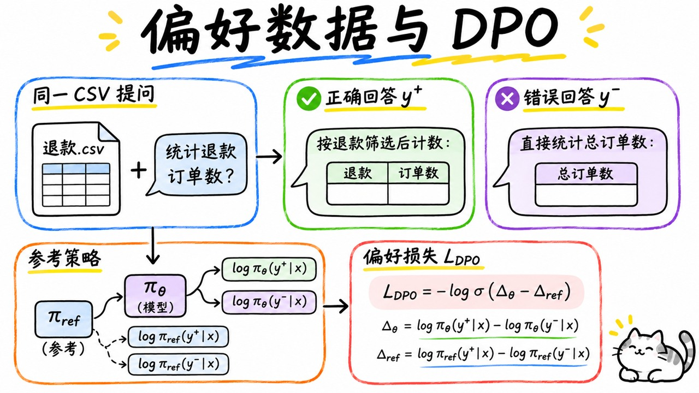

> **生成工具**：Codex\
> **生成模型**：gpt-6.2-sol

给退款助手同一个问题，表里是 `4`、`NA`、`6`。示范答复是 `{"count":2,"mean":5}`。另一份答复 `{"count":3,"mean":5}` 错把缺失行计入条数。监督微调（Supervised Fine-Tuning，SFT）只用示范。偏好训练把错误答复也变成监督，让模型学习面对同一个输入时怎样区分两者。

## 1. 一条偏好样本的三个字段

`prompt` 是角色、CSV 和要求组成的共同输入，`chosen` 是优选回复，`rejected` 是劣选回复。按同一聊天模板把它们拼成两条输入，分别累计助手正文与结束标记的 Token 对数概率。只有回复部分进入比较，提示由模型作为条件读取。本例把劣选的均值保留不动，专门标注缺失值误计。

奖励模型（Reward Model）通常接收提示和候选，输出一个标量分数。可以训练一个模型让优选分数高于劣选，再用该模型为在线采样提供奖励。DPO（Direct Preference Optimization，直接偏好优化）在离线收集的配对数据上直接调整策略参数，用固定参考策略校正已有的相对倾向。当前策略是待更新模型，参考策略通常是它的冻结 SFT 起点。本例在训练前计算并缓存参考分数。 [DPO 论文](https://arxiv.org/abs/2305.18290) · [TRL 的 DPOTrainer](https://huggingface.co/docs/trl/dpo_trainer) · [InstructGPT 的奖励模型](https://arxiv.org/abs/2203.02155)

## 2. 先算回复间隔，再减参考间隔

设 `M = log P(chosen | prompt) - log P(rejected | prompt)`。这里使用自然对数，概率差换算后的间隔单位为 nat。对每种策略先各算一个 `M`，再算 `ΔM = M_current - M_ref`。默认 sigmoid 型 DPO 的单条损失便是

```text
loss = log(1 + exp(-β × ΔM))
```

`β` 是无量纲系数。教学例中参考模型给优选和劣选的序列对数概率是 `-4`、`-5`，间隔为 `1`。当前模型打 `-3`、`-6`，间隔为 `3`。取 `β=0.5` 得 `ΔM=2`，损失约 `0.3133`。若两者初始相同，损失为 `log(2)≈0.6931`。较大的间隔可来自提升优选概率、压低劣选概率，或者两者同时发生。这个目标也可能只教会模型躲开某类难看的错误答案。

## 3. 在留出数据上同时看排名和作答

用 TRN-05 得到的 Qwen LoRA（低秩适配）权重作为起点。12 张训练表各有一对数据，偏好训练跑 12 次更新，`β=0.1`，学习率 `0.0005`。同一基座、同一模板、同一六题留出集。下表的「选优」指限定两个候选时正确答案的对数概率更高，「整题通过」则要求实际生成完整结束且 JSON 的条数和均值正确。

| 模型 | 留出选优 | 整题通过 |
| --- | ---: | ---: |
| LoRA SFT | 5/6 | 1/6 |
| SFT 后接离线 DPO | 5/6 | 0/6 |

`[4, NA, 6]` 的间隔从 `2.625` 升到 `4.878` nat。另一条 `[2, 5, NA]` 从 `3.557` 降到 `-4.476` nat。全空表则从负间隔变为正间隔，两边各一题改变排序，所以合计仍是 5/6。自由生成时出现了数字重复或非 JSON，说明强制比较训练集所覆盖的候选，并不能约束解码器可能生成的所有文本。这是一次小规模单次实验，样本量和更新步数只适合演示训练与验收的区别。 [实验脚本](experiments/trn-post-training/run_peft.py) · [逐题结果](experiments/trn-post-training/peft-results.json)

## 4. 让偏好数据区分业务差错

优劣两边尽量控制格式、长度和语气，避免「篇幅更长」变成偏好的代理特征。只有缺失值错误的劣选覆盖不到均值错误、输出缺键、重复键、数值类型和零值误判。可按错误族补样本，用固定规则先判定可验证字段，再请标注者处理解释完整度等主观部分。排序和自由生成分别汇报，额外保留未参与奖励设计的独立样本。若两项背离，先看失败原文和参考间隔，再决定扩偏好数据还是回退到 SFT。

```bash
python3 -m venv /tmp/trn-peft
/tmp/trn-peft/bin/pip install torch==2.9.1 transformers==4.57.6 peft==0.18.0
/tmp/trn-peft/bin/python experiments/trn-post-training/run_peft.py --out /tmp/peft-results.json
```

[返回 LLM 与 Agent 学习路线图](https://blog.lacknb.cn/articles/2026/11/19/1795058329577.html)
