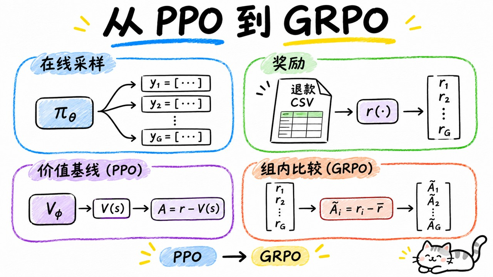

> **生成工具**：Codex\
> **生成模型**：gpt-6.2-sol

退款表有三行 `4`、`NA`、`6`。模型可能答对，也可能把缺失金额算进去。规则程序能重新计算结果，所以我们可以让当前模型先作答，再用程序给它的实际输出打分。强化学习（Reinforcement Learning，RL）在这里就是利用这些反馈更新下一轮的回答概率。**模型的回答从哪里来，分数怎样影响更新**，决定了这条训练链的行为。

## 1. 一轮训练怎样获得反馈

给当前策略一个提示。策略（policy）就是根据提示和已经生成的文字，给下一个 Token 分配概率的语言模型。一次采样生成完整回复，称为一条 rollout（采样轨迹）。回复可以是经过多个 Token 生成的 JSON，奖励器在回复结束后解析整串文本并核验统计。

| 候选 | 有效条数 | 均值 | 核验奖励 |
| --- | ---: | ---: | ---: |
| A | 2 | 5 | 1 |
| B | 3 | 10/3 | 0 |
| C | 1 | 4 | 0 |
| D | 2 | 5 | 1 |

A 和 D 可以是两次采样得到的相同答案。这里的奖励只取 0 或 1，数值均为无量纲。更新时保存采样策略下各回复 Token 的对数概率，再用当前策略重新计算这些概率。经过若干步更新后，把新策略用于下一批采样。这就是在线采样在训练中的含义。上一节 DPO 的输入是提前收集好的偏好对。

PPO（Proximal Policy Optimization，近端策略优化）可以用人工偏好训练出的奖励模型，也可以接可执行规则。RLHF（Reinforcement Learning from Human Feedback，从人类反馈做强化学习）是反馈来源与训练流程的描述。本文用核验程序替代人类偏好奖励模型，集中观察策略更新。 [PPO 原论文](https://arxiv.org/abs/1707.06347) · [InstructGPT 的 RLHF 流程](https://arxiv.org/abs/2203.02155)

## 2. 同一批奖励得到两种优势

优势（advantage）衡量当前回复相对某个基线好多少。假设 PPO 的价值模型在生成前预测最终奖励为 `0.4`。在这个单步教学计算中，用实际奖励减基线，四个优势是 `[0.6, -0.4, -0.4, 0.6]`。真实的 Token 级 PPO 价值模型可对每个部分回复给出估计，并用 GAE（Generalized Advantage Estimation，广义优势估计）组合相邻状态的价值误差，兼顾方差和偏差。

GRPO（Group Relative Policy Optimization，组相对策略优化）用同一提示的多个回复提供基线。本文用总体标准差演示，组均值 `0.5`，标准差 `0.5`。每条的优势为 `(奖励 - 0.5) / 0.5`，得到 `[+1, -1, -1, +1]`。等分组的优势在本例记为零。若同一个提示的四份回答次次全错或全对，组内没有相对差异。实际训练需记录这种组所占比例，核对奖励器、采样多样性和题目难度。具体训练器可配置标准差口径、归一化方式和零方差处理。 [GRPO 原论文](https://arxiv.org/abs/2402.03300) · [TRL GRPOTrainer](https://huggingface.co/docs/trl/grpo_trainer)

## 3. 概率比裁剪怎样生效

记某个已采样 Token 在当前策略下的概率为 `p_new`，在采样策略下的概率为 `p_old`。比值 `r = p_new / p_old` 衡量更新幅度。教学例取裁剪半径 `0.2`，用 `min(r × A, clip(r, 0.8, 1.2) × A)` 得到最大化目标的一项，`A` 表示该项的优势。

例如 A 候选中的一个 Token，`r=1.3`，`A=+1`。原项是 `1.3`，裁剪项为 `1.2`，取 `1.2`。B 候选取 `r=0.7`，`A=-1`，两项为 `-0.7`、`-0.8`，取 `-0.8`。负优势也有对应的受限方向。四项演算得到 `[1.2, -0.8, -1.1, 0.9]`，训练损失通常对最大化目标取负。

固定参考策略可以提供 KL（Kullback–Leibler，库尔贝克–莱布勒散度）约束，帮助限制训练后策略偏离参考分布。采样策略给概率比提供分母，参考策略提供另一条约束，两者的版本和更新方式需要分别记录。归一化按每条回复还是按总 Token，影响不同长度回复的权重。训练记录应注明实际损失实现与 KL 系数。

## 4. 从当前策略采样并更新一次试试

为了复现在线反馈，脚本还训练一个有三个动作的抽样策略。动作分别是把全部行计入、按真假值筛选，以及仅排除缺失值。三条规则生成的统计结果都经过同一核验器。动作由当前三个分数的 Softmax（指数归一化）分布抽出。每组抽四次，算组内优势，再对抽中动作的对数概率求梯度。每组只更新一次，当前策略就是采样策略，更新前概率比为 1，教学版只演示这一点的梯度，不复用旧采样，也没加 KL 惩罚。

固定随机种子 2026 跑 30 组，17 组的奖励标准差为零。正确动作的概率从 30.1% 升到 88.4%，用最高概率动作生成时，四张留出表由 0/4 升到 4/4。这个策略只在三条预定义规则中选择，规则本身是写好的，结果也不代表语言模型学会了写 JSON 或做算术。

## 5. 让留出评测捕获奖励投机

脚本把 `{"count":3,"count":2,"mean":5}` 交给默认 JSON 解析器，后写的 `count` 覆盖前值，于是宽松奖励通过。严格解析器拒绝重复键。这个实测说明训练用规则可能奖励会在另一实现中失败的输出。留出评测应分别统计模式合法、统计正确、回复结束和重复键。再按输出长度分桶，观察通过率是否随冗长输出变化，并保留训练场景之外的问答回归集。

```bash
python3 experiments/trn-post-training/run_toy.py --out /tmp/trn-toy.json
```

把教学策略替换为语言模型时，应保存每批采样的模型版本、候选文本、奖励分项、输出长度、裁剪占比和训练前后的留出结果。后续才能拆分收益来自更好的采样、评分器修复，还是策略更新本身。 [实验脚本](experiments/trn-post-training/run_toy.py) · [执行结果](experiments/trn-post-training/toy-results.json)

[返回 LLM 与 Agent 学习路线图](https://blog.lacknb.cn/articles/2026/11/19/1795058329577.html)
