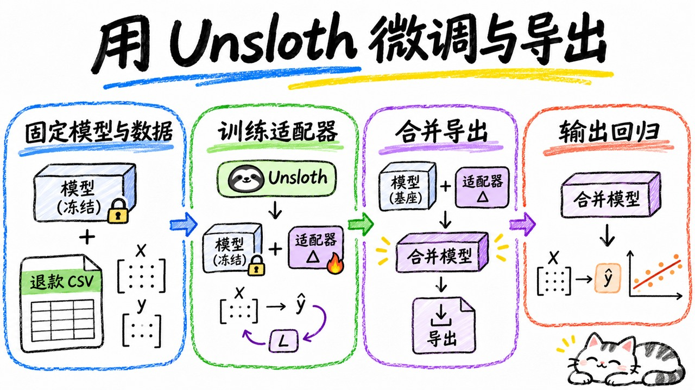

> **生成工具**：Codex\
> **生成模型**：gpt-6.2-sol

实验训练了一个退款 CSV 助手。输入 `4`、`NA`、`6` 时，目标是 `{"count":2,"mean":5}`。训练结束后，还要检查收下适配器的同事能否复原这次实验，以及只接收完整模型的服务能否用合并权重得到同样结果。本次在 Apple M1 上使用 Unsloth Zoo 的 MLX 训练后端，MLX 是面向 Apple Silicon 的数组和机器学习框架。 [Unsloth 项目](https://github.com/unslothai/unsloth) · [Unsloth 官方 Apple Silicon 测试流程](https://github.com/unslothai/unsloth/blob/f242fb9a248e200ba830bec42df3125a155511e2/.github/workflows/mlx-ci.yml)

## 1. 先固定模型、模板和数据合同

在 PyTorch 路线中，Transformers 提供模型和分词器，PEFT 注入 LoRA（低秩适配）并负责适配器读写，TRL 提供 SFT（监督微调）等训练器。Unsloth 在适用的后端为加载、注入、训练和导出提供接口。这里的 Apple Silicon 进程由 `mlx-lm` 承担底层文本模型，Unsloth Zoo 的 `FastMLXModel` 和 `MLXTrainer` 提供适配与训练流程。Transformers 仍参与分词器和聊天模板。两种后端的适配器文件都可能采用 Safetensors 容器，适配器配置、权重命名和布局要按加载器验证。 [TRL 的 SFTTrainer](https://huggingface.co/docs/trl/sft_trainer) · [Unsloth MLX 训练器源码](https://github.com/unslothai/unsloth-zoo/blob/f0be6ab5930fda798956f2f8fce0cfbb018ebdbf/unsloth_zoo/mlx/trainer.py)

| 项 | 本例口径 |
| --- | --- |
| 基座与分词器 | Qwen/Qwen2.5-0.5B-Instruct，revision 为 `7ae557604adf67be50417f59c2c2f167def9a775` |
| 训练与留出 | 12 张训练表，6 张留出表，包含全空和零值 |
| 模板 | 使用模型自带模板，训练时附完整回复，推理时只附助手开始标记 |
| 更新 | 每步 1 张表，共 12 步，学习率 0.001，种子 2026 |
| 适配器 | `q_proj`、`v_proj`，秩 4，`lora_alpha=8` |

训练行由同一模板分别渲染推理前缀和完整对话，确认前缀 Token 与完整对话对齐之后拆成 `prompt` 和 `completion`。训练器通过 `completion_only_loss=True` 屏蔽提示。回复以模板自带的结束标记收尾，关闭 `append_eos` 避免再附一个结束 Token。复用模板时用实际 Token 序列核对边界，并检查截断是否切掉答案。推理沿用同一前缀，生成预算最多 32 Token。

## 2. 运行、保存和重新加载

以下命令在 Apple Silicon 上建立独立的 Python 3.12 环境。安装包的 Git revision 固定到执行版本。模型首次运行会从 Hugging Face 下载，随后可用本地缓存复现。两个训练命令分别运行 16-bit 和 4-bit 基座，独立进程让峰值统计更容易比较。

```bash
python3.12 -m venv /tmp/trn-mlx
/tmp/trn-mlx/bin/pip install \
    'unsloth-zoo[mlx] @ git+https://github.com/unslothai/unsloth-zoo.git@f0be6ab5930fda798956f2f8fce0cfbb018ebdbf' \
    mlx==0.32.4 mlx-lm==0.32.2 transformers==5.18.0 torch==2.9.1
/tmp/trn-mlx/bin/python experiments/trn-post-training/run_unsloth.py --bits 16 --work-dir /tmp/trn-fp16
/tmp/trn-mlx/bin/python experiments/trn-post-training/run_unsloth.py --bits 4 --work-dir /tmp/trn-q4
```

`save_pretrained_merged(..., save_method="lora")` 写出适配器及配置，下载方仍要取得指定基座。实际脚本调用 `FastMLXModel.from_pretrained` 从适配器目录重新加载。16-bit 分支还调用 `save_method="merged_16bit"`，把增量合并成一套可直接加载的浮点权重，再用标准 `mlx_lm.load` 复验。4-bit 何时合并、合并后是否重新量化，应按部署路径选择和验证。 [Unsloth MLX 导出实现](https://github.com/unslothai/unsloth-zoo/blob/f0be6ab5930fda798956f2f8fce0cfbb018ebdbf/unsloth_zoo/mlx/utils.py) · [MLX LM 的适配器与融合说明](https://github.com/ml-explore/mlx-lm/blob/main/mlx_lm/LORA.md)

## 3. 用相同输入对照导出前后

| 路径 | 留出通过 | 与本组内存中微调模型的输出一致 |
| --- | ---: | ---: |
| 16-bit 基座 | 0/6 | — |
| 16-bit 微调后，内存中 | 1/6 | 6/6 |
| 16-bit 重新加载独立适配器 | 1/6 | 6/6 |
| 16-bit 合并权重重新加载 | 1/6 | 6/6 |
| 4-bit 基座 | 0/6 | — |
| 4-bit 微调后，内存中 | 2/6 | 6/6 |
| 4-bit 重新加载独立适配器 | 2/6 | 6/6 |

两个适配器的 Safetensors 文件各约 1.04 MiB。16-bit 完整合并权重约 942.41 MiB，以上体积只计权重文件。导出复验成功意味着这个版本的生成结果可以复现。六题里仍有多条算错，例如 `[4, NA, 6]` 两组都生成均值 4，所以这次导出仅做教学验收。真实报表的统计结果仍可直接由确定性程序取得。

每条生成保存原文。通过条件是输出可解析为 JSON 对象，且两个值等于程序计算的期望，因此业务通过率和导出前后文本一致率分别汇报。这里是验证加载、监督、训练、保存和推理完整可跑的短实验。部署前还需要用实际推理引擎重跑模板和停止检查，并根据服务目标扩大业务回归集。权重目录若需转交，随附模型 revision、模板版本、适配器配置、哈希和回归结果。 [实验脚本](experiments/trn-post-training/run_unsloth.py) · [16-bit 结果](experiments/trn-post-training/unsloth-fp16-results.json) · [4-bit 结果](experiments/trn-post-training/unsloth-q4-results.json)

[返回 LLM 与 Agent 学习路线图](https://blog.lacknb.cn/articles/2026/11/19/1795058329577.html)
