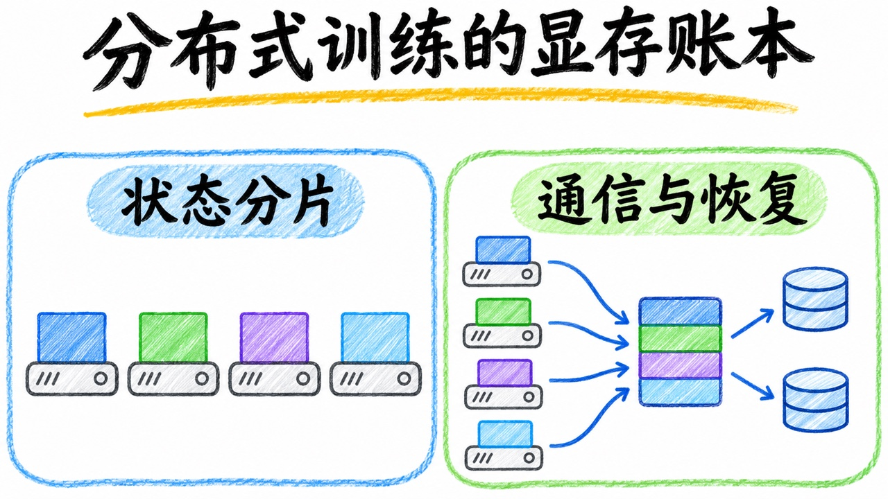

> **生成工具**：Codex\
> **生成模型**：gpt-6.2-sol

[TRN-02](trn-02-tiny-language-model.md) 带我们拿 `14,496` 个参数的微型模型跑了 60 步。当时单张内存里同时养着它，风平浪静。可如果你换成几十亿参数的大模型、准备了 4 张甚至 8 张加速卡：
- 普通的并行方式（**DDP，分布式数据并行**）只是让每张卡分着读不同样本，结果**每张卡肚子里依然孤零零塞着一模一样、全套完整的模型权重、梯度和巨型优化器状态**，显存一点没省下来！
- 那如果每张卡只存 1/N 的碎权重切片，真轮到计算某一层时，拿不到另一半权重还怎么乘？

这就是 **FSDP（Fully Sharded Data Parallel，全分片数据并行）** 和 **ZeRO（Zero Redundancy Optimizer，零冗余优化器）** 登场的舞台——一句话概括就是：**平时各管各的一截分片省显存，算到当前这一层时临时借来拼齐，算完立刻拆开只留自己负责那截更新**。注意本篇在双 CPU 进程上精确复现字节账本和分布式续训逻辑；至于真实 GPU 卡的显存峰值与多卡吞吐，必须拿到目标 GPU 环境下实测。[PyTorch FSDP2](https://docs.pytorch.org/docs/2.11/distributed.fsdp.fully_shard.html) · [ZeRO 原论文](https://arxiv.org/abs/1910.02054)

> **先用大白话讲明白**：把分布式训练想象成**4 个人合作抄改一本 400 页的厚账本**：
> - **传统 DDP（每人手里抱一整本复制品）**：4 个人各看 2 行数据写批注（算梯度），最后喊一嗓子 **All-reduce** 把批注平均一遍，4 个人各自全本修改。结果每个人桌子上都要腾出放 400 页的空间！
> - **ZeRO-1 / ZeRO-2 / FSDP(ZeRO-3)（只抱 100 页分片，用时借来抄完就还）**：
>   1. **前向 / 反向借拼（All-gather）**：平时每个人桌面上只摆自己负责的那 1/4（比如 Rank 0 拿着 `[w0, w1]`，Rank 1 拿着 `[w2, w3]`）。算到这一层时，通过 **All-gather（全收集）** 互相借看拼回完整 `[w0, w1, w2, w3]` 算出答案，算完马上撕掉借来的副本腾出桌面（`reshard_after_forward=True`）。
>   2. **汇总切分批注（Reduce-scatter）**：反向算完各自心里的全部 4 个修改建议（梯度 `[2,4,6,8]` vs `[4,6,8,10]`），通过 **Reduce-scatter（规约散发）** 一边求平均、一边精准按归属分包发还——Rank 0 只拿 `[3, 5]`、Rank 1 只拿 `[7, 9]`，立刻扔掉不属于自己的另外一半梯度！
>   3. **各改各的一截**：Rank 0 和 Rank 1 在自己桌面用本地的 AdamW 优化器状态，只悄悄更新手里握着的那几页权重。哪怕总共有上千亿参数，只要卡够多，单卡常驻的「模型状态」显存直接除成 `1/N`！


## 1. 先算一笔明账：单卡内存里到底塞了哪五大块？

沿用 [TRN-02](trn-02-tiny-language-model.md) 的 `14,496` 参数纯 **FP32**（32 位单精度浮点数，每个数字占 **4 字节**）模型，一次性处理批大小 `B=2`、长度 `T=6`、隐藏宽度 `H=32` 的输入。做一次优化器更新，设备内存里真正被吃掉的空间由下面五项构成：

| 显存账目科目 | 训练过程中谁读写、啥时候释放？ | 本微型模型的准确字节计算 |
| --- | --- | --- |
| **模型权重（Parameters）** | 前向和反向都读，优化器步改写 | `14,496` 个 FP32 元素 × 4 字节 = **`57,984` 字节** |
| **参数梯度（Gradients）** | 反向算出，供优化器更新，步末可清 | 等长 FP32 张量，仍占 **`57,984` 字节** |
| **优化器状态（AdamW Moments）** | AdamW 为每个参数维护一阶动量和二阶方差 | 两个等长 FP32 张量 = **`115,968` 字节**（外加每张量一个步数标量） |
| **激活值（Activations）** | 前向产出的中间层输出，供反向算梯度重用 | 例如单单 `[2, 6, 32]` 的 FP32 激活张量就是 `1,536` 字节，全网还会叠加多处 |
| **临时缓冲区（Workspace & Buffers）** | 算子内部暂存区、通信收发缓存、临时聚合权重、PyTorch 内存池碎片 | 随硬件算子、分片粒度、通信预取深度动态波动 |

把最稳固的前三大项「**参数 + 梯度 + AdamW 两条状态**」一相加：每个参数整整吃了 **`4 + 4 + 8 = 16` 字节**，总账正好 **`231,936` 字节（226.5 KiB**，注：`1 KiB = 1,024 字节`**）**！

> **想再深入一层？** 遇到 **混合精度训练（Mixed Precision, FP16/BF16 + FP32 主权重）** 时，巧合的是「每参数总模型状态字节数」经常还是 16 字节，只是配方换成了：`2 字节` 计算权重 + `2 字节` 梯度 + `4 字节` FP32 精确备份主权重 + `8 字节` FP32 的 Adam 两份矩状态。FSDP2 既支持拿低精度传算子、又允许拿着原生精度的切分状态各自更新；而在另一端，如果大模型里**激活值（Activations）**爆掉显存（长上下文特别明显），常用**激活重计算（Activation Checkpointing）**——前向时不保留中间层激活，等反向需要用到再临时重算一遍，换算力省显存（注意它跟写磁盘的 Checkpoint 检查点毫无关系！）。[FSDP2 混合精度配置](https://docs.pytorch.org/docs/2.11/distributed.fsdp.fully_shard.html)

## 2. ZeRO-1 / ZeRO-2 / ZeRO-3(FSDP)：切到哪一刀，单卡省多少？

**Rank** 指分布式进程池里的编号（例如 4 张卡是 `rank 0..3`，总进程数 `world_size = N = 4`）。拿这 `231,936` 字节固定状态对比四代并行策略（暂略步数标量与碎片）：

| 并行策略 | 参数常驻方式 | 梯度常驻方式 | AdamW 矩状态 | 本例每 Rank 理论均值 | 通讯开销直觉 |
| --- | --- | --- | --- | ---: | --- |
| **单设备 / 传统 DDP** | 完整 1 份 | 完整 1 份 | 完整 1 份 | `231,936` 字节 | 每步梯度做 1 次 `All-reduce` |
| **ZeRO-1** | 完整 1 份 | 完整 1 份 | **切 `N` 份** | `144,960` 字节 | 分开更新各自权重后同步回完整权重 |
| **ZeRO-2** | 完整 1 份 | **切 `N` 份** | **切 `N` 份** | `101,472` 字节 | 反向 `Reduce-scatter` 梯度分片 + 同步权重 |
| **ZeRO-3 / 全分片 FSDP** | **切 `N` 份** | **切 `N` 份** | **切 `N` 份** | **`57,984` 字节** | 按层/模块随时 `All-gather` + `Reduce-scatter` |

算一遍 ZeRO-2 校验数字：`57,984 + (57,984 + 115,968) ÷ 4 = 101,472` 字节，严丝合缝！真正训百亿模型时也不会把全网揉成一坨去收集，而是**把每层 Transformer Block 包成一个个小 FSDP 单元**——算第 2 层时同步预取第 3 层的分片，用通信掩盖计算时间。[DeepSpeed ZeRO 阶段定义与配置](https://deepspeed.readthedocs.io/en/latest/zero3.html) · [PyTorch FSDP2 的分片与通信](https://docs.pytorch.org/docs/2.11/distributed.fsdp.fully_shard.html)

## 3. 动手实测：双 CPU 进程验证「真分片减半」与「同轨迹续训」

把 [TRN-01](https://blog.lacknb.cn/articles/2026/11/21/1795272443691.html) 的 `train.bin`、`manifest.json` 以及 [TRN-02](trn-02-tiny-language-model.md) 的 `train_tiny.py` 放在同一个空目录（沿用 Python 3.12 + PyTorch 2.11.0）。今天让单进程一次吞 `2` 行，和双进程每个 rank 各自吞 `1` 行来一场极限严谨对比——两边的**全局有效批次（Global Batch）都是完全一样的 2 行**！

在目录里保存下面这段 `shard_demo.py`。它使用 PyTorch 的 CPU 集合通信后端 **Gloo**，并用 **DCP（Distributed Checkpoint，PyTorch 分布式检查点）** 保存/还原跨进程分片状态：

```python
from datetime import timedelta
import json
import os
from pathlib import Path

import torch
import torch.distributed as dist
import torch.distributed.checkpoint as dcp
from torch.distributed.checkpoint.state_dict import get_state_dict, set_state_dict
from torch.distributed.device_mesh import init_device_mesh
from torch.distributed.fsdp import fully_shard
from torch.distributed.tensor import DTensor

from train_tiny import IGNORE, TinyLM, batch, load_shard, summed_loss


def tensor_bytes(tensor):
    local = tensor.to_local() if isinstance(tensor, DTensor) else tensor
    return local.numel() * local.element_size()


def ledger(model, optimizer):
    states = optimizer.state.values()
    moments = sum(tensor_bytes(state[key]) for state in states
                  for key in ("exp_avg", "exp_avg_sq"))
    return {
        "parameters": sum(tensor_bytes(p) for p in model.parameters()),
        "gradients": sum(tensor_bytes(p.grad) for p in model.parameters()),
        "adam_moments": moments,
        "adam_steps": sum(tensor_bytes(state["step"]) for state in states),
    }


def build(vocab, mesh):
    torch.manual_seed(2026)
    model = TinyLM(vocab)
    if mesh is not None:
        fully_shard(model, mesh=mesh, reshard_after_forward=True)
    return model, torch.optim.AdamW(model.parameters(), lr=0.003, eps=1e-5, foreach=False)


def update(model, optimizer, shard, step, rank, world):
    starts = torch.tensor([0, 6] if step == 1 else [1, 7])
    x, y, mask = batch(shard, starts[rank::world])
    valid = y.ne(IGNORE).sum()
    if world > 1:
        dist.all_reduce(valid, op=dist.ReduceOp.SUM)
    optimizer.zero_grad(set_to_none=True)
    # FSDP averages gradients over ranks. Scale the local numerator by world.
    (summed_loss(model, x, y, mask) * world / int(valid)).backward()
    optimizer.step()


def snapshot(model, optimizer, step):
    weights, state = get_state_dict(model, optimizer)
    return {"model": weights, "optimizer": state, "step": torch.tensor(step)}


def train(rank, world):
    manifest = json.loads(Path("manifest.json").read_text())
    vocab = manifest["vocab_size"]
    data = load_shard(Path("."), "train.bin", manifest["shards"]["train.bin"], vocab)
    mesh = init_device_mesh("cpu", (world,)) if world > 1 else None
    model, opt = build(vocab, mesh)

    update(model, opt, data, 1, rank, world)
    print(json.dumps({"world": world, "rank": rank, **ledger(model, opt)}), flush=True)

    if world == 1:
        update(model, opt, data, 2, rank, world)
        torch.save(model.state_dict(), "single-reference.pt")
        return

    dcp.save(snapshot(model, opt, 1), checkpoint_id="sharded-ckpt")
    resumed, resumed_opt = build(vocab, mesh)
    state = snapshot(resumed, resumed_opt, 0)
    dcp.load(state, checkpoint_id="sharded-ckpt")
    set_state_dict(resumed, resumed_opt,
                   model_state_dict=state["model"], optim_state_dict=state["optimizer"])
    assert state["step"].item() == 1

    update(model, opt, data, 2, rank, world)
    update(resumed, resumed_opt, data, 2, rank, world)
    for direct, restored in zip(model.parameters(), resumed.parameters()):
        assert torch.equal(direct.to_local(), restored.to_local())

    single = torch.load("single-reference.pt", weights_only=True, map_location="cpu")
    max_diff = 0.0
    for name, param in model.named_parameters():
        global_param = param.full_tensor().detach()
        max_diff = max(max_diff, float((global_param - single[name]).abs().max()))
        torch.testing.assert_close(global_param, single[name], atol=2e-6, rtol=2e-5)
    if rank == 0:
        print(json.dumps({"resume_exact": True, "global_batch": 2,
                          "max_diff_from_single": max_diff}), flush=True)


def main():
    torch.set_num_threads(1)
    world = int(os.environ.get("WORLD_SIZE", "1"))
    if world not in (1, 2):
        raise ValueError("run with one process or two")
    if world == 1:
        train(0, 1)
        return
    dist.init_process_group("gloo", timeout=timedelta(seconds=30))
    try:
        train(dist.get_rank(), world)
    finally:
        dist.destroy_process_group()


if __name__ == "__main__":
    main()
```

先单进程跑一次留出黄金参考 `single-reference.pt`，紧接着用 `torchrun` 拉起 2 个本机进程跑对照实验（macOS 回环网卡写 `lo0`，Linux 一般写 `lo`）：

```bash
python shard_demo.py
GLOO_SOCKET_IFNAME=lo0 torchrun --master-addr=127.0.0.1 --master-port=29649 \
  --nproc-per-node=2 shard_demo.py
```

> **容易踩的坑**：
> 1. **在第 107 行写错损失缩放倍数**：FSDP 在反向 `Reduce-scatter` 时默认把两张卡各自的本地梯度**除以进程数 `world`（求平均）**！如果两张卡上有效预测标签数一个 `6` 个、一个 `5` 个（`all_reduce` 得到全局总和 `11`），各卡传损失时必须把分母写对——分子先乘以 `world`，再除以全局总有效数 `11`，才能跟单卡合算一遍 `total_loss / 11` 分毫不差！
> 2. **只看初始化完就测内存**：PyTorch 的 AdamW 往往到真正跑过第 1 次 `optimizer.step()` 时才延迟申请动量张量，开局刚建完对象统计会严重低估真实开销！

实测第 1 步完成瞬间（梯度尚未清空），本地物理张量字节分布精准切半：

| 实测本地载荷 | 单进程 | FSDP 两进程，每个 Rank |
| --- | ---: | ---: |
| 模型参数 (`parameters`) | `57,984` 字节 | **`28,992` 字节**（减半！） |
| 参数梯度 (`gradients`) | `57,984` 字节 | **`28,992` 字节**（减半！） |
| AdamW 两份动量 (`exp_avg` + `exp_avg_sq`) | `115,968` 字节 | **`57,984` 字节**（减半！） |
| AdamW 步数标量 (`adam_steps`) | `68` 字节 | `68` 字节（每个切分后分片张量依然带一个小标量） |

更关键的检验在后面：双进程在第 1 步写下分片检查点并重建新模型加载续训跑到第 2 步，跟不中断直跑的两进程**本地分片逐字节完全一致**；把它聚合还原跟单进程基准 `single-reference.pt` 对比，最大元素级误差仅仅 **`2.61 × 10⁻⁷`**！

## 4. 分片检查点到底要怎么存、怎么接回？

上面用的是 PyTorch 原生 **DCP（Distributed Checkpoint）** [PyTorch 2.11 Distributed Checkpoint](https://docs.pytorch.org/docs/2.11/distributed.checkpoint.html)：每个 Rank 各自高效写出分片文件夹，恢复时先捏出空的分片模型壳与空优化器字典结构交给 `dcp.load()`，再通过 `set_state_dict()` 注回状态。生产级作业里还记得带上学习率调度器、数据流偏移位置、RNG 种子和混合精度 `GradScaler`。如果要临时从 4 卡扩/缩到 8 卡加载同一份检查点（Resharding），DCP 虽然支持按新拓扑映射加载，改完 `world_size` 后依然要亲自核验学习语义与步数偏移。

若用 **DeepSpeed ZeRO**，各进程也是联合写入分片存档；特别记住官方文档提示：ZeRO-3 在中途保存完要是立刻要读回来续训，通常建议**重新初始化分布式引擎后再加载存档**；如果想拿去单卡推理，记得跑一遍官方提供的合并脚本拼出一整份干净权重。[DeepSpeed 检查点与权重导出](https://deepspeed.readthedocs.io/en/latest/model-checkpointing.html)

## 5. 上真实 GPU 压测显存峰值与吞吐时的 4 条铁律

真金白银买来多卡 GPU 做实测对照（比如单卡 vs DDP vs FSDP2 vs ZeRO-3）时，想要拿出一份经得起挑刺的压测报表，严格遵守以下 4 步：
1. **锁死全局有效工作量**：始终保证「单卡微批数 × Rank 数 × 梯度累积步数 = 相同的全局样本数（若含 `-100` 忽略位，对齐全局有效 Token 数与损失分母）」；
2. **热身后清零指标再测真峰值**：至少跑完一次 `optimizer.step()` 触发 AdamW 状态和缓存创建 -> 所有 Rank 障碍同步 -> 调 `torch.cuda.reset_peak_memory_stats()` -> 跑几步后再同步读取 `torch.cuda.max_memory_allocated()`（取各卡最大值）与 `max_memory_reserved()`（分清张量真用掉多少 vs 内存池占位多少）；
3. **吞吐只算最慢木桶的真实耗时**：整段同步起止，用「全局有效 Token 总数 ÷ **最慢那个 Rank** 的挂钟秒数」算出实际 `Tokens/s`，写 Checkpoint 的磁盘 IO 耗时必须单列账；
4. **必须做一次中断续训对齐检验**，确保没因为存错格式毁掉几十万电费跑出来的存档。[PyTorch CUDA 内存说明](https://docs.pytorch.org/docs/2.11/notes/cuda.html#cuda-memory-management)

## 下一篇

算清楚底层分片与显存账本，现在正式把目光从「怎么喂饱显卡」转回「模型究竟该学什么」！拿到业务手册原文、标准问答对、优选劣选对比数据——模型到底该做**继续预训练（Continued Pretraining）**、**监督微调（SFT）**，还是**偏好优化（DPO）**？它们分别改的是哪个能力、又怎样和 LoRA/全参更新范围解耦？[**TRN-03《选继续预训练、SFT 还是偏好优化》**](trn-03-training-objectives.md) 会用同一个基座分跑三条支线亲眼比对！ [LLM 与 Agent 学习路线图](https://blog.lacknb.cn/articles/2026/11/19/1795058329577.html)
