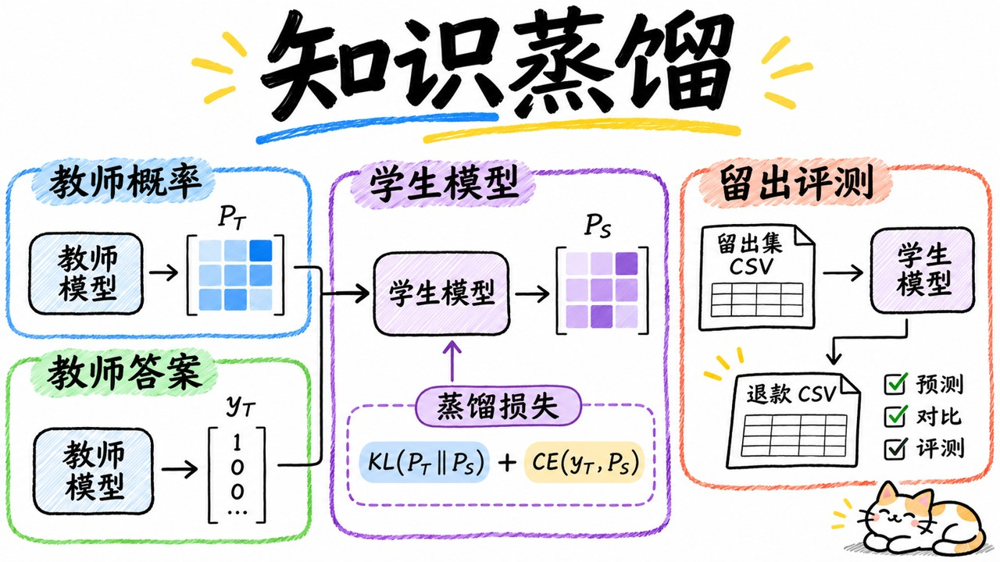

> **生成工具**：Codex\
> **生成模型**：gpt-6.2-sol

退款 CSV 中的 `0` 是有效金额，`NA` 是缺失值。设一个较强的教师模型知道这条规则，小模型准备接手。我们可以让它模仿老师的最终答案，也可以让它学习老师对每个选项的概率。知识蒸馏（Knowledge Distillation）是把教师这种额外监督交给学生的训练方法。教师和学生的模型可以不同，但必须说清学生在模仿哪个输出。 [知识蒸馏论文](https://arxiv.org/abs/1503.02531)

## 1. 同一份退款 CSV 的两种教师信号

表里是 `4`、`NA`、`6`。逐行判断有效的正确标签为 `[1, 0, 1]`，程序随后聚合成 `{"count":2,"mean":5}`。

| 路径 | 学生看到的监督 | 训练目标 |
| --- | --- | --- |
| 硬标签 | 每行是有效或缺失 | 提升正确类别的概率 |
| 软标签 | 每行的有效概率为 `[0.9, 0.1, 0.9]` | 学生概率分布贴近教师分布 |
| 教师答案 | 教师生成的完整 JSON | 对教师文本做监督微调，提高其 Token 概率 |

如果只能使用教师生成的答案，就保存原始输入、教师模型版本、采样设置和程序校验结果。这种路径可跨分词器，在学生侧重新分词。若直接模仿下一 Token 分布，教师和学生的词表与 Token 位置必须有明确对齐规则。蒸馏时用同一个固定前缀为两者打分，避免把不同条件下的概率直接相减。教师接口只返回少量候选时，还需说明如何处理缺失的概率质量。

## 2. 从分数到概率，再到学生损失

Logit 是模型分给一个类别的未归一化分数。教师对两类给出 `[2, 0]`。除以温度 `T` 再做 Softmax（指数归一化）后，`T=1` 的第一类概率约为 `0.8808`，`T=2` 时约 `0.7311`。标量温度作用于整个类别轴，越大时概率分布越平滑。学生也使用同一温度产生概率，计算教师到学生的 KL 散度。经典混合目标可写成

```text
L = (1 - λ) × CE(硬标签, 学生 T=1) + λ × T² × KL(教师 T || 学生 T)
```

`CE` 是交叉熵，`KL` 是库尔贝克–莱布勒散度，双方分布都以同一类别为索引。用自然对数时损失以 nat 计。系数 `λ` 在 0 到 1 之间，决定两个损失的相对权重，`T²` 补偿升温对梯度幅度的影响。本文的最小实验直接使用给定软概率，温度视为 1。教师分布固定时，软交叉熵和 `KL(教师 || 学生)` 仅差一个与学生无关的教师熵，两者对学生的梯度一致。

## 3. 固定学生和预算跑一次对照

学生只有两个权重，输入特征为「这一行有金额」和「这一行是非零金额」，两者分别用 `+1/-1` 编码。零金额的特征为 `[+1,-1]`，缺失行是 `[-1,-1]`。两个实验都从全零权重出发，用同一批四张训练表迭代 100 步。硬标签分支用 `1/0`，软标签分支用预设教师的 `0.9/0.1`。预测概率过半才计入金额，统计汇总由同一程序完成。

| 学生监督 | 留出表整表通过 | 对教师概率的均方误差 |
| --- | ---: | ---: |
| 硬标签 | 4/4 | 0.007519 |
| 软标签 | 4/4 | 0.00001549 |

均方误差在留出表的全部行上计算，衡量与预设教师概率的接近程度。两个学生都能正确处理 `[4, NA, 6]`、`[NA, 0]`、全空和零混合表。软标签让教师概率误差变小，整表结果保持相同。训练表与留出表完整输入不同，但二者共享零、缺失和非零三种行类型。这个实验验证了信号怎样改变学生，不支持跨分布泛化或通用能力结论。

```bash
python3 experiments/trn-post-training/run_toy.py --out /tmp/trn-toy.json
```

对生成式模型做同样比较，可共享任务输入、学生起点与训练 Token 预算，分别保留人工答案和校验通过的教师答案。业务表正确、格式正确、通用问答回归与教师调用成本各自记录。若比较概率蒸馏，还要记教师前向次数、分布保存体积和词表处理。这个教学程序使用离线规则教师，对外调用次数为零。 [实验脚本](experiments/trn-post-training/run_toy.py) · [执行结果](experiments/trn-post-training/toy-results.json)

[返回 LLM 与 Agent 学习路线图](https://blog.lacknb.cn/articles/2026/11/19/1795058329577.html)
