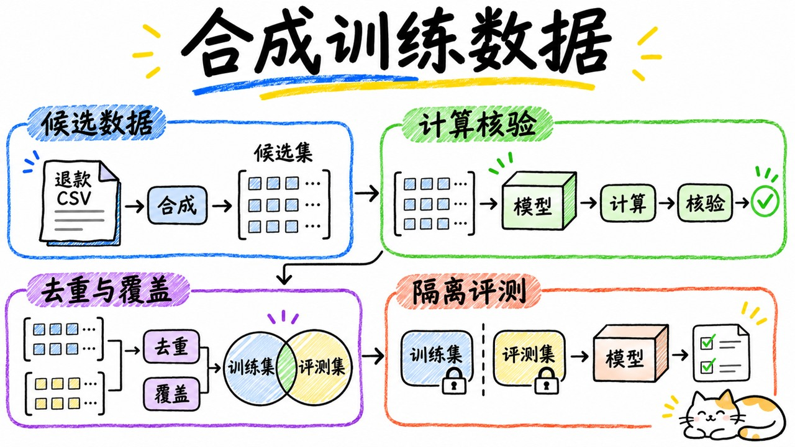
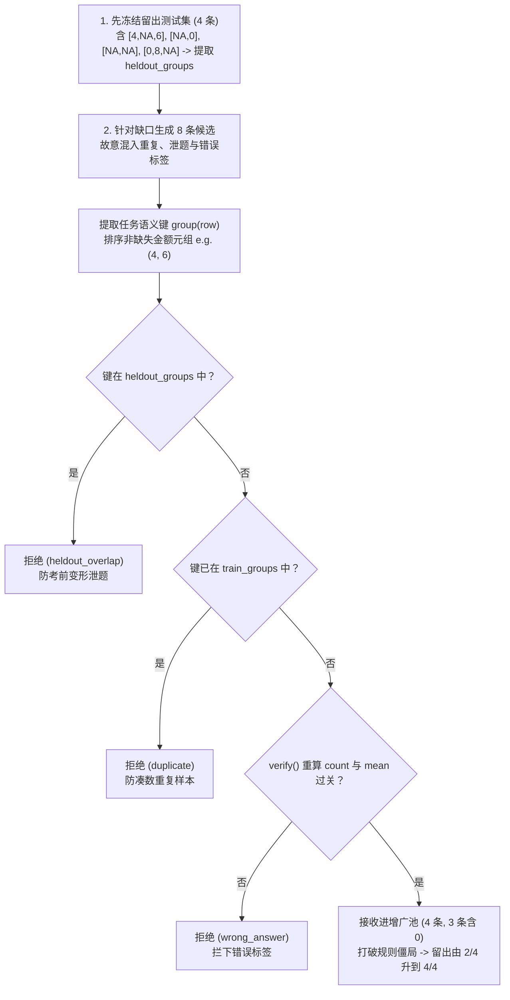

> **生成工具**：Codex\
> **生成模型**：gpt-6.2-sol

假设你手里收集了一批历史真实退款问答记录，遗憾的是里面全都是常规正数（`3、5、7、9`）搭配几个空值 `NA`。你可能会奇怪：「规则都挺简单的，有啥问题？」

隐患就在这儿！在只有正数和空值的数据里，两条本质南辕北辙的代码逻辑——**「只要不是空就计入（`value is not None`）」**和**「只要数字为真就计入（`bool(value)`）」**——算出来的结果**竟然一模一样**！模型训完顺顺当当上线，直到某天线上用户第一回上传了一条 **`0` 元退款**，`bool(0) == False` 当场把那条真 `0` 顺手扔掉，整个财务对账瞬间崩盘。

**合成训练数据（Synthetic Training Data）**最大的工程意义，从来不是「瞎吹水把一万条水成十万条」，而是像今天这样：**精准盯着训练覆盖里的语义盲区，主动构造一批覆盖缺口的新鲜样本、用确定性程序把标签算得铁板钉钉，再把重合泄漏题严防死守在考卷门外！**

> **先用大白话讲明白**：科学造合成训练数据，就像**名师发现全班模拟题居然一次没考过「数字 0」这个陷阱，连夜自己出题补缺**：
> 1. **先把保密期末卷锁进保险柜（先冻结 `heldout`）**：动手造题之前，绝对先把包含 `[4, NA, 6]`、`[NA, 0]`、`[NA, NA]`、`[0, 8, NA]` 的留出考卷密封隔离好！
> 2. **专挑盲区猛补题，算术答案让计算器算（Generator + Verifier）**：找规则模板或强老师大模型帮着生成丰富多样的「带 0 表、全空表、除出小数的表」指令与表格，至于里面统计出来的 `count` 和 `mean` 对不对，**千万别让大模型靠嘴估——一律送进真 Python 计算程序重新验算（必要时用精确分数保证无损）！**
> 3. **给每道题发一枚「去皮去壳语义钥匙」（防止考前泄题与凑数灌水）**：如果保密期末考卷里有一题 `[4, NA, 6]`，就算合成生成器换个顺序、塞两个 `NA` 写成 `[6, 4, NA, NA]`，它的数学本质一模一样，语义钥匙全是 `(4, 6)`！安检门一把认出它跟期末卷撞车（`heldout_overlap`），立刻一脚踢出训练候选池，绝不允许变相透题！



## 1. 先密封留出考卷，再按覆盖盲区造候选

我们的任务契约继续一字不改：忽略 `NA`，保留真实 `0`，全空时均值为 `null`。动手之前，先把包含 4 类典型情境的留出测试集 **`[4, NA, 6]`、`[NA, 0]`、`[NA, NA]`、`[0, 8, NA]`** 彻底冻结起来；接着再回头审视现有的训练集（全都是正数加 `NA`），明显缺少「`0` 值混合、小数均值、全空/多样缺失位置」几大桶。

业内构造候选数据时主要有三条来路：确定性**规则模板**生成、在现有合规训练样本上做**反事实变换**、或者让强教师模型来辅助生成（像经典的 **Self-Instruct** 论文那样靠大模型自举产指令再过层层筛选 [Self-Instruct 原论文](https://arxiv.org/abs/2212.10560)）。记住一条实战最优分工：**让擅长语言的大模型帮着改写五花八门的任务指令问法、表头格式，让从不犯糊涂的统计程序负责给出标准 `count` 与 `mean` 标签！**

为了验证筛选管道真能拦下坏数据，实验脚本 [experiments/trn-post-training/run_toy.py](experiments/trn-post-training/run_toy.py) 里的 `synthetic()` 特意把 4 条有毛病的假候选和 4 条补缺好候选混在一起投进流水线做实测检验。

## 2. 语义去重键、精确标签重算和人审，各防什么漏？

对当前这张无序汇总表而言，把金额行调个个儿（`[4, 6]` 改写成 `[6, 4]`）、或者多塞进十行空白 `NA`，都改变不了最终 `count` 与 `mean`。因此代码定义了一个干净的**任务语义去重键**：`tuple(sorted(v for v in row if v is not None))`——提取非缺失数字从小到大排好！
- 留出题 `[4, NA, 6]` 的钥匙是 **`(4, 6)`** -> 哪怕新造候选写着 `[6, 4, NA, NA]`，照样拔出 `(4, 6)` 这把一模一样的钥匙当场命中留出拦截！
- 同时它用 `tuple` 而不是去重 `set` 保留了重复数字（例如 `[4, 4, 6]` 的钥匙是 `(4, 4, 6)`，代表另一份真实金额不同的输入），如果将来业务扩展成需要返回「第几行出异常」，那时的语义键也记得同步升级成保留原始顺序！

把脚本 8 条候选实际跑通后全部交接清单摊开（直接引自 [experiments/trn-post-training/toy-results.json](experiments/trn-post-training/toy-results.json)）：

| 候选来源说明 | 候选表格与待验标签 | 管道处置结果 | 精确判定理由 (`reason`) |
| --- | --- | --- | --- |
| 原样本微调重复 | `[NA, 3]` -> `(1, 3)` | **丢弃** | `duplicate`：原训练池里早已存在 `(3,)` 组 |
| 留出变体泄题 | `[6, 4, NA, NA]` -> `(2, 5)` | **丢弃** | `heldout_overlap`：语义键 `(4, 6)` 直接撞车留出集！ |
| 含错标签诱饵 | `[0, 1, NA]` -> `(3, 1/3)` | **丢弃** | `wrong_answer`：错把 `NA` 塞进分母算成 3 行 |
| 留出全空泄题 | `[NA, NA, NA]` -> `(0, None)` | **丢弃** | `heldout_overlap`：撞车留出全空 `()` 语义组 |
| 补零缺口好数据 1 | `[0, 1, NA]` -> `(2, 1/2)` | **接收** | 标签精确验算无误且不撞车训练集和留出集 |
| 补零缺口好数据 2 | `[NA, 0, 2]` -> `(2, 1)` | **接收** | 同上，且精准覆盖首行 `NA` + 零值 |
| 补零缺口好数据 3 | `[0, 3, NA]` -> `(2, 3/2)` | **接收** | 同上，覆盖 `0` + 小数均值 `1.5` |
| 补常规小数好数据 | `[7, 2, NA]` -> `(2, 9/2)` | **接收** | 覆盖常规非整除小数均值 `4.5` |

> **容易踩的坑（别用浮点数近似匹配就草率放行，也别全靠机器省掉人审！）**：程序里验证均值特意使用了分数精确计算（`Fraction`）核对无误；真实上线的财务数据若涉及元角分四舍五入，一定提前跟业务对齐舍入规则（四舍五入还是银行家舍入）后再按该契约卡死检验，且 JSON 本身也要顺带验证必填键、禁止重复键与数字类型。更重要的一点：**代码只能检验「算出来的数对不对」，永远查不出「指令文字写得像不像人话、有没有自相矛盾的多余限制、分布跟线上一不一样」**——筛选过滤之后，抽样人审和各特征分桶占比检查（这里接收的 4 条里人为把 3 条配上了 `0` 补足缺口）绝对不能省！

## 3. 实证对比：仅仅补上 4 条合乎缺口的新表，留出成绩怎么翻番？

`run_toy.py` 最后安排了一场非常传神的对比规则选择实验：候选规则选择器只有两把尺子可选——规则 `0` 是正确的 `value is not None`，规则 `1` 是带着零值 Bug 的 `bool(value)`（在 Python 里 `bool(0)` 是 `False`），当两条规则在训练数据上命中完全相同时，故意设定打破僵局偏选第二条规则 `1`：

| 喂给选择器的训练输入 | 训练池上的胜负 | 最终选出来的规则 | 留出 4 张测试表通过情况 |
| --- | --- | --- | ---: |
| **只有 4 张原始正数表** | 两条规则打平（全都猜对全行！） | 误选中 **`rule 1` (`bool(value)`)** | **`2/4`**（2 张含 0 的表全挂） |
| **4 张原始表 + 过筛的 4 张合成表** | 含 `0` 样本打破并列！ | 精准锁死 **`rule 0` (`value is not None`)** | **`4/4`**（满分通杀！） |

> **想再深入一层？（怎么科学证明你的合成数据真的「内容有效」，而不只是「瞎堆样本量把步数撑多」？）**
> 上面的极简选择器证明了这 4 条补零数据确实解决了一个明确的覆盖死角（但该试验直接针对确定性规则选择，未重训大模型权重）。等到真去微调语言模型、老板问你「合成这 1 万条到底是因为题出得精准对症，还是单纯数据翻倍多训了几千步才好？」时，正确实验设计一定要开**三组对照（全用同一基座 + 锁死同样总更新步数 Token 预算）**：
> 1. 只有原始数据（重复过几轮凑齐一样更新步数）；
> 2. 靠普通同分布扩写/等比例采样扩到 2 倍的增广数据；
> 3. **专门针对失败分桶补缺口的增广数据**。
> 三组同台跑完同一套冻结留出集，数量带来的收益和精准补缺带来的收益瞬间一清二楚！

本地完整复跑脚本（同时覆盖 TRN-08、TRN-11、TRN-12）：

```bash
python3 experiments/trn-post-training/run_toy.py --out /tmp/trn-toy.json
```

> **大白话小结**：凡涉及用外部大老师生成合成数据的项目，务必在数据版本清单（Manifest）里记全这六样：生成器模型版本、提示词模板、确定性验算器版本、划分隔离所用的语义去重键、候选接收率以及人工抽检记录。记住最高安全禁令：**负责生成合成题的 Prompt 和生成器，绝对不允许以任何方式偷看或接触到那份密封 `heldout` 测试集里的原题！**

## 下一篇

经过前面 Data Pipeline、TinyLM 预训练、分布式 FSDP、SFT 掩码、LoRA、QLoRA、DPO、GRPO、知识蒸馏和合成数据一连串硬核训练环节，我们已经拿到了各种方法炼好的模型补丁。最后一步怎样在真正常用的极速微调框架（如 **Unsloth / MLX**）里把**加载基座 -> 检查聊天模板对齐 -> 注入微调 -> 保存约 1 MB 小适配器或合并出约 942 MB 完整权重 -> 交到推理端复验一个字不错**全部串通交卷？[**TRN-09《用 Unsloth 跑通微调、评测和导出》**](trn-09-unsloth-finetune-export.md) 为第四部分收官落地！

[返回 LLM 与 Agent 学习路线图](https://blog.lacknb.cn/articles/2026/11/19/1795058329577.html)
